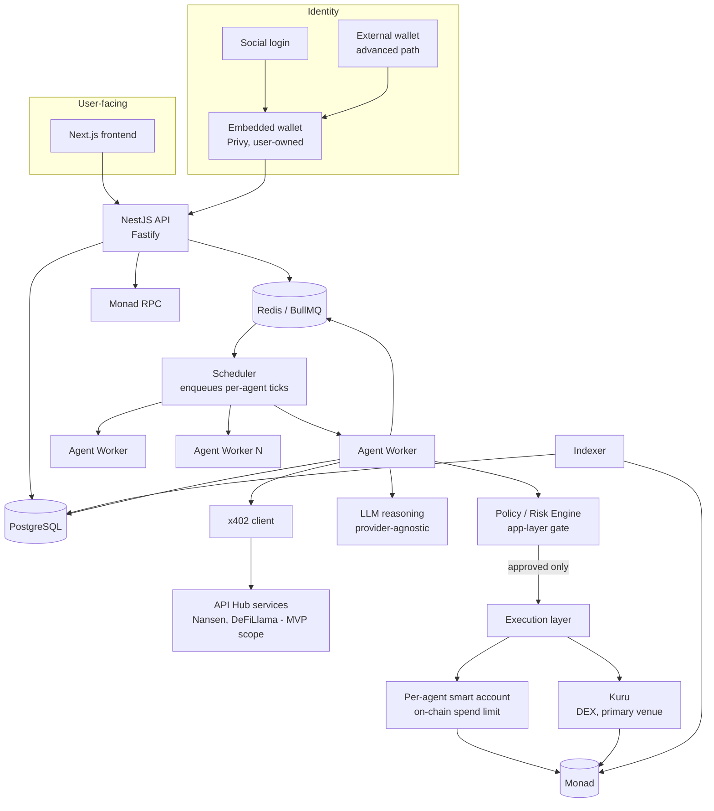

# ARCHITECTURE.md

System architecture for Monadeum: an autonomous economic ecosystem on Monad where AI agents hold capital, trade, purchase information via x402, and evolve. This document states decisions and the reasoning behind them. It assumes the reader has not seen any research notes; every conclusion here is self-contained.

Status: architecture decided for the MVP scope defined in `EVOLUTION.md` and `ECONOMICS.md`. Not yet implemented. See `THREAT-MODEL.md` and `SECURITY.md` for the security reasoning behind the boundaries drawn here.

---

## 1. What changed from the starting hypothesis, and why

The original starting hypothesis was a single Next.js frontend, a NestJS API, and generic agent workers pulling from a Redis queue, talking to Postgres, Redis, and "the blockchain" as three peer dependencies. Three changes were made to that hypothesis after research, each with a concrete reason:

1. **A policy/risk gate was added as a first-class component, separate from both the agent's reasoning and the wallet.** Two real, financially material incidents (an AI agent losing 13.19 ETH in 2024 and another losing roughly $150,000-$200,000 in 2026, both via prompt injection or permission escalation) share one root cause: the LLM was the sole authority over a financial action, with no independent, deterministic check of what the action actually did before it executed. Every credible mitigation found in research separates proposal from approval from execution as three distinct steps, with the middle step owned by code the LLM cannot talk its way around.

2. **Spending limits are enforced twice, at two structurally independent layers, not once.** Research into self-evolving agent systems found that when the safety/policy layer is itself part of what evolution can influence, evolutionary pressure toward higher fitness can erode exactly the constraints meant to protect capital. This means an application-layer policy engine alone is not sufficient if the same codebase or configuration is ever touched by an automated "improve this agent" process. The mitigation used elsewhere in production (Coinbase's Agentic Wallets product enforces spending policy at the smart-contract level, so that an agent cannot exceed its limit "even if the application logic is compromised, because the blockchain rejects out-of-policy transactions") is adopted directly: every agent's spending cap is encoded on-chain, in its own smart account, not only in the NestJS policy engine.

3. **An indexer was added as its own component, not folded into the API.** The chain is the source of truth for identity, custody, and reproduction events; Postgres is a read-model for the dashboard. Conflating "write path" (API enqueuing agent actions) with "read path" (indexer syncing on-chain events into a queryable store) would make the API responsible for two jobs with very different failure and retry semantics.

## 2. Component diagram



The two shaded facts that matter most: the Policy/Risk Engine sits **between** the LLM and the Execution layer, not inside the same call the LLM makes; and the on-chain smart account's own spend limit is a **second, independent** gate that does not trust the Policy Engine's correctness. A bug or a successful prompt injection in the Policy Engine still cannot move capital past what the smart account itself allows.

## 3. Capital flow

```
User funds embedded wallet (fiat on-ramp or external wallet transfer)
  -> user allocates capital to a specific agent
  -> platform deploys (or reuses, counterfactually) the agent's smart account
  -> capital transferred from user's embedded wallet to agent's smart account
  -> agent's smart account is now the agent's sole custody boundary

Agent smart account spends on:
  - x402 payments to information services (capped by a per-tick and daily budget)
  - trade execution on Kuru (capped by a per-trade and daily budget)
  - gas (sponsored by platform paymaster up to a budget, see section 7)

Agent smart account never spends on:
  - transfers to arbitrary addresses (contract allowlist excludes anything but
    Kuru's router, the reproduction contract, and the settlement asset; see
    section 16.3 for the recipient check the on-chain layer does not yet make)
  - withdrawals back to the user above the user's own configured limits
    (protects against a compromised agent silently draining back "to the user"
    as a laundering step, see THREAT-MODEL.md)

Reproduction:
  - moves a bounded fraction of a parent's realized profit (never principal)
    into a newly deployed child smart account
  - is the only capital-creating-looking event in the system, and it creates
    nothing: it reallocates capital that already exists in the parent's account
```

Full reproduction accounting rules are defined in `EVOLUTION.md`. The architectural guarantee this document makes is narrower: reproduction is implemented as an on-chain transfer between two smart accounts that both already exist under the platform's custody model, gated by the same policy engine and subject to the same on-chain spend-limit mechanism as any other agent action, not a special, less-scrutinized code path.

## 4. Agent lifecycle

```
Created (user funds it, smart account deployed, genome initialized)
  -> Active (runs ticks on a schedule)
      -> each tick: observe -> decide whether to buy information -> reason ->
         propose action -> policy engine evaluates -> execution (if approved)
         -> outcome recorded -> fitness updated
      -> may become eligible to reproduce (EVOLUTION.md defines eligibility)
      -> may reproduce (creates a Child, does not stop the parent)
  -> Retired (capital below minimum viable floor, or sustained bottom-percentile
     fitness, or explicit user action)
      -> stops trading, remains queryable, on-chain identity persists with
         status = inactive
  -> (no "deleted" state in the MVP: retired agents are historical record,
     not removed, matching ERC-8004's own identity-persistence model)
```

## 5. Reproduction lifecycle

```
Scheduler evaluates reproduction eligibility for every Active agent on a
fixed cadence (not on every tick, to avoid reproduction decisions being made
on noisy single-tick data)
  -> eligibility check (age, fitness percentile, profit-above-principal
     threshold, cooldown since last reproduction) - see EVOLUTION.md
  -> if eligible: genome is copied, mutation operator applied
  -> child smart account deployed (paymaster-sponsored)
  -> capital transferred: parent -> child, bounded fraction of parent's
     realized profit only
  -> on-chain reproduction event recorded (parent ID, child ID, generation,
     genome hash, capital amount) - this is the one on-chain event type
     the indexer treats as authoritative for lineage
  -> child enters Active state independently; parent is unaffected except
     for the capital transferred out
```

## 6. Wallet and account architecture

**Decision**: social login through an embedded-wallet vendor for the user's root identity, and one ERC-4337 smart account per agent, controlled by a session key the agent worker holds server-side, with the user's embedded wallet as the smart account's recoverable owner.

```
User
  |
  Social login -> Embedded wallet (Privy)         [external wallet: advanced path]
  |                    |
  |              owns / can recover
  |                    v
  |            Agent Controller (logical grouping in the API, not a contract)
  |                    |
  |     +--------------+--------------+
  |     v              v              v
  |  Agent #001     Agent #002     Agent #003
  |  ERC-4337       ERC-4337       ERC-4337
  |  smart account  smart account  smart account
  |  (own vault,    (own vault,    (own vault,
  |   own spend      own spend      own spend
  |   limit module)  limit module)  limit module)
```

**Why a smart account per agent, not one EOA per agent, and not one shared account with internal bookkeeping**: the brief's own requirement is that each agent needs an independent economic identity, with enforceable spending limits, revocable permissions, and the ability to isolate one agent's compromise from every other agent's funds. A shared account with only internal ledger bookkeeping fails the isolation requirement outright: a bug or a compromised agent could spend another agent's allocation, because the chain sees one account, not many. Independent EOAs give real isolation but no native way to encode a spending policy that the blockchain itself enforces; an EOA's private key can sign anything, so "spending limit" would live entirely in application code, which is exactly the single point of failure this document is trying to avoid. A per-agent ERC-4337 smart account gives both: a distinct on-chain address per agent (real isolation, matches the brief's own diagram in section 5), and a programmable validator module that can enforce a daily cap, a contract allowlist, and a max-per-transaction limit at the protocol level, so that "the blockchain rejects out-of-policy transactions" the way Coinbase's production system does.

**Why session keys, not the user signing every agent transaction**: the product requirement is that agents act autonomously without a human clicking approve per trade. ERC-4337's validator model supports a session key, held by the agent worker process, scoped to exactly the actions the agent is allowed to take (calls to the x402 facilitator and Kuru's router, within the account's own spend limit), while the user's embedded wallet remains the account's owner and can revoke or rotate that session key at any time. This satisfies both "agent autonomy" and "the user can recover from a compromised agent" without contradiction: revoking the session key stops the agent immediately, without touching the user's own root wallet.

**Root identity vendor**: Privy is the primary recommendation, verified independently to support Monad mainnet and testnet with official templates and a subsidized testnet faucet path. Dynamic is a documented, equally viable fallback, also independently verified on Monad. Neither vendor's x402 integration has been verified as tested against Monad specifically rather than Base or Ethereum; this is a pre-implementation spike, not a decision this document can close on research alone. Coinbase CDP and Sequence, despite being listed on Monad's own ecosystem page, could not be independently confirmed to support Monad from either vendor's own documentation, and are excluded from the MVP candidate list on that basis, not on capability grounds.

**Smart account / session-key infrastructure**: ERC-4337 is confirmed live on Monad mainnet with deployed canonical EntryPoint contracts and at least six mainnet-confirmed bundler and paymaster vendors. ZeroDev's session-key smart account pattern is the specific implementation recommended, since it directly supports the scoped, revocable, spend-capped session key this architecture requires and has confirmed Monad mainnet support as a bundler/paymaster vendor.

**Alternative considered and deferred**: EIP-7702 delegation (letting an agent's own EOA temporarily behave like a smart account) is confirmed live on Monad at the protocol level and is materially cheaper per transaction than deploying a full ERC-4337 account. It was not chosen for the MVP for two concrete reasons found in research: Monad's 7702 implementation carries two chain-specific constraints not present on Ethereum (a delegated EOA cannot drop below a 10 MON reserve balance, and `CREATE`/`CREATE2` calls are banned inside delegated-code execution), and the session-key/spend-limit tooling ecosystem around 7702 on Monad specifically is less mature than ERC-4337's six-vendor bundler/paymaster ecosystem. Revisit 7702 as a gas-optimization pass once the ERC-4337 architecture is proven in testnet, not before.

## 7. Gasless onboarding

**Decision**: the platform runs a paymaster (via the same ZeroDev infrastructure used for the smart account itself) that sponsors two specific transaction types, each under an explicit budget: (1) an agent's smart account deployment, and (2) an agent's first N x402 payments and first N trades after creation, up to a fixed MON budget per agent. Beyond that budget, the agent's own smart account pays its own gas out of its allocated capital, same as any other operating cost.

**Why capped, not unlimited, sponsorship**: unlimited gas sponsorship is a direct, unmetered cost center with no natural circuit breaker, and a compromised or degenerate agent (for instance one caught in a failed-transaction retry loop) could otherwise consume unbounded platform funds through gas alone, independent of its own trading capital. A fixed per-agent sponsorship budget makes the cost of onboarding one agent a known, bounded number that feeds directly into `ECONOMICS.md`'s cost model, and it fails closed: once the budget is exhausted, gas sponsorship stops and the agent must fund its own gas or become inactive, rather than the platform absorbing unbounded cost silently.

**What this achieves for the product principle**: a user creates an agent via social login, funds it in USDC (the same token used for x402 settlement, so no separate "buy MON for gas" step is required from the user), and the agent can transact immediately. The user never needs to hold MON to create their first agent, matching the brief's stated onboarding target directly.

## 8. x402 as an economic primitive

The agent worker's x402 client treats every external service response as untrusted input by default, not merely as data. This mirrors Monad's own posture (its API Hub documentation explicitly disclaims that listed services are independent, unaudited providers) and a documented class of attacks against x402's discovery layer specifically, where a poisoned or Sybil-flooded provider directory can bias which service an agent selects with a measured bias as high as roughly 70 percent in a controlled study, independent of any cryptographic flaw in the payment protocol itself.

**MVP service scope is deliberately narrow**: of the roughly five dozen services listed in Monad's own API Hub at research time, only two (Nansen and DeFiLlama) are genuinely relevant blockchain or market intelligence for a trading agent; the rest is generic B2B data with no clear use to this product. The MVP's x402 integration targets exactly those two services, plus Kuru's own market data where available directly (not via x402). This is a narrower "information economy" than the original brief's open-ended framing, and it is a deliberate scope decision, not an oversight: expanding the provider list is cheap to do later, and doing it before the core loop is proven adds untrusted surface area for no proven benefit yet.

**Every x402 payment is logged with its outcome**: what was paid, to which provider, what was returned, and whether the resulting information changed the agent's decision. This is both an economics requirement (x402 spend is a cost line in the fitness function, see `EVOLUTION.md`) and a security requirement (an anomalous pattern of x402 spend, for instance an agent that starts paying the same provider on every tick regardless of outcome, is one of the signals the circuit breaker in `SECURITY.md` watches for).

## 9. On-chain vs off-chain boundary

**On-chain** (Monad, ERC-8004-compatible identity registry plus each agent's own smart account state):
- agent identity: owner address, agent smart account address, parent agent ID, generation number, status (active / retired), genome hash, strategy-version hash
- capital custody: the smart account's own balance, this is inherent to the account existing on-chain, not a separate design choice
- spend-limit parameters enforced by the smart account's validator module (daily cap, per-transaction cap, contract allowlist)
- reproduction events (parent, child, generation, capital transferred, genome hash of the child)

**Off-chain** (PostgreSQL, written by agent workers and the indexer):
- full genome definition (the JSON the hash commits to)
- LLM reasoning traces and prompts
- detailed fitness history (per-tick PnL, running Sharpe/Sortino-style metrics, trade-by-trade log)
- x402 payment logs (provider, price, response summary, outcome)
- trade logs (venue, pair, size, slippage realized, fees paid)
- strategy mutation diffs between parent and child

**Hash-committed on-chain, full content off-chain**: genome and strategy-version data. This follows the same pattern ERC-8004 itself uses for reputation and validation data: keep the commitment (a hash, an event) cheap and on-chain, keep the payload (the actual content) off-chain where it is cheap to store and query, and make tampering detectable by re-hashing the off-chain copy and comparing it to the on-chain commitment.

**Reasoning for this split**: the brief's own instruction is not to put expensive or unnecessary AI data on-chain. The line drawn here is: anything that is either (a) required to trust the agent's identity and capital custody without trusting the platform's database, or (b) itself a security-critical limit (the spend cap) goes on-chain; everything that exists to explain or audit a decision after the fact, which by nature is large, mutable, and not itself a source of financial authority, goes off-chain with a cheap on-chain fingerprint.

## 10. Backend architecture (NestJS)

The API process is a Fastify-backed NestJS application whose job is CRUD, authentication, reading the Postgres read-model for dashboard queries, and enqueuing work. It contains no autonomous agent loop; the brief is explicit that the API process must not run infinite agent loops, and doing so would also couple the API's own uptime and scaling profile to the agent workers' very different load pattern (bursty, external-API-bound, retry-heavy).

Modules, using domain-driven boundaries rather than one module per brief-listed noun:

- **AuthModule**: social login session handling, embedded wallet provisioning callback, external wallet connect path
- **AgentsModule**: agent CRUD, funding, status, ownership; the only module that talks to the WalletsModule to provision a smart account
- **WalletsModule**: smart account deployment, session key issuance and revocation, paymaster budget tracking
- **StrategiesModule**: genome schema, strategy-plugin registry (trading is the first plugin, see section 12)
- **X402Module**: the x402 client wrapper, provider allowlist, response-outcome logging
- **RiskModule**: the app-layer Policy/Risk Engine described in section 1, packaged as a shared internal library, not a network service. The agent worker imports it directly and calls it in-process for every proposed action before submitting execution; the API imports the same package for read-only preview or dry-run use (for example, letting a user see whether a hypothetical action would pass policy before an agent proposes it for real), but the API never invokes it as part of any live agent decision, since the API has no agent loop to make that decision in. One rule implementation, two processes importing it, no network hop on the enforcement path.
- **TradingModule**: Kuru integration, order submission, fill tracking. Kuru is the MVP's primary venue. An earlier pass at venue choice leaned toward Monorail as the default router, with Kuru as a fallback where an order book was required. The decision here diverges from that lean, for two reasons checked again on 2026-09-22. First, Kuru's own SDK documents an EIP-7702 market-maker entrypoint: an EOA delegates to that contract and can batch cancel and place in one transaction (`https://docs.kuru.io/sdk/py-sdk-quickstart`). That is delegated trading, which is the property a session key needs from a venue. It does not reverse section 6: the agent account stays ERC-4337, and 7702 stays deferred as an account-architecture choice. Second, autonomous agents have already traded on Kuru's book in public. Kuru's own account described bots trading live on that book during Agent Arena (31 July 2026). A check of Monorail's public introduction the same day describes the aggregator and does not specify a caller contract an autonomous agent can build on. That is a stronger existence proof for Kuru than an unconfirmed autonomous API on Monorail. This paragraph is not a full survey of either venue, and it does not read Kuru's audit reports (see `SECURITY.md` section 13).
- **FitnessModule**: computes and stores the fitness metric defined in `EVOLUTION.md` on the fixed evaluation cadence
- **ReproductionModule**: eligibility evaluation, mutation operator, child provisioning orchestration
- **SimulationModule**: a thin NestJS wrapper that triggers and stores results from the standalone simulation engine (the top-level `simulation/` package, reusable outside the API, matching the brief's requirement to build the simulator before real trading). The engine itself does not touch real wallets or real chain state; SimulationModule's job is only to run it on demand and persist its output for the dashboard, not to reimplement its logic.

Not created as an API module: an Indexer. Per section 1, the indexer is a separate deployable component, not one of the API's NestJS modules, because it has a different failure and retry profile (syncing on-chain events into Postgres) than the API's request/response workload. It may share code with the API (for example, the same database models), but it runs and scales independently.

Not created for the MVP: a separate BlockchainModule (RPC access is a thin shared provider, not a domain module) and a MarketDataModule distinct from TradingModule (Kuru's own market data is consumed inside TradingModule for the MVP's single-venue scope; this splits out only once a second venue is integrated).

## 11. Worker architecture

**Decision**: BullMQ backed by Redis, with agent workers as separate deployable processes from the API, one job type per agent "tick."

**Why BullMQ over Temporal for the MVP**: Temporal gives stronger guarantees for long-running, multi-step workflows with complex compensation logic, which is a real future need (a reproduction event that spans multiple on-chain confirmations with rollback semantics is exactly that kind of workflow). But it is materially more operational complexity than this project needs to prove its core loop first: observe, decide whether to buy information, reason, propose, policy-check, execute, measure. BullMQ's retry, backoff, and idempotency-key primitives are sufficient for that loop, it has strong support in the Node and NestJS ecosystem already in use, and it scales horizontally the direct way the brief asks for, more agents means more worker processes consuming the same queue, not a redesign.

**Revisit trigger, stated explicitly rather than left implicit**: if reproduction workflows grow complex enough to need durable, multi-day sagas with compensating transactions (for example, a reproduction that must be rolled back if the child's smart account deployment succeeds but the capital transfer fails hours later due to a paymaster outage), that is the point to introduce Temporal for the ReproductionModule specifically, not to migrate the whole worker fleet preemptively.

**Idempotency**: every job carries an idempotency key derived from (agent ID, tick sequence number). A worker crash mid-tick and a subsequent retry must not double-spend or double-log; the RiskModule's approval and the TradingModule's order submission both check this key before acting.

**Scaling shape**: 10 agents run on one worker process comfortably. 100 to 1,000 agents scale by adding worker processes consuming the same BullMQ queue, with Redis as the shared coordination point; this requires no architectural change, only more processes, which is the scaling story the brief asks for without over-building it for a population size the MVP does not yet have.

## 12. Multi-strategy architecture

Every agent's genome includes a `strategyType` field and a strategy-specific parameter schema (see `EVOLUTION.md`). The agent worker's decision step calls into a strategy plugin implementing one shared interface: given the agent's current state and any purchased information, propose zero or one economic action. Trading is the only plugin implemented for the MVP. Adding a second strategy (for instance an information-arbitrage or data-reselling strategy suggested in the original brief) means writing a new plugin against the existing interface, not modifying the RiskModule, the WalletsModule, or the reproduction mechanism, all of which are strategy-agnostic by construction.

## 13. Agent-to-agent economy

Deferred past the MVP, explicitly, not by omission. The infrastructure precondition is real (x402 for payment, ERC-8004's reputation registry for trust signals between agents, both independently confirmed working or workable on Monad), but research into self-evolving agent populations specifically flags Sybil attacks and emergent collusion as threats unique to populations of agents that can communicate and transact with each other, with a documented finding that a single compromise can propagate through shared communication channels into descendant generations without the attacker needing repeated access. Enabling agent-to-agent payments before the single-agent policy and spend-limit architecture in this document is proven in testnet would add that threat surface before the foundational one is validated. This is a phase-2 capability requiring its own addition to `THREAT-MODEL.md` before it is enabled, not a missing feature of the MVP.

## 14. Failure handling

- **A worker crashes mid-tick**: the job is retried from the last completed idempotent step; no partial trade or partial x402 payment is left in an ambiguous state, because RiskModule approval and TradingModule submission are themselves idempotent against the tick's key.
- **An x402 provider is unreachable or returns malformed data**: treated as "no information available," not as a reason to proceed with a default assumption; a failed external call must never silently allow a trade to proceed as if the call had succeeded, per the invariant in `THREAT-MODEL.md`.
- **The paymaster is out of budget or down**: the agent's transaction falls back to being paid from the agent's own smart account balance; if that is also insufficient, the tick fails closed (no action taken) rather than executing an underfunded transaction.
- **The RPC provider is degraded**: the agent worker backs off and retries on the next scheduled tick rather than busy-polling; a missed tick is a bounded, recoverable cost (one cycle of inaction), not a reason to bypass any check to force an action through.
- **A reproduction event's capital transfer fails after the child account is deployed**: the child exists on-chain but is not yet Active until the capital transfer confirms; a stuck deployment-without-capital is a detectable, queryable state (via the indexer), not a silent capital leak, and is the concrete scenario flagged in section 11 as a future Temporal-migration trigger.

## 15. Frontend

Next.js, TypeScript, Tailwind, viem. Wagmi is not adopted as a core dependency: the primary onboarding path is embedded-wallet-driven (Privy's own SDK handles that path directly), and the autonomous agent runtime never touches React or Wagmi at all, it runs entirely in the worker processes described in section 11. Wagmi would add a dependency whose main value (multi-external-wallet connector UX) only matters on the advanced, external-wallet path, which is a smaller share of the intended product surface than the primary social-login path.

Priority order for the dashboard, matching the brief's own list: onboarding and agent creation, funding, population view, lineage view, per-agent performance and transparency (wallet address, transactions, x402 spend, trades visible without reading logs), evolution event feed.

## 16. Interface contracts (addendum)

Sections 1 to 15 describe components and what each one is responsible for. This section fixes the four seams where two components built in parallel could each look correct in review and still fail to fit: the Policy/Risk Engine's rule schema (16.1), the proposal type that crosses from strategy to risk to trading (16.2), the on-chain validator interface (16.3), and genome hash canonicalization (16.4). The types below are written in TypeScript and Solidity because a type is harder to misread than a paragraph. They are the contract, not an implementation.

Status: 16.1, 16.2, and 16.4 are decided. 16.3 is a draft. The rolling-daily-cap spike (issue #18) has recorded its testnet run, and its result confirms the custom daily-cap mechanism in 16.3; the exact interface is finalized in issue #21. Its coverage of x402 payments waits on the open question stated in 16.3.

**One rule applies across every seam: money crosses a boundary as an integer in the settlement asset's base units, never as a float.** The on-chain validator compares `uint256` values. An application-layer check done in floating point can place an amount on the other side of a cap from the chain's own check, and then the two layers disagree about the same transaction. Floats stay acceptable inside a strategy's own arithmetic. The conversion to base units happens once, when the proposal is built, rounding down. The settlement asset's `decimals` value is read from the token contract, not assumed.

```ts
type Hex = `0x${string}`;
/** Integer amount in settlement-asset base units. bigint in memory, decimal string in JSON. */
type BaseUnits = bigint;
```

### 16.1 Policy/Risk Engine rule schema

**Decision**: the checks are a fixed set of typed, pure TypeScript functions inside the RiskModule. The thresholds those functions read are a versioned, signed JSON document. The policy is not a runtime-interpreted rules language, and it is not an external rules engine.

**Why**: an interpreted policy language lets a data change alter *what* is checked, not only the thresholds, which moves the most load-bearing control in the system (`SECURITY.md` section 4) to a place code review does not see. An external rules engine puts a network hop on the enforcement path, which section 10 rules out, and adds a failure mode (engine unreachable) that would need its own fail-closed handling. Fixed checks with data thresholds keep the set of checks reviewable in a pull request, and let a threshold change without a deploy.

```ts
export interface PolicyDocument {
  schemaVersion: 1;
  version: number;                 // starts at 1, increments by 1 per change
  previousHash: Hex | null;        // 16.4 hash of version - 1; null only for version 1
  effectiveFrom: string;           // ISO 8601, UTC
  settlementAsset: Hex;            // token address of the settlement asset (USDC)
  allowedCalls: { target: Hex; selector: Hex; label: "kuru-router" | "reproduction" | "settlement-asset" }[];
  allowedPairs: string[];
  perActionCap: BaseUnits;
  sessionDailyCap: BaseUnits;      // SECURITY.md section 9, layer 2; must not exceed the on-chain dailyCap
  perTickInformationCap: BaseUnits;
  dailyInformationCap: BaseUnits;
  maxPositionFraction: number;     // protocol ceiling on riskTolerance, EVOLUTION.md section 1
}

/** Authoritative inputs. Read by the worker from the chain and the ledger, never taken from the proposal. */
export interface Ledger {
  capital: BaseUnits;
  spentInWindow: BaseUnits;        // windowTotal(account) from 16.3, read on-chain, so both layers use the same window
  informationBudget: BaseUnits;    // from the agent's stored genome; the effective information cap is the lower of this and the policy caps
  informationToday: BaseUnits;
  informationThisTick: BaseUnits;
  assetUniverse: string[];         // from the agent's stored genome, not from the proposal
}

export type Violation =
  | "call-not-allowed" | "recipient-not-allowed" | "pair-not-allowed" | "provider-not-allowed"
  | "per-action-cap" | "session-daily-cap" | "information-cap" | "position-fraction" | "plan-hash-mismatch" | "policy-unverified";

export type Decision =
  | { approved: true; policyVersion: number; policyHash: Hex; planHash: Hex | null }  // null for information requests
  | { approved: false; policyVersion: number; policyHash: Hex; violations: Violation[] };

/** A document whose signature and hash chain were verified on load. null when verification failed. */
export interface VerifiedPolicy { document: PolicyDocument; hash: Hex }

export function evaluateInformation(policy: VerifiedPolicy | null, request: InformationRequest, ledger: Ledger): Decision;
export function evaluateTrade(policy: VerifiedPolicy | null, proposal: ActionProposal, plan: ExecutionPlan, ledger: Ledger): Decision;
```

A rejection returns every violation it found, not only the first, so monitoring (`SECURITY.md` section 12) sees the full shape of a bad proposal.

The RiskModule derives how much each call spends from its calldata, and never from a figure the plan declares. A `transfer` or `approve` on the settlement asset spends its `amount`, and its recipient or spender must itself be an allowlisted target (`recipient-not-allowed` otherwise): an `approve` naming an attacker's address is the drain pattern of `THREAT-MODEL.md` scenario A, even though the call itself targets an allowlisted token. Every other allowlisted call spends 0, the same counting rule as the on-chain validator in 16.3. `perActionCap` is compared with the sum over every call in the plan, not with each call alone, so splitting one action into several calls does not multiply the cap. `session-daily-cap` compares `spentInWindow` plus that sum with `sessionDailyCap`, over the same rolling window the chain enforces: a calendar-day counter would reset while the on-chain window still holds the previous hours, and every approval in that gap would revert on-chain and still pay gas. An information request is capped per tick by the lower of the genome's `informationBudget` and `perTickInformationCap`, and per day by `dailyInformationCap`; the strategy plugin checking its own budget is not the enforcement, because the plugin sits on the proposal side of `SECURITY.md` section 4. A pair must be both in `allowedPairs` and in the agent's own `assetUniverse`.

**Known gap, the pair and the position size are declared**: the pair check and `maxPositionFraction` read `pair` and `notional` from the proposal's `TradeIntent`, not from the router calldata, because router calls are not decoded (they count 0, as above). A plan could therefore trade a different pair or size than it declares, up to the settlement-asset `approve` the plan also carries, which is counted and capped. Closing this requires decoding the Kuru router's calldata, which waits on issue #20 confirming the router interface. Until then, the spend caps bound this gap and the pair and position checks do not.

**How a rule change is authorized and audited, separately from genome mutation**:

- Policy documents live in an append-only table, one row per version: the document, its 16.4 hash, the signer address, and the signature. No application database role has `UPDATE` or `DELETE` on it. The worker's role can only `SELECT`. The role that writes genomes (ReproductionModule) has no grant on it at all. Only a separate operator role can `INSERT`.
- Each version is signed by an operator key over its 16.4 hash (EIP-191). That key is distinct from every session key and from any key a worker process holds. The allowed signer address is pinned in the worker's deployment configuration.
- On load, the RiskModule verifies the signature and the `previousHash` chain back to version 1, and that `effectiveFrom` never moves backward from one version to the next. If either check fails, it evaluates nothing and returns `policy-unverified` for every request. That is the fail-closed behavior of `SECURITY.md` section 8.
- Every `Decision` is logged with `policyVersion` and `policyHash`, so any past approval can be replayed against the exact document that produced it.

This is what gives the opening constraint of `EVOLUTION.md` a concrete home: the evolutionary process writes genomes, and it holds no credential that can write a policy version.

The checks above are implemented in `libs/risk`. The append-only table and its database grants arrive with the first Postgres schema, because no database layer exists yet. Until then, `libs/risk` verifies whatever rows it is given, and the grants are a requirement on that later work, not something the library can enforce.

**How the schema versions**: `version` changes when a threshold changes. That is data, signed, and deployed without code. `schemaVersion` changes when a field or a check is added or removed. That is a code change, reviewed in a pull request that updates this section. The RiskModule accepts only the `schemaVersion` values it was built for, and treats any other as `policy-unverified`.

An owner-set limit tighter than the protocol document (for example, a user lowering one agent's daily cap) is a later extension. When it is added, the effective limit is the minimum of the two, never looser than the document.

### 16.2 Proposal and execution-plan types

**Decision**: a tick produces up to two separately evaluated requests. First, an `InformationRequest`, evaluated before the strategy runs, because section 4 orders the tick as observe, then decide whether to buy information, then reason and propose. Second, an `ActionProposal`: the strategy plugin's zero or one economic action (section 12), with the state and purchased information it was based on. The trading intent in the proposal is then turned into an `ExecutionPlan`, the exact calls to be submitted, and **the RiskModule evaluates the plan, not the intent**. `SECURITY.md` section 4 requires the check to run on the transaction's structural shape (destination, amount, asset), and only the built calls have that shape. The TradingModule then submits only a plan whose hash equals the approved `planHash`.

```ts
export interface InformationRequest {
  tickKey: string;                 // `${agentId}:${tick}`, the section 11 idempotency key
  agentId: string;
  provider: "nansen" | "defillama";
  maxPrice: BaseUnits;
}

export interface PurchasedInformation {
  provider: "nansen" | "defillama";
  price: BaseUnits;
  observedAt: string;              // ISO 8601, UTC
  paymentRef: string;              // x402 settlement reference
  // The raw response is not carried. It was untrusted input (section 8); only its validated extraction reaches the strategy.
}

export interface ActionProposal {
  schemaVersion: 1;
  tickKey: string;
  agentId: string;
  account: Hex;                    // the agent's smart account
  genomeHash: Hex;                 // 16.4; binds the proposal to the genome that produced it
  strategyType: "trading";
  state: {                         // recorded for audit and explanation; the RiskModule enforces against Ledger instead
    capital: BaseUnits;
    principal: BaseUnits;
    ticksSinceTrade: number;
    observedAt: string;
  };
  information: PurchasedInformation[];
  action: TradeIntent | null;      // null: the plugin proposes nothing this tick
}

export interface TradeIntent {
  kind: "trade";
  pair: string;
  side: "long" | "flat";
  notional: BaseUnits;
  maxSlippageBps: number;
}

export interface ExecutionPlan {
  tickKey: string;
  calls: { target: Hex; data: Hex }[];  // native value is always 0; the selector is data's first 4 bytes
  planHash: Hex;                   // 16.4 hash of { tickKey, calls }; recomputed by the RiskModule, never trusted
}
```

**Where the current code differs**: `libs/strategy` computes `notional` as a `number` and folds the information decision into `Action.buyInformation`, `libs/tick` passes that `Action` to `policy` rather than a built plan, and the genome's `informationBudget` is a float in the simulation and in `libs/strategy`, not base units. Those are implementation gaps against this section, to be closed by the M2 and M3 work that consumes it. This section does not describe them as done.

### 16.3 On-chain validator interface (draft)

**Decision, provisional**: one spend-policy contract holds per-account limits and the call allowlist, keyed by smart account address. Its checks are split across the two phases of an ERC-4337 operation, because they have different needs:

- **Validation phase** (`check`): the call allowlist at `(target, selector)` granularity, a zero native value, and the per-transaction cap. `check` receives every call the operation executes, single or batched, and the per-transaction cap applies to their sum: a check that saw one call at a time would let one batched operation of `k` calls move `k` times the cap. None of these needs the current time, so all of them can reject an operation before it is included.
- **Execution phase** (`record`, called from a pre-execution hook): the rolling daily cap. ERC-7562's validation rules forbid the `TIMESTAMP` opcode during validation, so a check that needs "the last 24 hours" cannot run there. This is a constraint of the ERC-4337 validation rules as documented. The issue #18 spike did not exercise it, so it remains to be confirmed against the bundlers actually used on Monad. Its consequence is stated plainly: a daily-cap breach surfaces as a reverted execution that still pays gas, not as an operation rejected before inclusion.

**How an amount is counted**: only calls that move the settlement asset count. `transfer(to, amount)` and `approve(spender, amount)` on the settlement asset count `amount` in full, at the moment of the call. A call to the Kuru router or the reproduction contract counts 0, on the assumption that each pulls funds only through an allowance the account set with a counted `approve`. That assumption is not yet verified for Kuru's router, and is checked in issue #20. Counting an approval in full when it is set is conservative: an unbounded approval exceeds `perTxCap` and is rejected, and unused allowance only reduces headroom.

**Known gap, recipients are not checked on-chain**: the allowlist works at `(target, selector)` granularity, so allowing `transfer` and `approve` on the settlement asset allows them to any recipient or spender. A compromised session key could therefore send up to `perTxCap` per operation, and up to `dailyCap` inside the window, to an address of its choosing, and the chain would accept it. Only the RiskModule's `recipient-not-allowed` rule in 16.1 blocks that today, and the RiskModule is off-chain. The caps bound the loss; they do not prevent it. The fix under consideration is a per-account recipient allowlist that `check` applies to the first argument of `transfer` and `approve` on the settlement asset. It is not in the draft interface below, and issue #21 decides whether it is added before issue #25 implements the contract.

**The policy contract protects itself**: `setLimits` and `setAllowed` read the account from `msg.sender`, and a call a session key makes also executes from the account, so the contract alone cannot tell the owner from a session key. Two rules close that gap, and neither depends on the allowlist being configured correctly. `check` rejects any call whose target is the policy contract itself, whatever the allowlist says, so a session-key operation can never reach the owner functions. The owner reaches them only through the root-wallet validator, whose operations do not run the session key's hook or policy. Without both rules, one mistaken allowlist entry would let a compromised session key raise its own caps.

**Rolling window rule**: spend is stored in 25 one-hour buckets per account. The window total at hour `h` is the sum of buckets `h - 24` through `h`. That span covers between 24 and 25 hours, so it can over-count by up to one hour of spend but never under-counts. The chain therefore never allows more than `dailyCap` inside any 24-hour period. Storage is fixed-size per account.

**Why a custom contract and not ZeroDev's native policies**: the closest native combination, a call policy with a per-call value cap `X` plus the reset rate limit policy at `N` operations per window, was run on Monad testnet in issue #18 (`spikes/rolling-daily-cap`, 120 second windows, `X` = 0.001 MON, `N` = 3, so a nominal bound of 0.003 MON per window). It failed as a value cap in two independent ways. First, the rate limit counts operations, not calls: one batched operation of two capped transfers took one slot, and that window moved 0.004 MON. A call policy permission left at its default call type still accepted the batch, so nothing native bounded the number of calls per operation in this run. Second, the window is fixed, not rolling: each window opened with the first operation accepted after the previous one expired, and spending late in one window and early in the next moved 0.005 MON within 65 seconds. Rotating the session key daily, the other alternative considered, keeps both failures and adds a failure mode for an operation in flight during rotation, so it is rejected. The run used native MON and minute-long windows, and the reset rate limit policy is deployed on Monad testnet but not on mainnet, so the result describes the mechanism, not a mainnet configuration.

```solidity
// SPDX-License-Identifier: UNLICENSED
pragma solidity ^0.8.24;

/// Draft. The daily-cap state exists because no native rolling cap does, which issue #18's testnet run confirmed.
interface IAgentSpendPolicy {
    struct Limits {
        uint128 perTxCap;   // settlement-asset base units
        uint128 dailyCap;   // over any 24 hour period, per the window rule
    }

    event LimitsSet(address indexed account, uint128 perTxCap, uint128 dailyCap);
    event CallAllowed(address indexed account, address indexed target, bytes4 indexed selector, bool allowed);
    event Spent(address indexed account, uint256 amount, uint256 windowTotal);

    struct Call {
        address target;
        uint256 value;
        bytes data;
    }

    error CallNotAllowed(address target, bytes4 selector);   // also raised for target == address(this)
    error NativeValueNotAllowed(uint256 value);
    error PerTxCapExceeded(uint256 amount, uint256 cap);
    error DailyCapExceeded(uint256 windowTotal, uint256 cap);

    /// Validation phase. No time-dependent reads. Every call in the operation, single or batched.
    /// Returns the total the operation counts; perTxCap applies to that total.
    function check(address account, Call[] calldata calls) external view returns (uint256 total);

    /// Execution phase, from the account's pre-execution hook. msg.sender is the account.
    /// Recomputes the total from the calls, never trusts a caller-supplied amount.
    function record(Call[] calldata calls) external;

    function limits(address account) external view returns (Limits memory);
    function isAllowed(address account, address target, bytes4 selector) external view returns (bool);
    function windowTotal(address account) external view returns (uint256);

    /// Owner only: reachable through the root-wallet validator, never a session key, per the self-protection rule.
    function setLimits(Limits calldata newLimits) external;
    function setAllowed(address target, bytes4 selector, bool allowed) external;
}
```

**What issue #18 has settled, and what it has not**: ZeroDev ships no native resetting cap on value. Its reset rate limit counts operations, not amounts; its spending limit hook is a lifetime allowance with no reset and, as of 2026-09-27, is not deployed on Monad testnet or mainnet; and its gas, rate limit, and timestamp policies are deployed on Monad testnet but not on mainnet. The custom execution-phase window above therefore stands, rather than a reference to a native policy. Daily session-key rotation is not adopted: without the rate limit on mainnet, rotation alone gives no cumulative bound inside a day. Still open in #18: the recorded testnet run, including whether a batched operation breaks the native call-policy bound. Issue #21 finalizes this interface once #18 closes, and issue #25 implements it.

**Open question, x402 coverage**: the working assumption is that x402's `exact` scheme on EVM settles through an EIP-3009 `transferWithAuthorization` that the payer signs and the facilitator submits. This is not verified against the x402 version and facilitator this project will use. If it holds, an x402 payment never passes through the account's user-operation validation. It is authorized through the account's ERC-1271 `isValidSignature` instead, and the interface above does not see it. Until the policy has an entry point on that signature path, the on-chain daily cap does not bound x402 spend, and only the application-layer information caps in 16.1 do. The same assumption means the x402 facilitator is not a call target the account makes, which is why `allowedCalls` in 16.1 does not list it.

### 16.4 Genome hash canonicalization

**Decision**: RFC 8785, the JSON Canonicalization Scheme (JCS), encoded as UTF-8, hashed with keccak256 behind a domain tag.

```
hash = keccak256( utf8(tag) || 0x00 || utf8(JCS(normalize(value))) )

tag: "monadeum:genome:v1" | "monadeum:strategy:v1" | "monadeum:policy:v1" | "monadeum:plan:v1"
```

**Why JCS**: it is a published specification with an exact key order (lexicographic by UTF-16 code units) and an exact number format (ECMAScript number serialization). A TypeScript implementation and any later implementation in another language produce the same bytes without relying on a private convention. RFC 8785 was designed so that, in JavaScript, it matches `JSON.stringify` applied to an object whose keys are recursively sorted with the default sort. Any implementation is still checked against the RFC's own test vectors, not against that equivalence.

**Why keccak256**: it is a native EVM opcode, so a contract can recompute or compare a commitment cheaply, and it is the hash the surrounding Ethereum tooling already uses for commitments. SHA-256 is available on the EVM only as a precompile.

**Why a domain tag**: genome, strategy-version, policy (16.1), and plan (16.2) hashes all use this one scheme. The tag guarantees that a hash of one kind never equals a hash of another kind whose JSON happens to be identical.

**Normalization, applied before JCS**, because JCS does not do any of it:

1. Set-valued fields (`assetUniverse`, `informationSources`) are deduplicated and sorted in the same UTF-16 code unit order. JCS preserves array order, and mutation (`EVOLUTION.md` section 3.3) adds and removes elements, so element order is an accident of history, not meaning.
2. Numbers must be finite. Integer-valued fields (`executionFrequency`, `timeHorizon`) must be integers. JCS already rejects `NaN` and infinities and writes `-0` as `0`. Base-unit amounts are decimal strings, per the rule at the top of this section. That includes the genome's `informationBudget`, which is money: `"500000"` in the example below is 0.5 of a six-decimal settlement asset.
3. An absent optional field is omitted, never written as `null`.
4. Only genome fields are hashed. Derived values (fitness, reproduction eligibility, `EVOLUTION.md` section 1) and storage metadata (row IDs, timestamps) are excluded. The hashed object carries `schemaVersion`. Renaming or adding a field is a `schemaVersion` change, because key names are part of the hashed bytes.

Example. The genome below, with a duplicated and unsorted `assetUniverse` and a `-0` threshold:

```json
{"strategyType":"trading","schemaVersion":1,"riskTolerance":0.1,"executionFrequency":5,"assetUniverse":["PAIR_B","PAIR_A","PAIR_A"],"informationSources":["nansen","defillama"],"timeHorizon":20,"entryThreshold":0.002,"exitThreshold":-0,"informationBudget":"500000","modelConfiguration":"low"}
```

normalizes and canonicalizes to exactly these bytes, which are then hashed:

```json
{"assetUniverse":["PAIR_A","PAIR_B"],"entryThreshold":0.002,"executionFrequency":5,"exitThreshold":0,"informationBudget":"500000","informationSources":["defillama","nansen"],"modelConfiguration":"low","riskTolerance":0.1,"schemaVersion":1,"strategyType":"trading","timeHorizon":20}
```

The first implementation adds the resulting keccak256 value as a fixed test vector, computed by two independent implementations and checked to agree, so a later change to either side fails a test instead of surfacing as an on-chain mismatch.
