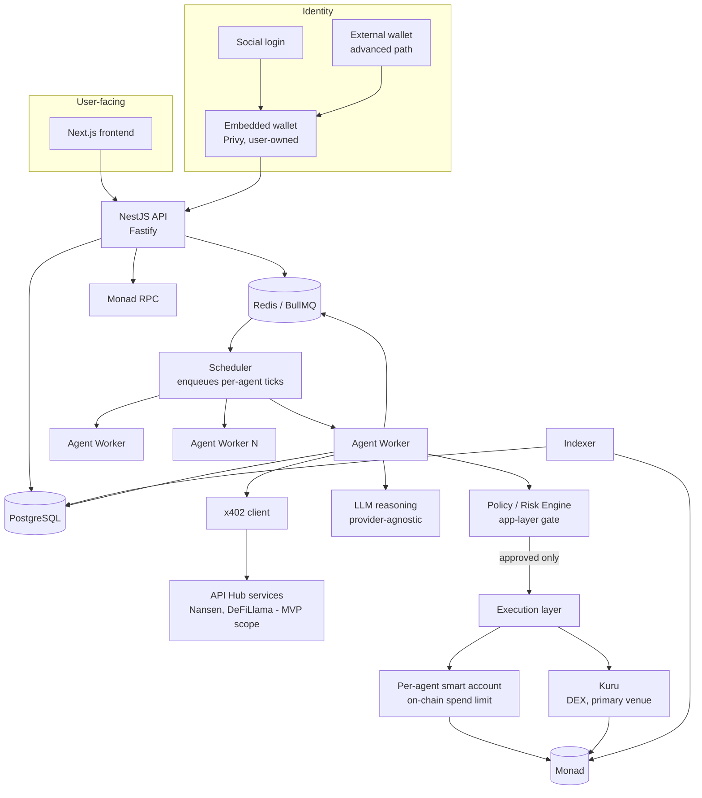

# ARCHITECTURE.md

System architecture for Monadeum: an autonomous economic ecosystem on Monad where AI agents hold capital, trade, purchase information via x402, and evolve. This document states decisions and the reasoning behind them. It assumes the reader has not seen any research notes; every conclusion here is self-contained.

Status: architecture decided for the MVP scope defined in `EVOLUTION.md` and `ECONOMICS.md`. Not yet implemented. See `THREAT-MODEL.md` and `SECURITY.md` for the security reasoning behind the boundaries drawn here.

---

## 1. What changed from the starting hypothesis, and why

The original starting hypothesis was a single Next.js frontend, a NestJS API, and generic agent workers pulling from a Redis queue, talking to Postgres, Redis, and "the blockchain" as three peer dependencies. Three changes were made to that hypothesis after research, each with a concrete reason:

1. **A policy/risk gate was added as a first-class component, separate from both the agent's reasoning and the wallet.** Two real, financially material incidents (an AI agent losing 13.19 ETH in 2024 and another losing roughly $150,000-$200,000 in 2026, both via prompt injection or permission escalation) share one root cause: the LLM was the sole authority over a financial action, with no independent, deterministic check of what the action actually did before it executed. Every credible mitigation found in research separates proposal from approval from execution as three distinct steps, with the middle step owned by code the LLM cannot talk its way around.

2. **Spending limits are enforced twice, at two structurally independent layers, not once.** Research into self-evolving agent systems found that when the safety/policy layer is itself part of what evolution can influence, evolutionary pressure toward higher fitness can erode exactly the constraints meant to protect capital. This means an application-layer policy engine alone is not sufficient if the same codebase or configuration is ever touched by an automated "improve this agent" process. The mitigation used elsewhere in production (Coinbase's Agentic Wallets product enforces spending policy at the smart-contract level, so that an agent cannot exceed its limit "even if the application logic is compromised, because the blockchain rejects out-of-policy transactions") is adopted directly: every agent's spending cap is encoded on-chain, in its own smart account, not only in the NestJS policy engine.

3. **An indexer was added as its own component, not folded into the API.** The chain is the source of truth for identity, custody, and reproduction events; Postgres is a read-model for the dashboard. Conflating "write path" (API enqueuing agent actions) with "read path" (indexer syncing on-chain events into a queryable store) would make the API responsible for two jobs with very different failure and retry semantics.

## 2. Component diagram



The two shaded facts that matter most: the Policy/Risk Engine sits **between** the LLM and the Execution layer, not inside the same call the LLM makes; and the on-chain smart account's own spend limit is a **second, independent** gate that does not trust the Policy Engine's correctness. A bug or a successful prompt injection in the Policy Engine still cannot move capital past what the smart account itself allows.

## 3. Capital flow

```
User funds embedded wallet (fiat on-ramp or external wallet transfer)
  -> user allocates capital to a specific agent
  -> platform deploys (or reuses, counterfactually) the agent's smart account
  -> capital transferred from user's embedded wallet to agent's smart account
  -> agent's smart account is now the agent's sole custody boundary

Agent smart account spends on:
  - x402 payments to information services (capped by a per-tick and daily budget)
  - trade execution on Kuru (capped by a per-trade and daily budget)
  - gas (sponsored by platform paymaster up to a budget, see section 7)

Agent smart account never spends on:
  - transfers to arbitrary addresses (contract allowlist excludes anything but
    the x402 facilitator, Kuru's router, and the reproduction contract)
  - withdrawals back to the user above the user's own configured limits
    (protects against a compromised agent silently draining back "to the user"
    as a laundering step, see THREAT-MODEL.md)

Reproduction:
  - moves a bounded fraction of a parent's realized profit (never principal)
    into a newly deployed child smart account
  - is the only capital-creating-looking event in the system, and it creates
    nothing: it reallocates capital that already exists in the parent's account
```

Full reproduction accounting rules are defined in `EVOLUTION.md`. The architectural guarantee this document makes is narrower: reproduction is implemented as an on-chain transfer between two smart accounts that both already exist under the platform's custody model, gated by the same policy engine and subject to the same on-chain spend-limit mechanism as any other agent action, not a special, less-scrutinized code path.

## 4. Agent lifecycle

```
Created (user funds it, smart account deployed, genome initialized)
  -> Active (runs ticks on a schedule)
      -> each tick: observe -> decide whether to buy information -> reason ->
         propose action -> policy engine evaluates -> execution (if approved)
         -> outcome recorded -> fitness updated
      -> may become eligible to reproduce (EVOLUTION.md defines eligibility)
      -> may reproduce (creates a Child, does not stop the parent)
  -> Retired (capital below minimum viable floor, or sustained bottom-percentile
     fitness, or explicit user action)
      -> stops trading, remains queryable, on-chain identity persists with
         status = inactive
  -> (no "deleted" state in the MVP: retired agents are historical record,
     not removed, matching ERC-8004's own identity-persistence model)
```

## 5. Reproduction lifecycle

```
Scheduler evaluates reproduction eligibility for every Active agent on a
fixed cadence (not on every tick, to avoid reproduction decisions being made
on noisy single-tick data)
  -> eligibility check (age, fitness percentile, profit-above-principal
     threshold, cooldown since last reproduction) - see EVOLUTION.md
  -> if eligible: genome is copied, mutation operator applied
  -> child smart account deployed (paymaster-sponsored)
  -> capital transferred: parent -> child, bounded fraction of parent's
     realized profit only
  -> on-chain reproduction event recorded (parent ID, child ID, generation,
     genome hash, capital amount) - this is the one on-chain event type
     the indexer treats as authoritative for lineage
  -> child enters Active state independently; parent is unaffected except
     for the capital transferred out
```

## 6. Wallet and account architecture

**Decision**: social login through an embedded-wallet vendor for the user's root identity, and one ERC-4337 smart account per agent, controlled by a session key the agent worker holds server-side, with the user's embedded wallet as the smart account's recoverable owner.

```
User
  |
  Social login -> Embedded wallet (Privy)         [external wallet: advanced path]
  |                    |
  |              owns / can recover
  |                    v
  |            Agent Controller (logical grouping in the API, not a contract)
  |                    |
  |     +--------------+--------------+
  |     v              v              v
  |  Agent #001     Agent #002     Agent #003
  |  ERC-4337       ERC-4337       ERC-4337
  |  smart account  smart account  smart account
  |  (own vault,    (own vault,    (own vault,
  |   own spend      own spend      own spend
  |   limit module)  limit module)  limit module)
```

**Why a smart account per agent, not one EOA per agent, and not one shared account with internal bookkeeping**: the brief's own requirement is that each agent needs an independent economic identity, with enforceable spending limits, revocable permissions, and the ability to isolate one agent's compromise from every other agent's funds. A shared account with only internal ledger bookkeeping fails the isolation requirement outright: a bug or a compromised agent could spend another agent's allocation, because the chain sees one account, not many. Independent EOAs give real isolation but no native way to encode a spending policy that the blockchain itself enforces; an EOA's private key can sign anything, so "spending limit" would live entirely in application code, which is exactly the single point of failure this document is trying to avoid. A per-agent ERC-4337 smart account gives both: a distinct on-chain address per agent (real isolation, matches the brief's own diagram in section 5), and a programmable validator module that can enforce a daily cap, a contract allowlist, and a max-per-transaction limit at the protocol level, so that "the blockchain rejects out-of-policy transactions" the way Coinbase's production system does.

**Why session keys, not the user signing every agent transaction**: the product requirement is that agents act autonomously without a human clicking approve per trade. ERC-4337's validator model supports a session key, held by the agent worker process, scoped to exactly the actions the agent is allowed to take (calls to the x402 facilitator and Kuru's router, within the account's own spend limit), while the user's embedded wallet remains the account's owner and can revoke or rotate that session key at any time. This satisfies both "agent autonomy" and "the user can recover from a compromised agent" without contradiction: revoking the session key stops the agent immediately, without touching the user's own root wallet.

**Root identity vendor**: Privy is the primary recommendation, verified independently to support Monad mainnet and testnet with official templates and a subsidized testnet faucet path. Dynamic is a documented, equally viable fallback, also independently verified on Monad. Neither vendor's x402 integration has been verified as tested against Monad specifically rather than Base or Ethereum; this is a pre-implementation spike, not a decision this document can close on research alone. Coinbase CDP and Sequence, despite being listed on Monad's own ecosystem page, could not be independently confirmed to support Monad from either vendor's own documentation, and are excluded from the MVP candidate list on that basis, not on capability grounds.

**Smart account / session-key infrastructure**: ERC-4337 is confirmed live on Monad mainnet with deployed canonical EntryPoint contracts and at least six mainnet-confirmed bundler and paymaster vendors. ZeroDev's session-key smart account pattern is the specific implementation recommended, since it directly supports the scoped, revocable, spend-capped session key this architecture requires and has confirmed Monad mainnet support as a bundler/paymaster vendor.

**Alternative considered and deferred**: EIP-7702 delegation (letting an agent's own EOA temporarily behave like a smart account) is confirmed live on Monad at the protocol level and is materially cheaper per transaction than deploying a full ERC-4337 account. It was not chosen for the MVP for two concrete reasons found in research: Monad's 7702 implementation carries two chain-specific constraints not present on Ethereum (a delegated EOA cannot drop below a 10 MON reserve balance, and `CREATE`/`CREATE2` calls are banned inside delegated-code execution), and the session-key/spend-limit tooling ecosystem around 7702 on Monad specifically is less mature than ERC-4337's six-vendor bundler/paymaster ecosystem. Revisit 7702 as a gas-optimization pass once the ERC-4337 architecture is proven in testnet, not before.

## 7. Gasless onboarding

**Decision**: the platform runs a paymaster (via the same ZeroDev infrastructure used for the smart account itself) that sponsors two specific transaction types, each under an explicit budget: (1) an agent's smart account deployment, and (2) an agent's first N x402 payments and first N trades after creation, up to a fixed MON budget per agent. Beyond that budget, the agent's own smart account pays its own gas out of its allocated capital, same as any other operating cost.

**Why capped, not unlimited, sponsorship**: unlimited gas sponsorship is a direct, unmetered cost center with no natural circuit breaker, and a compromised or degenerate agent (for instance one caught in a failed-transaction retry loop) could otherwise consume unbounded platform funds through gas alone, independent of its own trading capital. A fixed per-agent sponsorship budget makes the cost of onboarding one agent a known, bounded number that feeds directly into `ECONOMICS.md`'s cost model, and it fails closed: once the budget is exhausted, gas sponsorship stops and the agent must fund its own gas or become inactive, rather than the platform absorbing unbounded cost silently.

**What this achieves for the product principle**: a user creates an agent via social login, funds it in USDC (the same token used for x402 settlement, so no separate "buy MON for gas" step is required from the user), and the agent can transact immediately. The user never needs to hold MON to create their first agent, matching the brief's stated onboarding target directly.

## 8. x402 as an economic primitive

The agent worker's x402 client treats every external service response as untrusted input by default, not merely as data. This mirrors Monad's own posture (its API Hub documentation explicitly disclaims that listed services are independent, unaudited providers) and a documented class of attacks against x402's discovery layer specifically, where a poisoned or Sybil-flooded provider directory can bias which service an agent selects with a measured bias as high as roughly 70 percent in a controlled study, independent of any cryptographic flaw in the payment protocol itself.

**MVP service scope is deliberately narrow**: of the roughly five dozen services listed in Monad's own API Hub at research time, only two (Nansen and DeFiLlama) are genuinely relevant blockchain or market intelligence for a trading agent; the rest is generic B2B data with no clear use to this product. The MVP's x402 integration targets exactly those two services, plus Kuru's own market data where available directly (not via x402). This is a narrower "information economy" than the original brief's open-ended framing, and it is a deliberate scope decision, not an oversight: expanding the provider list is cheap to do later, and doing it before the core loop is proven adds untrusted surface area for no proven benefit yet.

**Every x402 payment is logged with its outcome**: what was paid, to which provider, what was returned, and whether the resulting information changed the agent's decision. This is both an economics requirement (x402 spend is a cost line in the fitness function, see `EVOLUTION.md`) and a security requirement (an anomalous pattern of x402 spend, for instance an agent that starts paying the same provider on every tick regardless of outcome, is one of the signals the circuit breaker in `SECURITY.md` watches for).

## 9. On-chain vs off-chain boundary

**On-chain** (Monad, ERC-8004-compatible identity registry plus each agent's own smart account state):
- agent identity: owner address, agent smart account address, parent agent ID, generation number, status (active / retired), genome hash, strategy-version hash
- capital custody: the smart account's own balance, this is inherent to the account existing on-chain, not a separate design choice
- spend-limit parameters enforced by the smart account's validator module (daily cap, per-transaction cap, contract allowlist)
- reproduction events (parent, child, generation, capital transferred, genome hash of the child)

**Off-chain** (PostgreSQL, written by agent workers and the indexer):
- full genome definition (the JSON the hash commits to)
- LLM reasoning traces and prompts
- detailed fitness history (per-tick PnL, running Sharpe/Sortino-style metrics, trade-by-trade log)
- x402 payment logs (provider, price, response summary, outcome)
- trade logs (venue, pair, size, slippage realized, fees paid)
- strategy mutation diffs between parent and child

**Hash-committed on-chain, full content off-chain**: genome and strategy-version data. This follows the same pattern ERC-8004 itself uses for reputation and validation data: keep the commitment (a hash, an event) cheap and on-chain, keep the payload (the actual content) off-chain where it is cheap to store and query, and make tampering detectable by re-hashing the off-chain copy and comparing it to the on-chain commitment.

**Reasoning for this split**: the brief's own instruction is not to put expensive or unnecessary AI data on-chain. The line drawn here is: anything that is either (a) required to trust the agent's identity and capital custody without trusting the platform's database, or (b) itself a security-critical limit (the spend cap) goes on-chain; everything that exists to explain or audit a decision after the fact, which by nature is large, mutable, and not itself a source of financial authority, goes off-chain with a cheap on-chain fingerprint.

## 10. Backend architecture (NestJS)

The API process is a Fastify-backed NestJS application whose job is CRUD, authentication, reading the Postgres read-model for dashboard queries, and enqueuing work. It contains no autonomous agent loop; the brief is explicit that the API process must not run infinite agent loops, and doing so would also couple the API's own uptime and scaling profile to the agent workers' very different load pattern (bursty, external-API-bound, retry-heavy).

Modules, using domain-driven boundaries rather than one module per brief-listed noun:

- **AuthModule**: social login session handling, embedded wallet provisioning callback, external wallet connect path
- **AgentsModule**: agent CRUD, funding, status, ownership; the only module that talks to the WalletsModule to provision a smart account
- **WalletsModule**: smart account deployment, session key issuance and revocation, paymaster budget tracking
- **StrategiesModule**: genome schema, strategy-plugin registry (trading is the first plugin, see section 12)
- **X402Module**: the x402 client wrapper, provider allowlist, response-outcome logging
- **RiskModule**: the app-layer Policy/Risk Engine described in section 1, packaged as a shared internal library, not a network service. The agent worker imports it directly and calls it in-process for every proposed action before submitting execution; the API imports the same package for read-only preview or dry-run use (for example, letting a user see whether a hypothetical action would pass policy before an agent proposes it for real), but the API never invokes it as part of any live agent decision, since the API has no agent loop to make that decision in. One rule implementation, two processes importing it, no network hop on the enforcement path.
- **TradingModule**: Kuru integration, order submission, fill tracking
- **FitnessModule**: computes and stores the fitness metric defined in `EVOLUTION.md` on the fixed evaluation cadence
- **ReproductionModule**: eligibility evaluation, mutation operator, child provisioning orchestration
- **SimulationModule**: a thin NestJS wrapper that triggers and stores results from the standalone simulation engine (the top-level `simulation/` package, reusable outside the API, matching the brief's requirement to build the simulator before real trading). The engine itself does not touch real wallets or real chain state; SimulationModule's job is only to run it on demand and persist its output for the dashboard, not to reimplement its logic.

Not created as an API module: an Indexer. Per section 1, the indexer is a separate deployable component, not one of the API's NestJS modules, because it has a different failure and retry profile (syncing on-chain events into Postgres) than the API's request/response workload. It may share code with the API (for example, the same database models), but it runs and scales independently.

Not created for the MVP: a separate BlockchainModule (RPC access is a thin shared provider, not a domain module) and a MarketDataModule distinct from TradingModule (Kuru's own market data is consumed inside TradingModule for the MVP's single-venue scope; this splits out only once a second venue is integrated).

## 11. Worker architecture

**Decision**: BullMQ backed by Redis, with agent workers as separate deployable processes from the API, one job type per agent "tick."

**Why BullMQ over Temporal for the MVP**: Temporal gives stronger guarantees for long-running, multi-step workflows with complex compensation logic, which is a real future need (a reproduction event that spans multiple on-chain confirmations with rollback semantics is exactly that kind of workflow). But it is materially more operational complexity than this project needs to prove its core loop first: observe, decide whether to buy information, reason, propose, policy-check, execute, measure. BullMQ's retry, backoff, and idempotency-key primitives are sufficient for that loop, it has strong support in the Node and NestJS ecosystem already in use, and it scales horizontally the direct way the brief asks for, more agents means more worker processes consuming the same queue, not a redesign.

**Revisit trigger, stated explicitly rather than left implicit**: if reproduction workflows grow complex enough to need durable, multi-day sagas with compensating transactions (for example, a reproduction that must be rolled back if the child's smart account deployment succeeds but the capital transfer fails hours later due to a paymaster outage), that is the point to introduce Temporal for the ReproductionModule specifically, not to migrate the whole worker fleet preemptively.

**Idempotency**: every job carries an idempotency key derived from (agent ID, tick sequence number). A worker crash mid-tick and a subsequent retry must not double-spend or double-log; the RiskModule's approval and the TradingModule's order submission both check this key before acting.

**Scaling shape**: 10 agents run on one worker process comfortably. 100 to 1,000 agents scale by adding worker processes consuming the same BullMQ queue, with Redis as the shared coordination point; this requires no architectural change, only more processes, which is the scaling story the brief asks for without over-building it for a population size the MVP does not yet have.

## 12. Multi-strategy architecture

Every agent's genome includes a `strategyType` field and a strategy-specific parameter schema (see `EVOLUTION.md`). The agent worker's decision step calls into a strategy plugin implementing one shared interface: given the agent's current state and any purchased information, propose zero or one economic action. Trading is the only plugin implemented for the MVP. Adding a second strategy (for instance an information-arbitrage or data-reselling strategy suggested in the original brief) means writing a new plugin against the existing interface, not modifying the RiskModule, the WalletsModule, or the reproduction mechanism, all of which are strategy-agnostic by construction.

## 13. Agent-to-agent economy

Deferred past the MVP, explicitly, not by omission. The infrastructure precondition is real (x402 for payment, ERC-8004's reputation registry for trust signals between agents, both independently confirmed working or workable on Monad), but research into self-evolving agent populations specifically flags Sybil attacks and emergent collusion as threats unique to populations of agents that can communicate and transact with each other, with a documented finding that a single compromise can propagate through shared communication channels into descendant generations without the attacker needing repeated access. Enabling agent-to-agent payments before the single-agent policy and spend-limit architecture in this document is proven in testnet would add that threat surface before the foundational one is validated. This is a phase-2 capability requiring its own addition to `THREAT-MODEL.md` before it is enabled, not a missing feature of the MVP.

## 14. Failure handling

- **A worker crashes mid-tick**: the job is retried from the last completed idempotent step; no partial trade or partial x402 payment is left in an ambiguous state, because RiskModule approval and TradingModule submission are themselves idempotent against the tick's key.
- **An x402 provider is unreachable or returns malformed data**: treated as "no information available," not as a reason to proceed with a default assumption; a failed external call must never silently allow a trade to proceed as if the call had succeeded, per the invariant in `THREAT-MODEL.md`.
- **The paymaster is out of budget or down**: the agent's transaction falls back to being paid from the agent's own smart account balance; if that is also insufficient, the tick fails closed (no action taken) rather than executing an underfunded transaction.
- **The RPC provider is degraded**: the agent worker backs off and retries on the next scheduled tick rather than busy-polling; a missed tick is a bounded, recoverable cost (one cycle of inaction), not a reason to bypass any check to force an action through.
- **A reproduction event's capital transfer fails after the child account is deployed**: the child exists on-chain but is not yet Active until the capital transfer confirms; a stuck deployment-without-capital is a detectable, queryable state (via the indexer), not a silent capital leak, and is the concrete scenario flagged in section 11 as a future Temporal-migration trigger.

## 15. Frontend

Next.js, TypeScript, Tailwind, viem. Wagmi is not adopted as a core dependency: the primary onboarding path is embedded-wallet-driven (Privy's own SDK handles that path directly), and the autonomous agent runtime never touches React or Wagmi at all, it runs entirely in the worker processes described in section 11. Wagmi would add a dependency whose main value (multi-external-wallet connector UX) only matters on the advanced, external-wallet path, which is a smaller share of the intended product surface than the primary social-login path.

Priority order for the dashboard, matching the brief's own list: onboarding and agent creation, funding, population view, lineage view, per-agent performance and transparency (wallet address, transactions, x402 spend, trades visible without reading logs), evolution event feed.
