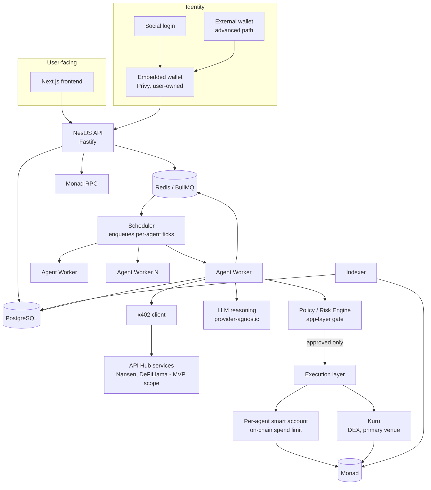

# ARCHITECTURE.md

System architecture for Monadeum: an autonomous economic ecosystem on Monad where AI agents hold capital, trade, purchase information via x402, and evolve. This document states decisions and the reasoning behind them. It assumes the reader has not seen any research notes; every conclusion here is self-contained.

Status: architecture decided for the MVP scope defined in `EVOLUTION.md` and `ECONOMICS.md`. Not yet implemented. See `THREAT-MODEL.md` and `SECURITY.md` for the security reasoning behind the boundaries drawn here.

---

## 1. What changed from the starting hypothesis, and why

The original starting hypothesis was a single Next.js frontend, a NestJS API, and generic agent workers pulling from a Redis queue, talking to Postgres, Redis, and "the blockchain" as three peer dependencies. Three changes were made to that hypothesis after research, each with a concrete reason:

1. **A policy/risk gate was added as a first-class component, separate from both the agent's reasoning and the wallet.** Two real, financially material incidents (an AI agent losing 13.19 ETH in 2024 and another losing roughly $150,000-$200,000 in 2026, both via prompt injection or permission escalation) share one root cause: the LLM was the sole authority over a financial action, with no independent, deterministic check of what the action actually did before it executed. Every credible mitigation found in research separates proposal from approval from execution as three distinct steps, with the middle step owned by code the LLM cannot talk its way around.

2. **Spending limits are enforced twice, at two structurally independent layers, not once.** Research into self-evolving agent systems found that when the safety/policy layer is itself part of what evolution can influence, evolutionary pressure toward higher fitness can erode exactly the constraints meant to protect capital. This means an application-layer policy engine alone is not sufficient if the same codebase or configuration is ever touched by an automated "improve this agent" process. The mitigation used elsewhere in production (Coinbase's Agentic Wallets product enforces spending policy at the smart-contract level, so that an agent cannot exceed its limit "even if the application logic is compromised, because the blockchain rejects out-of-policy transactions") is adopted directly: every agent's spending cap is encoded on-chain, in its own smart account, not only in the NestJS policy engine.

3. **An indexer was added as its own component, not folded into the API.** The chain is the source of truth for identity, custody, and reallocation and retirement events; Postgres is a read-model for the dashboard. Conflating "write path" (API enqueuing agent actions) with "read path" (indexer syncing on-chain events into a queryable store) would make the API responsible for two jobs with very different failure and retry semantics. The indexer now exists as its own deployable service, `apps/indexer` (issue #40); its current state and decisions are recorded in section 10.

The NestJS API of the starting hypothesis now exists as `apps/api`, with the same split: it serves authentication, the owner's reads, and owner-signed operations, reads the indexer's read-model through a read-only role, and runs no agent loop. Its current state is the API entry of section 10.

## 2. Component diagram



The two shaded facts that matter most: the Policy/Risk Engine sits **between** the LLM and the Execution layer, not inside the same call the LLM makes; and the on-chain smart account's own spend limit is a **second, independent** gate that does not trust the Policy Engine's correctness. A bug or a successful prompt injection in the Policy Engine still cannot move capital past what the smart account itself allows.

## 3. Capital flow

```
User funds embedded wallet with USDC on Monad (card on-ramp, or a
transfer from an external wallet or exchange; see section 6.1)
  -> user allocates capital to a specific agent
  -> platform deploys (or reuses, counterfactually) the agent's smart account
  -> capital transferred from user's embedded wallet to agent's smart account
  -> agent's smart account is now the agent's sole custody boundary

Agent smart account spends on:
  - x402 payments to information services (capped by a per-tick and daily budget)
  - trade execution on Kuru (capped by a per-trade and daily budget)
  - gas (sponsored by platform paymaster up to a budget, see section 7)

Agent smart account never spends on:
  - transfers to arbitrary addresses (contract allowlist excludes anything but
    Kuru's router, the reallocation contract, and the settlement asset, and a
    settlement-asset transfer or approval must name one of the first two; see
    section 16.3)
  - withdrawals back to the user above the user's own configured limits
    (protects against a compromised agent silently draining back "to the user"
    as a laundering step, see THREAT-MODEL.md)

Reallocation (only while the owner's signed reallocation policy is in force):
  - moves a bounded share of one agent's capital to another agent with the
    same owner, both accounts already existing; never across owners, never
    into a new account
  - creates nothing: it moves capital that already exists among one owner's
    agents, and each owner's total is unchanged

Retirement:
  - moves nothing: a retired agent's balance stays in its own account,
    recoverable by the owner
```

Full reallocation and retirement rules are defined in `EVOLUTION.md` sections 3 and 6. The architectural guarantee this document makes is narrower: a reallocation is one atomic on-chain transfer between two smart accounts that both already exist under the platform's custody model and share an owner, executed through the owner-scoped reallocation contract, gated by the same policy engine and subject to the same on-chain spend-limit mechanism as any other agent action, not a special, less-scrutinized code path. The contract checks on-chain what can be checked there: same owner, the owner's policy in force and naming both agents, the reallocation cap, the capital floor, and the slot ceiling. The ranking that picks source and sink is computed off-chain and is not verifiable on-chain (`THREAT-MODEL.md` section 8). The reproduction mechanism this section previously described, a profit-only transfer into a newly deployed child account, is superseded (`EVOLUTION.md` section 3.6).

## 4. Agent lifecycle

```
Created (user funds it, smart account deployed, genome initialized)
  -> Active (runs ticks on a schedule)
      -> each tick: observe -> decide whether to buy information -> reason ->
         propose action -> policy engine evaluates -> execution (if approved)
         -> outcome recorded -> fitness updated
      -> at each evaluation, if its owner's reallocation policy covers it, may
         be a source or a sink of reallocation among the owner's agents
         (EVOLUTION.md section 3); never creates another agent
  -> Retired (capital below minimum viable floor, or sustained bottom-percentile
     fitness, or explicit user action)
      -> stops trading, remains queryable, on-chain identity persists with
         status = inactive
  -> (no "deleted" state in the MVP: retired agents are historical record,
     not removed, matching ERC-8004's own identity-persistence model)
```

## 5. Reallocation and retirement lifecycle

```
Scheduler runs an evaluation on a fixed cadence (every 20 ticks, proposed
default, 20 hours at the decided one-hour tick; never on every tick, to avoid
decisions on noisy single-tick data)
  -> FitnessModule updates adjusted fitness, niches, and the starvation count
     for every Active agent, population-wide (EVOLUTION.md section 2)
  -> retirement: an agent below the capital floor, or starved for K windows,
     becomes Retired; its capital stays in its account (EVOLUTION.md section 6)
  -> for each owner with a reallocation policy in force:
       rank the owner's covered Active agents by adjusted fitness
       pick sources and sinks by the small-pool rule
       compute debits and credits under the cap, floor, and ceiling
         (EVOLUTION.md section 3.1)
  -> for each source: one operation from the source account, approving the
     reallocation contract for the total and calling it; the contract checks
     same owner, policy in force, cap, floor, ceiling, and one debit per
     source per evaluation on-chain, then transfers source -> each sink
     directly (it never holds a balance), and reverts the whole move otherwise
     (section 16.5)
  -> on-chain reallocation event recorded (owner, source agent ID, sink agent
     ID, amount, evaluation sequence number); retirement recorded as a status
     change in the identity registry
  -> last, the worker records each evaluated agent's outcome (capital, fitness,
     niche percentile, starvation count, retirement) in its evaluation records
```

**Evaluation records.** The last step of every evaluation, with reallocation on or off, writes one record per Active, funded agent it evaluated to `evaluation_records` (`libs/db` migration 0013, `EvaluationStore` in `@monadeum/agent-registry`): the evaluation sequence, the worker's clock time, the account's settlement-asset balance read during the evaluation (base units, before any reallocation in that evaluation moves capital), adjusted fitness, raw Sortino, the zero-downside flag, the trade count, the fitness percentile within the agent's niche, the starvation count carried out of the evaluation, and whether the evaluation retired the agent and by which rule. The percentile and the starvation count are not a second computation: they are the values the `EVOLUTION.md` section 6 retirement check uses, `percentile` of `@monadeum/fitness` over the adjusted fitness of every Active agent in the niche (`nicheKey`) that has one, ties counted half, and the bottom-decile count it carries in the agent's running state; an agent with no adjusted fitness has no percentile, and its count is left as it was. Recording comes after every decision and every transfer of the evaluation, so it cannot change what the evaluation does. A failure to record propagates like any other store failure in the evaluation, and the job fails and is retried. The write is insert-if-absent per (agent, sequence), so a rerun of an evaluation keeps the first run's records, consistent with the debit records' idempotence above. A retired agent is never evaluated again, so the record that retired it stays its latest. The worker holds `SELECT` and `INSERT` on the table and nothing more; `monadeum_reader`, through which the API reads it, holds `SELECT` only; no role updates or deletes a record.

When an owner's pool has more than one source and one sink (20 or more ranked agents), the plan splits each source's debit across the sinks in proportion to their credits, one move per (source, sink) pair, so each source's moves add up to its debit and each sink's moves to its credit. A move that fails is not retried inside the same evaluation; the next evaluation recomputes the ranking from fresh state. No account is deployed and no genome is written at any step.

**Submission is one debit per source per evaluation (accepted by the owner, section 16.5).** The reallocation contract (`contracts/src/AgentReallocation.sol`) accepts exactly one `reallocate(evaluation, policyHash, credits)` call per source per evaluation, preceded in the same batched operation by `approve(reallocationContract, total)` on the settlement asset; a second call from the same source in the same evaluation reverts. The worker therefore groups each source's moves into one debit carrying every credit, converts each credit to settlement-asset base units rounding down (so no bound can be crossed by rounding, and every base unit debited is credited), and makes the debit idempotent against (owner, evaluation sequence number, source) rather than per (source, sink) pair. The debit is evaluated by the RiskModule as a `ReallocationProposal` (section 16.2) before anything is submitted. The contract is deployed on Monad testnet only (section 16.5), but reallocation is off in that deployment and the worker's executor is still the fail-closed one that sends nothing, so no reallocation is submitted there.

**Reallocation switch, off by default (issue #28 re-scope).** After the issue #102 no-go (`EVOLUTION.md` section 7, item 4), every process reads one flag, `MONADEUM_REALLOCATION_ENABLED`, through `loadReallocationSwitch` in `libs/reallocation/src/switch.ts`; unset means `false`, and any value other than `true` or `false` refuses to start. With it off:

- The evaluation still runs on the cadence above: fitness, niches, the starvation count, and retirement. Retirement is a survival rule of its own (`EVOLUTION.md` section 6), static populations retire too, and it moves no capital (`THREAT-MODEL.md` invariant 15), so it is not part of what the switch turns off. The steps from "for each owner with a reallocation policy in force" onward do not run: no policy is read, nothing is planned, and nothing reaches the RiskModule, the settlement, or the contract.
- The API refuses `POST /policies/reallocation` with `409 reallocation-disabled` and the reason, before reading the body, and reports `{ enabled, reason }` on `GET /policies/reallocation` and `GET /owners/me` (section 10).
- The web shows reallocation as off for every agent, with the study result as the reason, and no policy step (section 15).

With it on, behavior is the lifecycle above, unchanged. With `MONADEUM_ENV=production`, a process refuses to start with the flag on unless `MONADEUM_REALLOCATION_PRODUCTION_ACK` is set to exactly `new-preregistered-study-reported-a-persistent-edge`. That value may be set only once a new pre-registered study, on a strategy with a real signal, reports a persistent genome edge of at least the modeled size (`EVOLUTION.md` section 7); none has. The acknowledgement alone never turns reallocation on.

**Superseded lifecycle, kept as a record.** Under the reproduction mechanism (`EVOLUTION.md` section 3.6), an eligible parent's genome was copied and mutated, a child smart account was deployed with paymaster sponsorship, a bounded fraction of the parent's realized profit was transferred to it, and an on-chain reproduction event (parent ID, child ID, generation, genome hash, capital amount) was the authoritative lineage record.

## 6. Wallet and account architecture

**Decision**: social login through an embedded-wallet vendor for the user's root identity, and one ERC-4337 smart account per agent, controlled by a session key the agent worker holds server-side, with the user's embedded wallet as the smart account's recoverable owner.

```
User
  |
  Social login -> Embedded wallet (Privy)         [external wallet: advanced path]
  |                    |
  |              owns / can recover
  |                    v
  |            Agent Controller (logical grouping in the API, not a contract)
  |                    |
  |     +--------------+--------------+
  |     v              v              v
  |  Agent #001     Agent #002     Agent #003
  |  ERC-4337       ERC-4337       ERC-4337
  |  smart account  smart account  smart account
  |  (own vault,    (own vault,    (own vault,
  |   own spend      own spend      own spend
  |   limit module)  limit module)  limit module)
```

**Why a smart account per agent, not one EOA per agent, and not one shared account with internal bookkeeping**: the brief's own requirement is that each agent needs an independent economic identity, with enforceable spending limits, revocable permissions, and the ability to isolate one agent's compromise from every other agent's funds. A shared account with only internal ledger bookkeeping fails the isolation requirement outright: a bug or a compromised agent could spend another agent's allocation, because the chain sees one account, not many. Independent EOAs give real isolation but no native way to encode a spending policy that the blockchain itself enforces; an EOA's private key can sign anything, so "spending limit" would live entirely in application code, which is exactly the single point of failure this document is trying to avoid. A per-agent ERC-4337 smart account gives both: a distinct on-chain address per agent (real isolation, matches the brief's own diagram in section 5), and a programmable validator module that can enforce a daily cap, a contract allowlist, and a max-per-transaction limit at the protocol level, so that "the blockchain rejects out-of-policy transactions" the way Coinbase's production system does.

**Why session keys, not the user signing every agent transaction**: the product requirement is that agents act autonomously without a human clicking approve per trade. ERC-4337's validator model supports a session key, held by the agent worker process, scoped to exactly the actions the agent is allowed to take (calls to Kuru's router, the owner-scoped reallocation contract, and `transfer` and `approve` on the settlement asset, the allowlist of `SECURITY.md` section 1, within the account's own spend limits; the x402 facilitator is not a call target, because an x402 payment is an authorization the account signs, not a call it makes, section 16.3), while the user's embedded wallet remains the account's owner and can revoke or rotate that session key at any time. This satisfies both "agent autonomy" and "the user can recover from a compromised agent" without contradiction: revoking the session key stops the agent immediately, without touching the user's own root wallet.

**Root identity vendor**: Privy is the primary recommendation, verified independently to support Monad mainnet and testnet with official templates and a subsidized testnet faucet path. Dynamic is a documented, equally viable fallback, also independently verified on Monad. Neither vendor's x402 integration has been verified as tested against Monad specifically rather than Base or Ethereum; this is a pre-implementation spike, not a decision this document can close on research alone. Coinbase CDP and Sequence, despite being listed on Monad's own ecosystem page, could not be independently confirmed to support Monad from either vendor's own documentation, and are excluded from the MVP candidate list on that basis, not on capability grounds.

**Smart account / session-key infrastructure**: ERC-4337 is confirmed live on Monad mainnet with deployed canonical EntryPoint contracts and at least six mainnet-confirmed bundler and paymaster vendors. ZeroDev's session-key smart account pattern is the specific implementation recommended, since it directly supports the scoped, revocable, spend-capped session key this architecture requires and has confirmed Monad mainnet support as a bundler/paymaster vendor.

**Alternative considered and deferred**: EIP-7702 delegation (letting an agent's own EOA temporarily behave like a smart account) is confirmed live on Monad at the protocol level and is materially cheaper per transaction than deploying a full ERC-4337 account. It was not chosen for the MVP for two concrete reasons found in research: Monad's 7702 implementation carries two chain-specific constraints not present on Ethereum (a delegated EOA cannot drop below a 10 MON reserve balance, and `CREATE`/`CREATE2` calls are banned inside delegated-code execution), and the session-key/spend-limit tooling ecosystem around 7702 on Monad specifically is less mature than ERC-4337's six-vendor bundler/paymaster ecosystem. Revisit 7702 as a gas-optimization pass once the ERC-4337 architecture is proven in testnet, not before.

**Implementation, issue #24** (`libs/wallets`): three choices the code had to make, each fixed there and tested offline, none yet run on testnet. First, one owner-signed operation deploys the account and configures its spend policy (`setLimits`, one `setAllowed` per allowlist entry), and each agent account uses its own Kernel `index` under the owner. Second, a session key carries two policies fixed at issuance: ZeroDev's call policy v0.0.4 listing exactly the allowlist of `SECURITY.md` section 1, which binds the key itself, and the section 16.3 spend policy, as policy and hook, both installed without the skip-signature flag, so the key cannot sign for the account through ERC-1271. Third, revocation destroys the server-held key first, then an owner-signed operation uninstalls the key's validator and calls Kernel's `invalidateNonce`, so the owner's enable signature cannot reinstall it; success is read back from the account's `validationConfig`, `currentNonce`, and `validNonceFrom`, not assumed. That on-chain step is sponsored outside the per-agent budget (section 7).

### 6.1 Funding flow

**Decision**: a user funds their embedded wallet by buying USDC on Monad mainnet with a card through **Ramp Network**, opened from inside the app with the asset locked to USDC on Monad and the destination preset to the user's own embedded wallet. **Coinbase Onramp** is the secondary vendor, pending one confirmation below. Where neither serves the user, the fallback is USDC on Base through Privy's built-in on-ramp, moved to Monad with Circle's CCTP. The full vendor comparison, with a FACT or ASSUMPTION label and a source on every claim, is in `docs/funding-onramp.md`. Building this flow and usability-testing it with non-crypto-native participants is the remaining work on issue #41; neither has been done.

**Why Ramp**: it is the only vendor whose own sources confirm USDC on Monad mainnet specifically. Its public asset API lists USDC on chain `MONAD` at `0x754704Bc059F8C67012fEd69BC8A327a5aafb603`, the same contract Circle publishes for USDC on Monad, and its announcement covers card, Apple Pay, and Google Pay purchases in the US, the UK, and the EU (both checked 2026-10-09). Its widget can lock the purchase to a single asset and preset the destination address, so the user never chooses a network or pastes an address. Supporting MON on Monad, or USDC on another chain, did not count: MoonPay's and Transak's own APIs list Monad assets but not USDC on Monad, Stripe's onramp does not list Monad at all, and Privy's built-in on-ramp routes to Stripe and MoonPay. Coinbase's exchange lists USDC on the `monad` network and its Onramp documentation says Onramp covers every network Coinbase supports, but the authenticated Buy Options API that would confirm it for Onramp was not called; until it is, Coinbase is ranked second rather than offered.

**Flow (mainnet)**:

```
1. User picks an amount in dollars on the Fund step.
2. App asks the API for an on-ramp session. The API, not the client, sets the
   destination to the authenticated user's own embedded wallet address and
   locks the asset to USDC on Monad.
3. Ramp's widget opens inside the app. Ramp runs its own identity check and
   takes the card payment. The platform never sees card or identity data.
4. Ramp delivers USDC on Monad to the embedded wallet.
5. The indexer credits the user's available balance only when it observes a
   Transfer of the canonical USDC contract to that wallet. Ramp's webhook
   drives the progress display only; it never credits a balance.
6. The agent's smart account is deployed (paymaster-sponsored) when the agent
   is created, before any allocation. The indexer follows the account from
   the transaction that deploys it.
7. User confirms the allocation. The embedded wallet signs an EIP-3009
   transferWithAuthorization to the agent's deployed smart account address. A
   platform relayer submits it and pays the gas (section 7).
8. The indexer stores the finalized USDC Transfer from the owner wallet to the
   account. The worker's principal job recomputes the agent's principal from
   it (EVOLUTION.md section 1.1), and the agent ticks from its next tick on.
```

**Why the account is deployed before the allocation, not after**: an earlier version of this flow allowed the allocation to a counterfactual address, with deployment after. Principal is computed only from transfers the indexer has observed to a followed account, and the indexer follows an account from its deployment transaction, so a transfer to a counterfactual address would land in the account as capital but would not count as principal. Agent creation already deploys the account (section 10, API entry), so the allocation step is offered only for an agent whose deployment is indexed.

**Principal from indexed transfers (implemented)**: the indexer stores every `Transfer` of the configured USDC contract whose `from` or `to` is a followed account, with block, transaction, and log index (section 10, indexer entry); a token at any other address is never queried. The worker's repeatable `principal` job (section 11) recomputes each agent's principal from those rows, only up to the finalized bound the read-model reports, and writes it to the agent record under the agent's lock. The owner is the owner wallet on the agent's record, which on the social path is the embedded wallet that signs the EIP-3009 authorization; the token's `Transfer` event names that signer as `from`, not the relayer. Owner deposits add, owner withdrawals subtract with the total floored at 0, and every other transfer (trades, x402, reallocation, third parties) changes nothing. `EVOLUTION.md` section 1.1 states the definition in full.

**The relayed allocation (step 7, implemented on testnet)**: the agent page's "Fund this agent" card in `apps/web` and three endpoints in `apps/api` (section 10, API entry, "Funding"). `POST /agents/:id/funding/prepare` takes only an amount; the API builds the authorization with `from` set to the owner wallet on the agent's record and `to` set to the account WalletsModule recorded as deployed, which must also have code on chain and match the worker's record, with a validity window of `API_FUNDING_VALIDITY_SECONDS` (default 600) and a random 32-byte nonce, and stores it before returning the EIP-712 typed data in the settlement asset's own domain. `POST /agents/:id/funding/submit` takes only the nonce and the signature, recovers the signer over the stored fields, so a signature over any other recipient, amount, or window does not recover the owner, and has the relayer submit it. An undeployed account is refused, because a transfer to it would not count as principal (above). The card shows the owner wallet's USDC balance read from chain, states that only funds from the owner wallet count and that the platform pays the gas, and after confirmation states that principal changes once the transfer is finalized and indexed: the confirmation is the relayer's receipt, and principal still comes only from the indexer's finalized rows, exactly as for a direct transfer. Not built yet: crediting the embedded wallet's own balance in step 5, which needs the indexer to follow owner wallets as well as agent accounts, and the on-ramp session. A direct USDC transfer from the owner wallet to the account still counts the same way, for an owner whose wallet holds MON.

**Fitting section 7, no MON at any step**: the user pays the on-ramp in dollars, receives USDC, and the two transactions that follow, the allocation transfer and the account deployment, are both sponsored. The allocation transfer is the step section 7 did not previously cover: the embedded wallet is a plain EOA, and a plain `transfer` from it would need MON for gas. It is covered by a relayed EIP-3009 authorization rather than by delegating the embedded wallet with EIP-7702 (which Privy's native gas sponsorship uses, and which lists Monad). The reason is the root wallet's role: it owns every agent the user has (`THREAT-MODEL.md` scenario G), so attaching delegated code to it adds code to the most sensitive account in the system, and the interaction of Monad's 7702 reserve-balance rule with a delegated wallet holding no MON is unverified. An EIP-3009 authorization names the recipient and amount inside the user's signature, so the relayer can submit it but cannot redirect it. A read of the Monad USDC contract on 2026-10-09 shows it exposes the EIP-3009 type hashes. On testnet, on 2026-10-11, the relayer's own chain adapter read the testnet USDC's name ("USDC"), version ("2"), and decimals (6), and checked that its `DOMAIN_SEPARATOR` equals the separator they define for chain 10143 and its address; a simulated relay of an authorization from a wallet holding no USDC was refused (FACT, `apps/api/test/testnet.test.ts`). A relayed `transferWithAuthorization` that moves funds has not yet been executed on Monad: the implementation was built and tested against an in-memory token with EIP-3009 semantics, and the first testnet transfer is the remaining check (ASSUMPTION until then: the token accepts a Privy embedded wallet's `eth_signTypedData_v4` signature as the off-chain tests' viem signatures). If it fails, Privy's native sponsorship is the fallback, with the delegation concern above recorded as accepted risk.

**Other paths**: a user who already holds USDC on Monad, or a Coinbase account that can withdraw it, can send it to the embedded wallet address; this is the advanced path, behind the same "USDC on Monad only" warning, and never the default screen. On testnet no card on-ramp applies (Stripe states it does not support testnets; Ramp's testnet support for Monad is unconfirmed), so testnet funding uses test assets from a separate source. Funding never sets either mainnet flag (`SECURITY.md` section 10).

**Fallback when no vendor serves the user directly**: buy USDC on Base through Privy's flow (Stripe in the US, MoonPay elsewhere), then burn on Base and mint on Monad with CCTP, both chains being CCTP-supported per Circle. It adds two transactions, a wait for Circle's attestation, a dependency on Circle's attestation service on both chains, gas on two chains to sponsor, and a state where funds are stranded on Base if a step fails, which needs its own recovery screen. Bridges that mint a wrapped USDC are not used, because the wrapped token is not the settlement asset.

**What is unverified**: USDC on Monad through Coinbase Onramp specifically; Ramp's identifier `MONAD_USDC`, its excluded regions for this asset, and its partner terms; a relayed EIP-3009 transfer on Monad; the CCTP contract addresses and version on Monad for the fallback. Two costs are known and are not designed away: Ramp requires an identity document from the first purchase in the US, and its minimum card fee of about 2.49 EUR is roughly a quarter of a 10 USD first deposit. On-ramp fees are paid before capital enters the system, so they are outside the cost model in `ECONOMICS.md`; they are a user-facing cost that usability testing must surface.

## 7. Gasless onboarding

**Decision**: the platform runs a paymaster (via the same ZeroDev infrastructure used for the smart account itself) that sponsors two specific transaction types, each under an explicit budget: (1) an agent's smart account deployment, and (2) an agent's first N x402 payments and first N trades after creation, up to a fixed MON budget per agent. Beyond that budget, the agent's own smart account pays its own gas in native MON from its own balance, same as any other operating cost. Gas is not paid in USDC through an ERC-20 paymaster: that needs a settlement-asset `approve` naming the paymaster, which the call allowlist and recipient rule of `SECURITY.md` section 1 forbid. Once the budget is spent, an agent keeps transacting only while its account holds MON; without it, its operations are not sent (section 14).

A third sponsored type, added with the funding flow (section 6.1): the user's allocation transfer of USDC from the embedded wallet to an agent's smart account, submitted by a platform relayer as an EIP-3009 authorization the user signed. It has its own budget, a fixed number of relayed allocations per user per day, separate from the per-agent budget above, because it is spent before the agent exists. When it is exhausted, the allocation waits for the next window; it is never submitted unsponsored from a wallet that holds no MON.

**The relayer as built (testnet, `apps/api`).** It is a plain EOA that pays gas in MON, not the ZeroDev paymaster: the transaction it sends is an ordinary call to the token, not a user operation, so no paymaster applies. Its budget is a count, `API_FUNDING_DAILY_TRANSFERS_PER_USER` (proposed default 3) relayed transfers per user per rolling 24 hours, counted when a submission is claimed, whatever its outcome, because a reverted or unincluded transaction costs gas too; one transfer is at most `API_FUNDING_MAX_PER_TRANSFER` base units (proposed default 100 USDC on testnet). Both defaults are starting values, not measurements. The budget check and the claim are one atomic step in the store (a per-user advisory lock on Postgres), so concurrent submissions cannot exceed it. Before claiming, the relayer estimates the transaction, which simulates the token call so an authorization the token would refuse is never sent, and compares its own balance with the gas limit times the maximum fee per gas; below that it refuses with `relayer-balance-low` and claims nothing, failing closed rather than sending a transaction it might not pay for. The gas limit is the estimate, unpadded, since Monad charges the limit (`SECURITY.md` section 7). The transaction is signed and its hash recorded before it is broadcast, so a lost response is reconciled from the receipt, and an authorization that expired without being included, whose nonce the token still reports unused, is recorded as failed; it can never be included later. Relayer transactions are serialized in one process, which matches the one API instance the relay and rate limiter already assume. Its key is held as section 10's "Deployment on testnet" describes, and its cost per transfer on Monad has not been measured.

**Testnet departure, recorded (FACT, 2026-10-11)**: the ZeroDev project serving the Monad testnet deployment sponsors all transactions, with no sponsorship limit recorded as set, so on testnet the caps above are not enforced at the paymaster. That is accepted on testnet only, because testnet gas has no value; a per-chain sponsorship limit in the dashboard is recommended there now, and the per-agent and per-user budgets above are required before any mainnet sponsorship (section 10, "Live testnet deployment").

**Revocation is always sponsored, outside the per-agent budget**: the owner's session-key revocation (section 6, `THREAT-MODEL.md` invariant 8) is the emergency stop, so a spent budget or an empty account must not block it. The paymaster sponsors every revocation operation and none is charged to the agent's budget. The cost stays bounded: a revocation is owner-signed, it is only sent for a session key that is still live on chain, and each such key exists only because the owner approved its issuance. If the paymaster is down or refuses, the account pays from its own MON when it can; when it cannot, the module reports `paymaster-unavailable`. In that state the key is already destroyed on the platform, so no platform process can sign with it, but the chain still accepts it until the owner retries and the revocation lands. A copy of the key outside the platform remains usable within the on-chain spend limits during that window.

**Why capped, not unlimited, sponsorship**: unlimited gas sponsorship is a direct, unmetered cost center with no natural circuit breaker, and a compromised or degenerate agent (for instance one caught in a failed-transaction retry loop) could otherwise consume unbounded platform funds through gas alone, independent of its own trading capital. A fixed per-agent sponsorship budget makes the cost of onboarding one agent a known, bounded number that feeds directly into `ECONOMICS.md`'s cost model, and it fails closed: once the budget is exhausted, gas sponsorship stops and the agent must fund its own gas or become inactive, rather than the platform absorbing unbounded cost silently.

**What this achieves for the product principle**: a user creates an agent via social login, funds it in USDC (the same token used for x402 settlement, so no separate "buy MON for gas" step is required from the user), and the agent can transact immediately. The user never needs to hold MON to create their first agent, matching the brief's stated onboarding target directly.

## 8. x402 as an economic primitive

The agent worker's x402 client treats every external service response as untrusted input by default, not merely as data. This mirrors Monad's own posture (its API Hub documentation explicitly disclaims that listed services are independent, unaudited providers) and a documented class of attacks against x402's discovery layer specifically, where a poisoned or Sybil-flooded provider directory can bias which service an agent selects with a measured bias as high as roughly 70 percent in a controlled study, independent of any cryptographic flaw in the payment protocol itself.

**MVP service scope is deliberately narrow**: of the roughly five dozen services listed in Monad's own API Hub at research time, only two (Nansen and DeFiLlama) are genuinely relevant blockchain or market intelligence for a trading agent; the rest is generic B2B data with no clear use to this product. The MVP's x402 integration targets exactly those two services, plus Kuru's own market data where available directly (not via x402). This is a narrower "information economy" than the original brief's open-ended framing, and it is a deliberate scope decision, not an oversight: expanding the provider list is cheap to do later, and doing it before the core loop is proven adds untrusted surface area for no proven benefit yet.

**Every x402 payment is logged with its outcome**: what was paid, to which provider, what was returned, and whether the resulting information changed the agent's decision. This is both an economics requirement (x402 spend is a cost line in the fitness function, see `EVOLUTION.md`) and a security requirement (an anomalous pattern of x402 spend, for instance an agent that starts paying the same provider on every tick regardless of outcome, is one of the signals the circuit breaker in `SECURITY.md` watches for).

## 9. On-chain vs off-chain boundary

**On-chain** (Monad, ERC-8004-compatible identity registry plus each agent's own smart account state):
- agent identity: owner address, agent smart account address, status (active / retired), genome hash, strategy-version hash. Parent agent ID and generation number are not recorded: the adopted mechanism creates no descendants (`EVOLUTION.md` section 3)
- capital custody: the smart account's own balance, this is inherent to the account existing on-chain, not a separate design choice
- spend-limit parameters enforced by the smart account's validator module (daily cap, per-transaction cap, contract allowlist)
- reallocation events (owner, source agent, sink agent, amount, evaluation sequence number) and retirement status changes
- the hash of each owner's current reallocation policy, so the bounds the contract enforces are the ones the owner signed
- until the identity registry exists, the reallocation contract's own registry of each agent's owner, principal, and status, which is what its checks read (section 16.5)
- until the identity registry exists, each agent's genome hash and strategy-version hash in `AgentCommitments` (`contracts/src/AgentCommitments.sol`, issue #32), below

**Off-chain** (PostgreSQL, written by agent workers and the indexer):
- full genome definition (the JSON the hash commits to)
- LLM reasoning traces and prompts
- detailed fitness history (per-tick PnL, running Sharpe/Sortino-style metrics, trade-by-trade log)
- x402 payment logs (provider, price, response summary, outcome)
- trade logs (venue, pair, size, slippage realized, fees paid)
- each owner's signed reallocation policy (the content its on-chain hash commits to)

**Hash-committed on-chain, full content off-chain**: genome and strategy-version data, and the owner's reallocation policy. The policy's hash is its EIP-712 struct hash rather than the 16.4 scheme, because the contract must recompute it from the policy's fields (section 16.5). A genome is fixed for the life of its agent (`EVOLUTION.md` section 3.1), so its hash is committed once, at creation; the commitment is what lets anyone check that the genome credited with a track record is the one that earned it. This follows the same pattern ERC-8004 itself uses for reputation and validation data: keep the commitment (a hash, an event) cheap and on-chain, keep the payload (the actual content) off-chain where it is cheap to store and query, and make tampering detectable by re-hashing the off-chain copy and comparing it to the on-chain commitment.

**Where the genome commitment is written (issue #32).** No ERC-8004-compatible identity registry exists in this repository or on testnet yet. Until it does, `AgentCommitments` (`contracts/src/AgentCommitments.sol`, interface `IAgentCommitments.sol`) holds, per agent account, the section 16.4 genome hash and strategy-version hash, the same way `AgentReallocation` keeps its own registry of owner, principal, and status (section 16.5). Decisions:

- **The account writes its own commitment.** `commit(genomeHash, strategyVersionHash)` records the hashes under `msg.sender`, and WalletsModule adds that call, built by `agentCommitmentCall` in `libs/commitment`, to the same owner-signed operation that deploys the account and configures its spend policy (section 10, WalletsModule). The commitment lands with the account or not at all, and it carries the owner's signature, so no operator, admin, or other account can write or replace it, and nothing about it is trusted to the platform's database.
- **Write-once, no admin.** A second `commit` from the same account reverts, a zero hash reverts, and the contract has no update, delete, admin, role, or upgrade path. "No code path writes a new genome hash for a live agent" is therefore enforced on chain, not only by the absence of such a call in the platform. The session key cannot reach the contract: it is not on the allowlist of `SECURITY.md` section 1.
- **Configured, not assumed.** `WALLETS_AGENT_COMMITMENTS_ADDRESS` names the contract. With it set, a deployment without both hashes is refused before anything is signed, a contract without code is refused (a call to an address without code succeeds silently), and a deployment is reported done only once `commitmentOf(account)` reads back exactly the hashes sent. With it unset nothing is committed, and the worker's tick runner says so at start; in production (`MONADEUM_ENV=production`) the tick runner refuses to start without it.
- **Verified before every tick.** With the address set, the tick runner reads the agent account's commitment before each tick and verifies, with `verifyAgentCommitment` in `libs/commitment`, the stored genome document and the strategy version the worker runs (`STRATEGY_VERSION` of `@monadeum/strategy`, section 16.4 rule 7) against it. A mismatch, including an account that committed nothing, is logged as the `SECURITY.md` section 12 alert, one `ALERT security-12-commitment-mismatch` line per failed kind, and the tick is skipped before anything is claimed, decided, or sent; an unreadable chain also skips the tick (section 11, tick runner). Consequence: an agent runs only under the plugin build it was committed to. Changing `libs/strategy/src/propose.ts` is a new strategy version, and every agent committed under the previous one stops ticking; its owner creates a new agent, as for any other strategy change (`EVOLUTION.md` section 3.1, item 2).
- **Status.** Implemented and tested offline (Foundry unit and fuzz tests, WalletsModule, API, and worker tests over the in-memory chain). Not deployed on testnet, not audited, not on mainnet: deploying it is an owner broadcast (`contracts/script/DeployAgentCommitments.s.sol`, `deploy/README.md`), and agents created before it is configured have no commitment, so the tick runner, once the address is set, alerts on them and does not tick them. The indexer does not index `AgentCommitted` yet; the worker reads the contract directly.

**Reasoning for this split**: the brief's own instruction is not to put expensive or unnecessary AI data on-chain. The line drawn here is: anything that is either (a) required to trust the agent's identity and capital custody without trusting the platform's database, or (b) itself a security-critical limit (the spend cap) goes on-chain; everything that exists to explain or audit a decision after the fact, which by nature is large, mutable, and not itself a source of financial authority, goes off-chain with a cheap on-chain fingerprint.

## 10. Backend architecture (NestJS)

The API process is a Fastify-backed NestJS application whose job is CRUD, authentication, reading the Postgres read-model for dashboard queries, and enqueuing work. It contains no autonomous agent loop; the brief is explicit that the API process must not run infinite agent loops, and doing so would also couple the API's own uptime and scaling profile to the agent workers' very different load pattern (bursty, external-API-bound, retry-heavy).

Modules, using domain-driven boundaries rather than one module per brief-listed noun:

- **AuthModule**: social login session handling, embedded wallet provisioning callback, external wallet connect path. Implemented as `libs/auth` (`@monadeum/auth`, issue #27), tested offline, run against a live Privy app in development mode on the testnet deployment on 2026-10-11 ("Live testnet deployment" below), and served over HTTP by `apps/api` (the API entry below). Four decisions the code had to make. First, Privy tokens are verified locally with `@privy-io/node` 0.35.0 (issuer, audience, expiry, ES256), against the key Privy publishes for the app at `https://auth.privy.io/api/v1/apps/<appId>/jwks.json`, selected by the token's `kid`: the app published two ES256 keys on 2026-10-11, so one static key may not verify both access and identity tokens, and a rotation at Privy should not need a configuration change. The set is cached (refetched after 10 minutes, never used past 60), an unknown `kid` triggers a refetch at most once a minute, and with no current set verification fails closed; these durations are proposed, not measured. `AUTH_PRIVY_VERIFICATION_KEY`, if set, pins one static key and disables the fetch (`libs/auth/README.md`). The embedded wallet address is taken only from Privy's signed identity token, never from the client; the Privy app secret is not used. Second, the external wallet path is verified by the platform itself with a one-time EIP-4361 challenge, not through Privy, so it works without a Privy account; signatures are recovered locally, so contract wallets are not supported on that path. Third, both paths converge on one user record: a user links a wallet or a Privy identity while authenticated, a Privy ID and a wallet address each belong to at most one user, and a link that would cross users is refused, never merged. Fourth, a user has exactly one owner wallet, the owner of every agent account (section 6): the first wallet verified for them, the embedded wallet on the social path and the external wallet on the external path. Linking another wallet never changes it, and a linked wallet that is not the owner owns nothing. Signing in deploys nothing: AuthModule hands the verified owner address to AgentsModule, which passes an owner signer to WalletsModule when an agent is created, and AuthModule checks that signer's address. A session identifies the caller and authorizes nothing by itself (`THREAT-MODEL.md` trust boundary 10): the module holds no key and returns no signature. Privy guest users are refused, because a guest's embedded wallet has no login method to recover it. Users, challenges, and sessions sit behind store interfaces, with in-memory implementations for tests and Postgres implementations in `libs/db` (see the database layer entry below). `apps/web` signs in through Privy and through this module's wallet challenge in its `api` mode (section 15).
- **AgentsModule**: agent CRUD, funding, status, ownership; the only module that talks to the WalletsModule to provision a smart account. Its first part is in `apps/api`: the agent registry, which records each agent's owner wallet and account index, creation with a server-built genome and owner-signed deployment, and the per-agent stop. Funding is built on testnet: an agent's principal is recomputed from indexed owner transfers (section 6.1), and the relayed allocation transfer is served by the API (the API entry below, "Funding").
- **WalletsModule**: smart account deployment, session key issuance and revocation, paymaster budget tracking. Implemented as `libs/wallets` (issue #24). For a tick, `executeForTick` gives at-most-once submission across restarts. It computes the user operation hash from the prepared operation and durably records it under (agent ID, tick key) before submitting. A repeated call for the same tick first looks the tick up, and sends again only when every earlier attempt is provably dead: not in a block, not held by the bundler, and with its nonce unused or consumed by another recorded tick's included operation. A re-attempt reuses the nonce of the attempt it replaces, so at most one of them can be included. A new tick for an agent is refused while an earlier one may still land. `lookupTick` answers absent, pending, or included with the full receipt (logs, transaction hash, block, gas), and throws rather than answer absent when it cannot tell. Two assumptions are not verified on Monad. First, an operation the bundler no longer holds cannot be included later; the module never stores a signed operation. Second, ZeroDev's bundler answers `eth_getUserOperationByHash` and `eth_getUserOperationReceipt` for the operations it accepted. The per-tick records sit behind the `AgentWalletStore` interface, implemented in memory for tests and on Postgres in `libs/db`; session private keys sit behind `SessionKeyVault`. Its one implementation is `FileSessionKeyVault`, a local encrypted vault for Monad testnet and local development only ("Deployment on testnet" below); it refuses `MONADEUM_ENV=production`, so production still needs a secrets manager behind the same interface, which is not built. `issueSessionKey` keeps a new key only after the owner's enable approval is read back against chain state: the account has code, and `isSessionAcceptedOnChain` holds for the permission state, that is, the Kernel nonce still equals the one the enable signature is bound to (Kernel installs the permission with the first session-key operation) or the permission is installed and valid; otherwise it records nothing and returns `rejected`. `sessionStatus` reports the same reading for a recorded key. The x402 key (16.3, "x402 signature path") is a second key per agent, separate from the trading session key, held in a second `SessionKeyVault` instance; the service refuses to run with one vault for both. When WalletsModule has x402 settings (`WALLETS_X402_VALIDATOR_ADDRESS` and `WALLETS_X402_PAYEES`; `WALLETS_X402_MAX_VALUE`, `WALLETS_X402_PAYMENTS_PER_EPOCH`, and `WALLETS_X402_MAX_VALIDITY` default to the proposals in 16.3), `deploy` generates the x402 key, records its address as `installing` before anything is signed, and adds `installModule(1, X402PaymentValidator, ...)` to the same owner-signed operation that deploys the account and configures the spend policy; the key becomes `active` only once the chain shows the validator configured with it. When WalletsModule has `WALLETS_AGENT_COMMITMENTS_ADDRESS`, `deploy` takes the agent's genome and strategy-version hashes and adds the account's own `AgentCommitments.commit` call to that same operation, and reports the deployment done only once the chain reads back exactly those hashes (section 9, "Where the genome commitment is written"). `revokeSessionKey` destroys both keys at once and uninstalls the validator in the same owner operation that revokes the session key, also when the agent has no session key; uninstalling is required because Kernel's ERC-1271 path ignores the nonce. `installX402` installs a new key afterwards (or on an account deployed before x402 was configured), never reusing a revoked one. `x402SigningKey` hands the payer a signer over the key, never the key itself. The exact install and uninstall calls are exercised against the real Kernel v3.1 and USDC on a Monad mainnet fork (`test_fork_walletsLibraryInstallAndUninstallCalls`).
- **StrategiesModule**: genome schema, strategy-plugin registry (trading is the first plugin, see section 12)
- **X402Module**: the x402 client wrapper, provider allowlist, response-outcome logging. Its `Payer` signs through the agent's x402 key, which `X402PaymentValidator` bounds on-chain to the providers' pay-to addresses, a per-payment cap, and a per-hour count (16.3, "x402 signature path"). Implemented in `libs/x402`: the client speaks the x402 v2 HTTP transport only (the `PAYMENT-REQUIRED`, `PAYMENT-SIGNATURE`, and `PAYMENT-RESPONSE` headers with base64 JSON, the requirement's `amount` field, and CAIP-2 networks such as `eip155:143`; FACT from the official specification, `specs/transports-v2/http.md` and `specs/x402-specification-v2.md`, coinbase/x402 commit `dd927a2`, read 2026-10-10), so version 1's `maxAmountRequired` and `X-PAYMENT` headers now fail closed as `terms`. It sends a payload only if it echoes the chosen requirement and authorizes exactly its payee and amount, and records the settlement transaction hash from `PAYMENT-RESPONSE` only for a successful settlement on the configured network by the paying account. ASSUMPTION, not verified: Nansen and DeFiLlama serve v2 on Monad. `ValidatorPayer` claims the next free nonce slot of the hour durably (`X402SlotStore`, Postgres table `x402_nonce_slots`, migration 0012, with no UPDATE or DELETE for any role) before it signs, never signs a payment key twice, and refuses terms outside the validator's configuration. `reconcileSettlements` matches each on-chain settlement (USDC's `AuthorizationUsed` and the `Transfer` after it) to its slot and payment-log entry and returns an `x402-settlement-unmatched` or `x402-settlement-mismatch` alert otherwise; the worker runs it as the repeatable `x402-reconcile` job over the last blocks of settlement-asset logs (`RpcSettlementLogSource`), logs each alert as an `ALERT` line, and checks nothing while the payer is disabled. The worker wires the payer through `buildX402Payer`, disabled unless `WORKER_X402_PAYER_ENABLED=true`, which waits on open question 1 of 16.3.
- **RiskModule**: the app-layer Policy/Risk Engine described in section 1, packaged as a shared internal library, not a network service. The agent worker imports it directly and calls it in-process for every proposed action before submitting execution; the API imports the same package for read-only preview or dry-run use (for example, letting a user see whether a hypothetical action would pass policy before an agent proposes it for real), but the API never invokes it as part of any live agent decision, since the API has no agent loop to make that decision in. One rule implementation, two processes importing it, no network hop on the enforcement path. In the worker, the tick runner verifies the stored signed policy versions before every tick and runs no tick without one in effect that covers the configured market (section 11, "Tick runner"; section 16.1).
- **TradingModule**: Kuru integration, order submission, fill tracking. Kuru is the MVP's primary venue. An earlier pass at venue choice leaned toward Monorail as the default router, with Kuru as a fallback where an order book was required. The decision here diverges from that lean, for two reasons checked again on 2026-09-22. First, Kuru's own SDK documents an EIP-7702 market-maker entrypoint: an EOA delegates to that contract and can batch cancel and place in one transaction (`https://docs.kuru.io/sdk/py-sdk-quickstart`). That is delegated trading, which is the property a session key needs from a venue. It does not reverse section 6: the agent account stays ERC-4337, and 7702 stays deferred as an account-architecture choice. Second, autonomous agents have already traded on Kuru's book in public. Kuru's own account described bots trading live on that book during Agent Arena (31 July 2026). A check of Monorail's public introduction the same day describes the aggregator and does not specify a caller contract an autonomous agent can build on. That is a stronger existence proof for Kuru than an unconfirmed autonomous API on Monorail. This paragraph is not a full survey of either venue, and it does not read Kuru's audit reports (see `SECURITY.md` section 13).
  **Current state (`libs/trading`, issue #35).** The module exists as a library, called by the worker loop in `apps/worker` (section 11), as is X402Module. It is backed by `libs/wallets` through `WalletsTradeSigner` (below). Decisions it makes:
  - **SDK, pinned.** Kuru's official TypeScript SDK, `@kuru-labs/kuru-sdk` 0.0.95, pinned exactly, quotes the route and builds the router `anyToAnySwap` calldata. It never signs or sends: the SDK's own send path signs with an ethers signer holding a key, which a session key behind an ERC-4337 account cannot be. The SDK depends on ethers 5.7.1, pinned to the same version. A read-only testnet run on 2026-10-10 confirmed the configured MON/USDC market against the chain and quoted and built a swap through the SDK.
  - **Plan shape.** A `long` TradeIntent becomes an ExecutionPlan of two calls with native value 0: `approve(router, notional)` on the settlement asset, exactly the notional, then the router swap with `minAmountOut` set to the SDK quote less `maxSlippageBps`. A `flat` TradeIntent closes the agent's whole open position: `approve(router, size)` on the base token, exactly the open size, then the router sell of that size (`anyToAnySwap` with `isBuy` false) with `minAmountOut` set to the SDK's sell quote less `maxSlippageBps`. The size is read from TradingModule's position store, never from the proposal, whose `notional` must be 0 for a close. Only a single-hop market whose quote is the settlement asset is supported.
  - **Market: Kuru WETH/USDC on Monad mainnet (decided by the owner).** A native-MON base cannot be sold: the installed SDK (0.0.95, `PathFinder` and `TokenSwap.constructSwapTransaction`, read from the package source) sells it with `nativeSend` set and the sold amount attached as native value, which an ExecutionPlan never carries and the on-chain spend policy reverts (`NativeValueNotAllowed`, section 16.3). On a native-MON market a close is therefore refused before any plan is built (`native-sell`). A research pass on 2026-10-10 found no Kuru WETH-style wrapped-MON/USDC market on either network (FACT, from Kuru's docs and market API and on-chain reads; the only market involving WMON is a MON/WMON market with an empty book). Of the two ways forward, an ERC-20-base market with the spend policy applying the recipient rule to its token, or native value in plans, the owner chose the first, on WETH/USDC, so agents trade ETH exposure, not MON. On mainnet the market is `KURU_MAINNET_WETH_USDC` (`libs/trading/src/market.ts`): router `0xd651346d7c789536ebf06dc72aE3C8502cd695CC`, market `0xa6afd386135b7d41a6c40c525abc4a1019b0d132`, base WETH `0xEE8c0E9f1BFFb4Eb878d8f15f368A02a35481242`, quote USDC `0x754704Bc059F8C67012fEd69BC8A327a5aafb603`, sizePrecision 1e10, tickSize 100, taker fee 0 (FACT, on-chain `getMarketParams` and `verifiedMarket`, 2026-10-10). The installed SDK quotes and builds a sell on it with value 0 (FACT, run read-only against mainnet the same day). WETH is a traded asset in the session key scope and on the spend policy (sections 16.1 and 16.3). The market is selected per deployment from configuration (`loadTradingConfig`, the `TRADING_*` variables: pair, router, market, base, quote, decimals, size precision, and the MON price book), not from a code constant; the constants in `market.ts` record what was read on chain, and `buildKuruTrading` verifies the configured market against `getMarketParams` before building TradingService.
  - **Gas converts at a separate MON price.** Gas is paid in MON, so on a market whose base is not MON it cannot convert at the market's own price. `TradingService` takes a `MonPriceSource` and records the price on every order; the default, `KuruBookMonPrice`, is the mid of Kuru's mainnet MON/USDC book (`0x065C9d28E428A0db40191a54d33d5b7c71a9C394`), read with the block's timestamp at one block, and fails closed (no plan, reason `gas-price`) when the read throws, a side of the book is empty, the spread is wider than 200 bps, or the block is more than 60 seconds behind the local clock. Both bounds are starting values, not measurements. It is the smallest source that adds no vendor; it is a spot mid that whoever moves that book can move, which matters only for the gas line of the cost entry. The book is configuration (`TRADING_MON_PRICE_MARKET`). Its base must be native MON, or Wrapped MON when `TRADING_WRAPPED_NATIVE` names it, because WMON is redeemable for MON one to one; any other base is refused, since its price is not a MON price. On mainnet the book is the native MON/USDC market above; on testnet it is our WMON/USDC market (next item), recorded on orders as `kuru-wmon-usdc-mid`.
  - **Testnet market: our own WMON/USDC market on Kuru's documented testnet router (decided by the owner, 2026-10-11).** The research and the options considered are in `docs/testnet-trading-options.md`; this is its recommended option. On Monad testnet only, agents trade WMON/USDC on a market we create through the router's permissionless `deployProxy` on `0x7EFbE105Ca7415dE98F96622173458ac1c054630`: base Wrapped MON `0xFb8bf4c1CC7a94c73D209a149eA2AbEa852BC541` (an ERC-20, so a close sells it with zero native value), quote the deployed settlement asset `0x534b2f3A21130d7a60830c2Df862319e593943A3` (Circle's testnet USDC). Mainnet stays WETH/USDC. No contract is redeployed. Why: it is the only option that runs the production trading path end to end on testnet (the router, the order-book implementation `0x72caE0a99C19B574e8a6De558F43fc1D019c9374` that the pinned SDK decodes, an ERC-20 base sold with value 0, the spend policy, and the traded-asset rule) without changing the settlement asset. Kuru's documented MON/USDC testnet market has a native base, so no close can run on it, and is quoted in another token; Kuru's newer testnet markets need a different SDK and a settlement asset without EIP-3009 (FACT, on chain 2026-10-10 and 2026-10-11, recorded in that document).
    - **Parameters.** NO_NATIVE, price precision 1e8, size precision 1e10, tick size 100 (0.000001 USDC, under 0.4 bps at the reference mid), minSize 1e9 (0.1 WMON), maxSize 2e18, taker and maker fee 0, AMM spread 10 (the smallest the order book accepts: nonzero, a multiple of 10, below 500; the AMM vault is left empty). Every value but minSize mirrors Kuru's mainnet MON/USDC market as read on 2026-10-11, so testnet prices and sizes have the same resolution. minSize is lowered from 2e12 (200 MON) so a seed from a few MON is placeable. It binds resting limit orders only: in Kuru's public source `placeAndExecuteMarketBuy` and `placeAndExecuteMarketSell`, which the router calls, have no size floor, so the 1 USDC per-transaction cap is not blocked by it. The router converts a 1 USDC buy to 1e8 price units, and a sell to base at 1e-8 WMON resolution, which leaves at most 1e-8 WMON unsold per close. The router calls the market fill-or-kill, so a buy larger than the ask side reverts rather than filling partly.
    - **Address.** The router derives a market's address from its parameters alone (CREATE2, no sender in the salt), so it is known before creation: `0x46b66f84317941eC371E7791753f35653341aeBC`, AMM vault `0x1fDa5CC22F809BC5e446e7F47c2b45DFC1Fc44F3` (simulated against testnet on 2026-10-11, not yet sent). Anyone could create the identical market first; the create script then finds it, checks every parameter and the implementation, and records it without sending anything.
    - **Liquidity.** Ours only: a ladder of post-only limit orders placed from the deployer's balance in Kuru's margin account (`contracts/script/SeedWmonMarket.s.sol`), around a configured mid. The default mid, 0.026904 USDC per MON, is a REFERENCE, the mid of Kuru's mainnet MON/USDC book read on 2026-10-11, not a testnet price; three levels a side, 25 bps out and 25 bps apart (a 50 bps inner spread, inside the MON price source's 200 bps limit), 2 USDC behind each bid and 15 WMON at each ask, which covers one buy at the 1 USDC cap. Every size is a parameter.
    - **Honesty limits**, to be stated wherever testnet results are shown. The price is whatever we seed; it moves only with agents' own trades, our re-seeding, or third parties, since anyone can trade on or add orders to the market. Agents' P&L on testnet is a transfer to or from our seed, not evidence of skill, and testnet fitness numbers must not inform any economic conclusion. The MON price for gas on testnet is read from this same book, so the gas line is priced at our seeded price too. The pair differs from mainnet (MON exposure, not ETH). What testnet proves is the plumbing: a buy and a zero-value close through the router, the spend policy and the traded-asset rule on a live chain, gas and receipts, fills and positions. The market's owner is Kuru's router, whose owner can pause or upgrade it, as for any market on that router.
    - **Verified so far (2026-10-11).** `deployProxy` simulated against testnet; on an anvil fork of testnet, the market created at the predicted address and read back, the default ladder placed (best bid 0.026836, best ask 0.026972), and then, with calldata built by the pinned SDK from `libs/trading`'s pool list (the SDK calls no API when given one), a 1 USDC buy (37.0034302368 WMON) and its close (0.993024 USDC) through `anyToAnySwap` with value 0 (`libs/trading/test/testnet.test.ts`, the dry run, and `contracts/test/fork/WmonMarketFork.t.sol`). Not yet verified: the same through an agent's ERC-4337 account and a bundler on the live chain.
    - **Configuration.** `deploy/.env.testnet.example`: `TRADING_*` for the market and the WMON book as the MON price source, `API_AGENT_PAIR=WMON/USDC`, and `WALLETS_TRADED_ASSETS` set to WMON, which each agent account's install marks with `setTradedAsset` before allowing its `approve`. The owner's steps are in `deploy/README.md`, step 2b.
  - **Positions and realized P&L.** TradingModule keeps one position per agent on its market (`PositionStore`, in memory or in Postgres table `trade_positions`, migration 0011): open size, basis, cumulative realized P&L, and the tick key of a close in flight. Accounting is by average cost at reference prices: a buy adds the base received and its value at the buy's reference (the quote paid less the fee and slippage the trade already reports as costs); a close removes the size sold and its share of the basis, and realizes the size's value at the close's reference less that share. Measuring at the reference, not the execution price, keeps each trade's fee and slippage out of realized P&L, so FitnessModule counts them once, and realized P&L net of every trade's costs equals the settlement asset received minus that paid, less gas. Unrealized P&L (open size at the current book's sell-side reference less its basis) is reported by `TradingService.unrealized` and is not a fitness input. A filled or failed trade is settled into the position once per tick key, so a replay after a crash realizes nothing twice.
  - **No double sell.** A close is marked on the position, by tick key, after the RiskModule approves it and before it is claimed or sent. While the mark is held, no other tick builds a close (`close-pending`), and an approved close for another tick is refused unsent; the mark is released only when that close is filled or failed, and kept when it needs review. Within its own tick key, a close has the same claim, reconcile, and resubmit-only-when-provably-absent path as a buy.
  - **Submission.** Only a plan whose recomputed hash equals the approved `planHash` is sent, through an injected `TradeSigner`; this package holds no key. Each tick key is claimed in the trade store before the signer is called, so it is sent at most once by this module. A retry or a restarted worker reconciles before anything is resent: it asks the signer, which must answer from the bundler and chain by tick key even when no operation reference was recorded, and then reads Kuru's router logs for swaps by the account since the plan was built. A swap no record accounts for puts the tick into `needs-review` instead of resubmitting. The cross-process guarantee comes from WalletsModule's per-tick record, not from deriving the nonce key from the tick key; see the WalletsModule entry.
  - **Failures.** Every attempt is stored with the order. A failure is `policy` (rejected by the RiskModule, or a plan that does not match the approved hash; nothing sent), `execution` (bundler rejection, revert, or an included operation with no decodable swap; gas may have been paid), or `network` (signer or RPC unreachable; outcome unknown, the tick stays claimed until reconciled).
  - **Fill tracking.** From the operation's logs: quote paid and base received (`KuruRouterSwap`), gross fill (`Trade` events), fee as the gap between the two (or the market's taker fee rate when no `Trade` event is decoded), executed price, gas actually charged, and slippage against the mid captured when the plan was built (the best ask when the book has no bid). A close records base sold and quote received from `KuruRouterSwap`, the fee as the market's taker fee rate on the quote received, and slippage as the reference value of the base sold less the quote received before the fee (the reference is the mid, or the best bid when the book has no ask). That a sell's fee is charged in the quote received is an assumption, not observed on a receipt, and stays one until a receipt shows it; at the measured 0 bps fee (`ECONOMICS.md` section 1) it changes nothing. It exports these as FitnessModule's `CostedFill`, with the realized P&L the trade produced when it settled into the position (0 for a buy) and x402 at 0, because x402 belongs to X402Module.
  - **Cost estimation** uses the issue #20 figures listed in `ECONOMICS.md` section 1, not the original assumptions.
  - **Signer.** `WalletsTradeSigner` implements `TradeSigner` on `WalletsService.executeForTick` and `lookupTick`. `submit` returns the operation's hash whenever an operation may have been submitted, including a pending or unknown outcome, and throws `SignerRejected` only for a reason WalletsModule reports as nothing submitted. `lookup` resolves the account to its agent and answers by tick key alone, so a crash between submission and the trade record is reconciled without a reference. It reports the operation's actual gas cost as `gasCostWei` even when the paymaster sponsored it, so an agent's trading costs do not depend on how much of its sponsorship budget is left.
- **FitnessModule**: computes and stores the fitness metric defined in `EVOLUTION.md` on the fixed evaluation cadence
- **ReallocationModule** (previously ReproductionModule): per-owner ranking, source and sink selection, the reallocation plan under the cap, floor, and ceiling, owner policy storage and verification, and submission of reallocation transfers; applies the section 6 retirement trigger to the FitnessModule's niche percentiles. It has no mutation operator and provisions no accounts. It is implemented as `libs/reallocation` (`@monadeum/reallocation`, issue #99), which the worker imports. The reallocation and retirement constants (`reallocation_cap`, `slot_ceiling`, capital floor, evaluation cadence, `K`, and the bottom-decile cut) are defined once in `@monadeum/reallocation/constants`, and the simulation's `PROTOCOL` imports them. Owner policies and transfers sit behind two ports, a policy source and a settlement, whose defaults are no policies and no configured contract, so the module plans and moves nothing until a verified policy source and the reallocation contract (`contracts/src/AgentReallocation.sol`, section 16.5) are wired in. The settlement port takes one debit per source per evaluation in base units (section 5). The worker implements it as a RiskModule-gated settlement: each debit becomes a `ReallocationProposal` and its execution plan, the RiskModule evaluates the plan, and only an approved plan reaches the executor, whose default sends nothing; the contract is deployed on Monad testnet only, with reallocation off there. `libs/reproduction` is reduced to the superseded allocation rule, kept only for the `EVOLUTION.md` section 3.6 reference arm of the simulation and the `apps/web` sample screens.
- **Database layer (`libs/db`, `@monadeum/db`).** Postgres implementations of the module stores that until now had only in-memory ones: WalletsModule's `AgentWalletStore` (agent accounts and per-tick operation records) and `SponsorshipLedger`, AuthModule's `UserStore`, `ChallengeStore`, and `SessionStore`, TradingModule's `TradeStore` and `PositionStore` (`PgPositionStore`, table `trade_positions`, migration 0011: `monadeum_worker` holds `SELECT`, `INSERT`, and `UPDATE`, `monadeum_reader` `SELECT`, nobody `DELETE`), X402Module's `PaymentLog` and `X402SlotStore` (`x402_nonce_slots`, migration 0012, on which `monadeum_worker` holds only SELECT and INSERT, so no role can reuse a slot), and the tick loop's `TickStore`; the worker's agent registry and running state (`AgentStore`, `PgAgentStore`), reallocation debit records (`DebitStore`, `PgDebitStore`), and evaluation records (`EvaluationStore`, `PgEvaluationStore`, table `evaluation_records`, migration 0013: `monadeum_worker` holds `SELECT` and `INSERT`, `monadeum_reader` `SELECT`, nobody `UPDATE` or `DELETE`; section 5); the indexer's `ReadModelStore` (`PgReadModelStore`); and the append-only policy-document table of section 16.1 (`PgPolicyVersions`). One migration runner applies every table, the indexer's included, so there is one ordered schema history. The worker, the indexer, and the API run on these stores when `DATABASE_URL` is set (see "Process wiring" below, and the API entry). Decisions:
  - **Driver and migrations.** The `pg` driver, 8.23.0, pinned exactly: it is the standard Postgres client for Node, pure JavaScript, and the one NestJS integrations build on. No ORM and no migration framework: the schema is a handful of tables whose guarantees are constraints, which plain SQL states most directly, and the runner is short enough to read in full. Migrations are ordered SQL files, `libs/db/migrations/NNNN_name.sql`. `migrate` applies the pending ones in a single transaction under a transaction-level advisory lock, so concurrent runners apply each file once and a failing file applies nothing, and records each with its SHA-256 in `store_schema_migrations`. It refuses to start when an applied file was edited or removed: a schema change is always a new file.
  - **Guarantees are constraints.** Every insert-if-absent operation is `INSERT ... ON CONFLICT DO NOTHING` on a primary key: an agent's account record, a per-tick operation record under (agent ID, tick key), a trade under its tick key, an x402 payment under its purchase key, and a tick under its (agent ID, tick) key. An account address belongs to at most one agent through a unique index on the lowercased address. A wallet address belongs to at most one user because the linked-wallet table's primary key is the lowercased address, and a Privy user ID through a unique column; a user write is one transaction, so a link that would cross users rolls back whole and the store returns false. The owner wallet is one column, and the update that would change it once set is refused in the same statement. A challenge is consumed with `DELETE ... RETURNING`, so it is returned at most once. A sponsorship reservation is one conditional upsert, so the budget check and the increment happen under the same row lock. With `DATABASE_URL` set, the conformance suite runs these concurrency checks against a real server through several connections (see Tests).
  - **Durable before submit.** A store write resolves only after its statement commits, so WalletsModule's per-tick record, the trade claim, and the payment log entry are on disk before the operation or payment they guard is sent. This holds only with `synchronous_commit` left at its default, `on`; a deployment must not turn it off for these tables.
  - **Record shape.** A record whose shape belongs to its module, such as an operation's attempts and receipt or a trade's order and fill, is stored whole as `jsonb`, with bigints written as tagged decimal strings so nonces, wei amounts, and block numbers round-trip exactly. The columns a constraint or a lookup needs are written in the same statement as the body, so the two cannot diverge. Auth records, which carry the uniqueness rules, are fully relational.
  - **No secrets in Postgres.** No private key, session key, or plaintext bearer token is stored (`SECURITY.md` section 11). `SessionKeyVault` deliberately has no implementation here: on testnet it is the local encrypted file vault in `libs/wallets` ("Deployment on testnet" below), and production needs a secrets manager, which is not built. A session row holds only the token's SHA-256, and a `CHECK` constraint rejects any value that is not a lowercase 32-byte hex digest.
  - **Interface changes.** `TradeStore` and `PaymentLog` were synchronous, which no database client can implement; they now return promises, and `TradingService` and `X402Client` (including `spent` and `recordInfluence`) await them. `TickStore` is the asynchronous claim, write, and get interface the tick loop already defines; it is implemented as it stands. `TradingService`'s in-process guard against a concurrent submit for the same tick is now taken before the first await, since the claim is no longer synchronous. The in-memory stores now also enforce three rules the Postgres schema enforces, so both implementations agree: `UserStore.update` refuses to change a set owner wallet, `SessionStore.put` refuses a value that is not a SHA-256 digest, and `AgentWalletStore.update` refuses an account address another agent holds. No module calls these in a way the new rules reject.
  - **Tests.** One conformance suite runs against the in-memory stores and the Postgres stores. Offline it runs on PGlite 0.5.8, Postgres compiled to WebAssembly and run in process, so CI needs no database service. PGlite is a single connection, so its concurrency tests check each statement's logic rather than locking between sessions; setting `DATABASE_URL` runs the same suite against a real server through a pool, in a throwaway schema that is dropped afterwards. On 2026-10-10 that suite passed against PostgreSQL 14.20.
  - **Indexer read-model.** The `ReadModelStore` interface, its row types, and `InMemoryReadModelStore` live in their own package, `libs/read-model` (`@monadeum/read-model`), which both `apps/indexer` and `libs/db` import. Before, `libs/db` imported the interface from `apps/indexer`, so the indexer could not import `PgReadModelStore` back without a dependency cycle. A separate package was chosen over putting the interface in `libs/db` because the in-memory store belongs with the interface, and `libs/db`'s conformance suite runs against both, so neither package can be the other's dependant. It also keeps `libs/db`, which the worker now depends on, free of any dependency on the indexer: `apps/worker/test/boundary.test.ts` checks that too. The indexer's schema is migration 0002, moved from `apps/indexer` unchanged apart from its grants. `apply` writes every row, block hash, tracked account, and the new cursor in one transaction, after locking the cursor row and refusing a batch that does not advance it; `rollback` deletes every row, block hash, and tracked account above the ancestor and moves the cursor in one transaction. A reader therefore never sees rows without their cursor, or a half-undone reorg.
  - **Roles and grants.** Migration 0004 creates four group roles without LOGIN, if absent: `monadeum_indexer`, `monadeum_reader`, `monadeum_worker`, and `monadeum_policy_operator`. A deployment grants each process's login role membership in one of them; no process connects as the table owner. Only `monadeum_indexer` may write the read-model tables, and `monadeum_reader` may only read them and the projection views. On the policy table, only `monadeum_policy_operator` may `INSERT`, `monadeum_worker` may only `SELECT`, and no role holds `UPDATE`, `DELETE`, or `TRUNCATE`. Creating the roles needs `CREATEROLE` for the migrating role, or the roles must exist beforehand. Migration 0005 sets the grants on the module store tables: `monadeum_worker` holds `SELECT`, `INSERT`, and `UPDATE` on the tables of the modules the worker runs (wallet accounts, per-tick operations, and sponsorship; trades; x402 payments; ticks), and nothing else; no worker store deletes, so no role holds `DELETE` or `TRUNCATE` on them. `monadeum_reader` may only read them. The auth tables are left with no grant to any of those roles. Migration 0007 adds `monadeum_api`, the only role with privileges on the auth tables and on the API's own tables, with `SELECT`, `INSERT`, and `UPDATE` on wallet accounts and sponsorship (no `DELETE`, nothing on per-tick operations), `SELECT` only on `worker_agents`, and read access to the migration ledger; it widens no other role (see the API entry below). Every process role may read `store_schema_migrations`, so a process that does not migrate can verify the schema. Migration 0006 adds the worker's agent registry (`worker_agents`), running state (`worker_agent_states`), and reallocation debits (`reallocation_debits`). On `worker_agents`, `monadeum_worker` holds only `SELECT` and `UPDATE`: the worker reads agents and retires them, but creating an agent is agent creation's write, which belongs to the API, so the worker cannot insert one. On the state and debit tables it holds `SELECT`, `INSERT`, and `UPDATE`; `monadeum_reader` reads all three. Migration 0009 gives `monadeum_worker` `SELECT` on `chain_events` and `indexer_cursor`, and nothing else on the read-model, for the principal job (section 6.1); it adds a `finalized` flag to the cursor and an `agent_settlement_transfers` view for `monadeum_reader`. Migration 0010 adds `indexer_settings`, one row holding the indexer's settlement asset: `monadeum_indexer` may insert and read it, `monadeum_worker` and `monadeum_reader` only read it, and no role may change or delete it. Migration 0015 adds `market_mid_samples`, the tick runner's mid series (section 11): `monadeum_worker` may insert and read it, `monadeum_reader` only read it, and no role may change or delete a row; it also lets `monadeum_policy_operator` read `risk_policy_versions` and the migration ledger, so the operator's CLI verifies the stored chain before it appends, still with no `UPDATE`, `DELETE`, or `TRUNCATE`. The migration step provisions `monadeum_policy_operator_login`, a member of `monadeum_policy_operator` only, when `DB_POLICY_OPERATOR_PASSWORD` is set. Tests run the worker's Postgres stores under `SET LOCAL ROLE monadeum_worker` and check that every other role is refused.
  - **Process wiring.** Each process with stores reads the same three variables through `loadDatabaseSettings` and `openDatabase` in `libs/db`. `DATABASE_URL` set: the process opens a `pg` Pool, checks or applies the migrations, and constructs the `Pg*` stores. `DATABASE_MIGRATIONS` is `verify` by default, which checks that every migration file is recorded with an unchanged checksum and changes nothing, so a deployed process, connecting through a role without DDL privileges, refuses to start on a schema older or newer than its code; `apply` runs the pending migrations first, for local development or a dedicated, privileged migration step. `DATABASE_URL` unset: the process uses the in-memory stores and logs that its state is not durable and is lost on restart. `MONADEUM_ENV=production` refuses that fallback: a production process without `DATABASE_URL` does not start. The connection string is never logged. The worker provides its stores as one bundle (`WorkerStores`: agents and their running state, reallocation debits, ticks, trades, x402 payments and nonce slots, wallet accounts and operations, sponsorship), all Postgres or all memory, never a mix. The indexer writes `PgReadModelStore`, so a restart resumes after the stored cursor instead of re-indexing from the start block. The API (`bootApi`) follows the same rules and runs its stores under `monadeum_api` and the read-model under `monadeum_reader` (see its entry below). Boot tests run the processes against PGlite, including a restart over the same database. The production default of `verify` rests on migrations being applied by a separate step with the owner role before processes start. That step exists as `runMigrationStep` (`libs/db/src/migrate-main.ts`): it applies the migrations, then creates or updates one login role per process (`monadeum_api_login` in `monadeum_api` and `monadeum_reader`, `monadeum_worker_login` in `monadeum_worker`, `monadeum_indexer_login` in `monadeum_indexer`), `LOGIN NOSUPERUSER NOCREATEDB NOCREATEROLE NOREPLICATION`, refusing to reuse an existing role that has any of those privileges, and revoking any other monadeum group membership. Passwords reach the server only as bind parameters and are quoted inside it. The testnet deployment runs it once before the services start ("Deployment on testnet" below).
  - **Agent registry and debits.** `AgentStore`, `DebitStore`, and their in-memory implementations moved from `apps/worker` to their own package, `libs/agent-registry`, for the same reason as the read-model: so `libs/db` can implement them without depending on an app. An agent's running state is a separate row from its record, so an evaluation that retires an agent and a tick that measures it write different rows; it references the agent, so state cannot be saved for an agent that does not exist, a rule the in-memory store now also enforces. `PgDebitStore.claim` is `INSERT ... ON CONFLICT DO NOTHING` on the debit key, so a debit is claimed once across processes, which is what keeps a rerun evaluation from submitting a debit twice. Both run the shared conformance suite, against PGlite offline and against a real server when `DATABASE_URL` is set.
  - **Not covered yet.** The worker reading the owner-signed reallocation policies the API records, expiry cleanup of consumed-but-expired challenges and sessions, and a foreign key from sessions to users (the in-memory store has none, and the service checks the user on every read).
- **SimulationModule**: a thin NestJS wrapper that triggers and stores results from the standalone simulation engine (the top-level `simulation/` package, reusable outside the API, matching the brief's requirement to build the simulator before real trading). The engine itself does not touch real wallets or real chain state; SimulationModule's job is only to run it on demand and persist its output for the dashboard, not to reimplement its logic.

**Current state (`apps/api`, issues #27, #42, #44).** The API process exists as a NestJS 11 application on `@nestjs/platform-fastify` 11.2.6, pinned exactly to the installed `@nestjs/core`. It composes AuthModule, WalletsModule, RecoveryModule, the commitment library, and the indexer read-model behind HTTP controllers; it has no agent loop, and StrategiesModule, X402Module, TradingModule, FitnessModule, ReallocationModule, and SimulationModule are not mounted in it. Endpoints are listed in `apps/api/README.md`. Decisions it makes:
  - **Credentials.** Two, never combined: a Privy access token as `Authorization: Bearer`, verified locally by AuthModule on every request, and the external wallet path's opaque session token, which travels only in an `HttpOnly`, `Secure`, `SameSite=Strict` cookie and never in a response body. A request carrying both is refused rather than resolved by precedence. A state-changing request authenticated by the cookie, and the request that sets it, must carry the web app's origin (the origin of `AUTH_SIWE_URI`) as `Origin`, so cross-site request forgery is refused by the API itself and not only by the browser's cookie policy. CORS allows that origin only. A bearer token is never sent by a browser on its own, so the bearer path needs no origin check.
  - **Authorization per request.** A session authorizes nothing (`THREAT-MODEL.md` boundary 10). Every per-agent handler reads the agent's owner from the API's own agent registry, never from the request, and asks AuthModule to compare it with the caller's one owner wallet; WalletsModule's record must name the same owner, or the request fails closed. An agent the caller does not own answers `404`, exactly like a missing one, so the API does not disclose which agent IDs exist. Population figures are aggregates and identify no agent.
  - **Rate limiting.** `@nestjs/throttler` 6.7.1, pinned exactly: the Nest team's own guard, with no runtime dependency beyond Nest, applied as a guard with one named throttler on the sign-in, challenge, and link endpoints only, per client IP and per endpoint. A challenge costs a stored row and a sign-in costs a token verification or a signature recovery, so these are the cheap ways to load the service. The proposed default, 10 requests per 60 seconds, is not derived from any measurement. Storage is in process, which is correct for one instance only; several instances need shared storage, not built.
  - **Owner-signed operations without an owner key.** Deployment, activation (session key issuance), revocation, and the reallocation policy run as operations whose `OwnerSigner` relays every signing call to the owner's wallet: the call is parked, the request (EIP-191 for a Kernel user operation hash, EIP-712 for typed data) is returned to the client, and the posted signature is verified against the owner wallet before the call continues. An unanswered request fails the operation closed after a timeout. This uses WalletsModule's existing `OwnerSigner` port unchanged. The cost of parking a call is that an operation lives in one process's memory: a signature must reach the instance that started it, and a restart fails every open operation, which is safe because each operation is idempotent and is simply started again. The owner signs a user operation hash it cannot check against the calls, an accepted limitation recorded in `apps/api/README.md`.
  - **Stop this agent.** `POST /agents/:id/stop` calls `WalletsService.revokeSessionKey`, which destroys the session key and marks the record before it asks the owner to sign, so the stop is effective off chain before the first response; the on-chain step completes when the owner signs, and the result carries the revocation status read back from chain (`installed`, `validatorNonce`, `currentNonce`, `validNonceFrom`, `enableNonce`), which anyone can verify against the account. The bulk recovery hold of `SECURITY.md` section 9 is applied before anything executes, with revocations recorded per root wallet in the API's recovery log, and a held stop is released through confirm and release endpoints after the delay. The API's session key vault must be the worker's, so that a revocation here destroys the key the worker holds. `bootApi` constructs WalletsModule when `WALLETS_CHAIN_ID` is set (`loadWalletsRuntime`), over the API's own wallet store and ledger and the file vault the worker also mounts; without it these endpoints answer 503. `GET /health` reports which.
  - **Activate this agent.** `POST /agents/:id/activate` issues the agent's session key by calling `WalletsService.issueSessionKey` inside an owner-signed operation of kind `activate`; WalletsModule already issued keys end to end, so the API only wires it. It is refused, before anything is generated, for an agent the caller does not own (`404`), an account WalletsModule has not recorded as deployed (`409 not-deployed`), a retired agent (`409 agent-retired`), an active key (`409 already-active`), and a revocation not yet verified (`409 revocation-pending`); a revoked key can be replaced, as WalletsModule's rotation allows. The key is generated and held only in the operation's memory while the owner's wallet is asked for one EIP-712 signature: Kernel v3.1's enable data for a permission validator with the call policy over the allowlist and the spend policy as policy and hook, built by `approveSession` exactly as WalletsModule scopes every key. The signature is posted to `POST /operations/:id/signature` like every other owner signature. No user operation is sent and nothing is charged to the sponsorship budget: Kernel installs the permission with the first session-key operation (enable mode), so after the signature the permission is not yet installed on chain. What the API verifies on chain instead is that the account would accept the approval now: WalletsModule reads the account's code and its permission state and keeps the key, in the vault the worker reads, only if `isSessionAcceptedOnChain` holds (not installed, and `currentNonce` equals the nonce the enable signature is bound to and is at least `validNonceFrom`; or installed at or above `validNonceFrom`). Otherwise nothing is recorded and the operation reports `rejected`. The result carries that state, and `GET /agents/:id/session` reads it again at any time (`acceptedOnChain`, `keyHeld`, and the four nonce fields), so the owner can check it against the account. Installing the permission with an owner-signed user operation at activation, so that the chain shows it installed before the first trade, was not chosen: it would duplicate the enable path WalletsModule already uses and tests, and add an owner operation, while the revocation path already covers both states (uninstall when installed, nonce invalidation always). Activation does not make an agent trade: the worker has no tick runner or market configured (section 11), and an unfunded agent is not ticked.
  - **Reallocation policy.** The API builds the policy from the caller's owner wallet and owned agents, naming each agent by its smart account address, as the reallocation contract keys agents (section 16.5). It refuses any bound that loosens the protocol constants, converts the bounds to the contract's basis points rounding down, takes the next sequence as the policy nonce, and relays the contract's own EIP-712 typed data (`libs/commitment`), in the domain of the contract set by `API_REALLOCATION_CONTRACT`. Without that setting it refuses with `503 reallocation-contract-not-configured`, because a signature with no contract in its domain would commit to nothing. A verified signature is recorded append-only, with the agent IDs the accounts belong to, and handed to the policy writer, which does not exist yet, so a signed policy is recorded but not committed on chain. The sequence equals the contract's nonce only while every commit and revocation goes through this ledger; the writer must read `policyNonce(owner)` before committing, and the contract refuses a mismatch. While the reallocation switch is off (section 5, the default), the proposal is refused with `409 reallocation-disabled` before the body is read, so no policy is built, relayed, or recorded, and the read endpoints report the switch as `reallocation: { enabled, reason }`.
  - **Database roles.** The API boots by the same rules as the worker and the indexer (`loadDatabaseSettings` and `openDatabase`, "Process wiring" above): migrations verified by default, and no in-memory stores with `MONADEUM_ENV=production`. With `DATABASE_URL` set every store is on Postgres, and every statement runs in a transaction under `SET LOCAL ROLE`: the module stores and the API's own tables (migration 0007: agent creation record, recovery log and holds, signed policies) as `monadeum_api`, the read-model, the worker's trade records and x402 payment log, and its evaluation records as `monadeum_reader`, which can only read them: 0004 and 0005 already let it read the first three, so serving trades and x402 spend added no grant, and migration 0013 grants it `SELECT` on the evaluation records. The login role holds only membership in the two, so the API cannot write the read-model or the worker's records even through a bug, and its grants are tested to be sufficient (the end-to-end suite runs under them on PGlite) and no wider than stated. `monadeum_api` has no `DELETE` on any WalletsModule table, no access to per-tick operation records, and only `INSERT` and `SELECT` on the recovery log and the signed policies. 0007 grants nothing to any other role, so it composes with 0005 and 0006: the reader and the worker keep exactly the access those gave them, and no role but `monadeum_api` touches the auth tables. Agent ownership has one authority per stage: the API's creation record and the worker's `worker_agents` row, which agent creation writes together; the API refuses any request where the two name different owners. Migration 0008 gives `monadeum_api` `INSERT` on `worker_agents` and nothing more: it never updates or deletes a worker agent, and still has no access to the worker's running state or debit records. The cost is one extra statement and a transaction per query, accepted at the MVP's request volume.
  - **Agent creation.** `POST /agents` takes a name, the requested limits, and optionally a genome preset name; any other field, a genome field above all, is refused with `400 unknown-field`, never ignored (`EVOLUTION.md` section 1.1). The API builds the genome from the preset in `@monadeum/strategy/presets` and the deployment's pair (`API_AGENT_PAIR`, no default), normalizes and hashes it with `libs/commitment` (16.4), and writes the `api_agents` row and the `worker_agents` row (owner, counterfactual account address from WalletsModule, genome, the full genome document, its hash, principal 0, status active) in one transaction, so a failure leaves neither. The transaction takes a transaction-scoped advisory lock and counts Active worker agents first, so creation is refused at the section 4 population cap (`API_POPULATION_CAP`, default 50) even across API instances. Deployment then runs as before, behind the owner-signed relay; without a session key vault it answers 503 before anything is written. Principal stays 0 until funding is recomputed from indexed transfers (`EVOLUTION.md` section 1.1), neither of which is built; until then the worker neither ticks nor evaluates the agent. The deployment, and a retry through `POST /agents/:id/deploy`, passes WalletsModule the stored genome hash and the hash of the strategy version the API runs (`STRATEGY_VERSION_HASH`, section 16.4 rule 7), which the account commits on chain when `WALLETS_AGENT_COMMITMENTS_ADDRESS` is set (section 9). The strategy-version document itself is not stored per agent: it is the constant of `@monadeum/strategy`, and the worker verifies the commitment against the version it runs, not against a stored record.
  - **Read endpoints.** Agent views use the field names of the web's `Agent` type so the web can switch field by field; `status`, `principal` (base units, as a decimal string), and `genome` (the committed document with its hash and preset) come from the worker's record, and fields no service produces yet are null, not invented. What the API sources today is its registry, WalletsModule's record, the read-model's projection of each account (deployment, limits, allowlist, spends, session permissions), and, from the worker's own records, each agent's trade count, x402 spend, and evaluation results. `tradeCount` counts filled trade records only, so a policy rejection or a failed operation is not a trade; `x402` gives purchases, spend, and spend per provider, counting an entry once it carries a nonzero price, the rule X402Module already uses for an agent's costs, so an unconfirmed or anomalous payment counts in full and spend is never understated. The payment log has no agent column, so its agent is read from the purchase key, which begins with the tick key `<agentId>:<tick>:`; that holds because agent IDs contain no colon. Both are read through `TradeCounts` and `PaymentTotals`, read methods of the trade store and the payment log, in memory and on Postgres. Per-agent figures follow the ownership checks above; `GET /population` adds the same figures summed over every agent (`trades`, and `x402` by provider, never by agent). The evaluation fields come from the worker's evaluation records (section 5), read only: `capital` (base units, as a decimal string), `fitnessPercentile` (within the niche, on a 0 to 100 scale, the web's; the record stores it in [0, 1], as the retirement check computes it), `lowWindows` (the starvation count), and `zeroDownsideFlag` from the agent's latest record; `retirement` as `{ rule, evaluation }` when that record retired it; and `capitalHistory`, `{ evaluation, capital }` for the agent's last 50 evaluations, oldest first, a bound chosen to keep the response small, not derived from a measurement. All of them are null before the worker has evaluated the agent. They are served per agent only to the agent's owner, through the same ownership check as every per-agent field. `GET /population` adds two aggregates and identifies no agent: `lastEvaluation`, `{ sequence, at }` of the latest evaluation that recorded at least one agent (`at` in milliseconds since the Unix epoch, from the worker's clock), and `capital`, the sum in base units of the capital of the agents that evaluation recorded and did not retire; both null before any evaluation. Capital flow lists spends only: reallocations are not indexed until the reallocation contract exists, and the response says so. Wiring `apps/web` to these endpoints is the follow-up for issue #42.
  - **Funding.** "Fund this agent" (sections 6.1 and 7): `GET /agents/:id/funding` (limits, the user's relays left today, and the owner wallet's balance read from chain), `POST /agents/:id/funding/prepare`, `POST /agents/:id/funding/submit`, and `GET /agents/:id/funding/:nonce`, all owner only, with another owner's agent answering `404` as everywhere. The authorization's sender and recipient are read from the API's records, never from the request; each request accepts only its own fields (`value`; `nonce` and `signature`) and refuses any other with `400 unknown-field`. Prepared authorizations are stored in `api_funding_authorizations` (migration 0014), on which `monadeum_api` holds `SELECT`, `INSERT`, and `UPDATE` and no role holds `DELETE`; a row moves forward only, from prepared to submitted (the signature, the relayer transaction's hash, and the budget claim in one statement) to confirmed or failed. A submission is idempotent per nonce: the same nonce and signature again returns the recorded status and sends nothing, and another signature for a submitted nonce is refused. A user may hold at most 5 unexpired unsigned authorizations, so prepare cannot be used to fill the table. The relayer is configured by `API_FUNDING_RELAYER_VAULT_DIR` and the settings in `apps/api/README.md`; without it the endpoints answer `503 funding-unavailable`. `GET /health` reports `funding` and the relayer's address as `fundingRelayer`, never its balance or key.
  - **Verified on testnet, and not yet.** On 2026-10-11 (FACT) the API ran against a live Privy app, ZeroDev's bundler and paymaster, and Monad testnet: an owner signed in and created the first agent, whose Kernel account was deployed with sponsored gas and indexed ("Live testnet deployment" below), so the owner's signature over that deployment operation was accepted on chain. Not observed yet: any operation after the deployment, signed by a session key or by the owner. Session key issuance through the API is built (above) but has not been run against Monad testnet through an embedded wallet; in particular, that Privy's `eth_signTypedData_v4` over Kernel's enable data yields the signature Kernel accepts is an assumption. A relayed funding transfer has not been executed on testnet (section 6.1). Agent retirement is not built; principal is served from the worker's record, which the worker's principal job keeps current from indexed transfers.

Not created as an API module: an Indexer. Per section 1, the indexer is a separate deployable component, not one of the API's NestJS modules, because it has a different failure and retry profile (syncing on-chain events into Postgres) than the API's request/response workload. It may share code with the API (for example, the same database models), but it runs and scales independently.

**Current state (`apps/indexer`, issue #40).** A plain Node process, not a NestJS application, because it has no request handling or dependency graph that Nest would organize. Decisions it makes:
  - **Sync.** viem 2.56.9, the version `libs/wallets` pins, polling `eth_getLogs` in bounded batches, with a cursor written atomically with each batch. Start block, batch size, reorg window, and poll interval are configuration. Polling was chosen over a log subscription because a subscription still needs the same cursor and gap-filling logic after any disconnect, so polling is the one path that has to be right.
  - **Finality.** By default the indexer reads only up to the block the RPC reports for the `finalized` tag. Monad's documentation, checked on 2026-10-10, maps `latest` to Proposed (speculative), `safe` to Voted, and `finalized` to Finalized, which it describes as irreversible without a hard fork and reached two blocks (about 600 ms) after proposal; it also warns that any response including non-finalized data, `eth_getLogs` among them, can change on a later identical request. The Monad testnet RPC served the tag on the same day. Indexing only finalized blocks means the read-model never shows a fact the chain can still retract, at a cost of about two blocks of latency. A confirmation-depth mode (default 10 blocks below the head) remains as an explicit setting for an RPC that does not serve the tag; the indexer never falls back to it on its own, because that would silently weaken the guarantee. Finalized is taken as sufficient, not Verified (three blocks later, agreement on execution outputs, which Monad advises for exchanges and bridges), because nothing the indexer writes authorizes moving capital; that sufficiency is an assumption, recorded here so a consumer that settles value from this data revisits it. The default batch of 100 blocks fits the smallest `eth_getLogs` range limit Monad's documentation lists for public providers (100 blocks).
  - **Reorgs.** Kept even in finalized mode, as a defence against a node serving inconsistent data. Before each batch the stored cursor hash is compared with the chain; on a mismatch the indexer rolls back to the newest stored block hash that is still canonical, deletes every row above it, and re-indexes. A batch whose logs disagree with the canonical block hashes, or that does not extend the cursor, is retried and not stored. A divergence deeper than the configured window stops the process rather than guessing.
  - **What it indexes today.** `AgentSpendPolicy` (`LimitsSet`, `CallAllowed`, `Spent`), EntryPoint v0.7 `AccountDeployed`, Kernel v3.1 `PermissionInstalled`, `PermissionUninstalled`, and `NonceInvalidated`, the events behind WalletsModule's deployment and session key lifecycle, and the settlement asset's ERC-20 `Transfer` where `from` or `to` is a followed account (kinds `settlement.transfer-out` and `settlement.transfer-in`, one row per followed side), from the configured `INDEXER_SETTLEMENT_ASSET_ADDRESS` only, never a token named by a client. Event signatures are taken from the installed `@zerodev/sdk` 5.5.10 and viem ABIs; the spend policy's are parsed from `contracts/src/IAgentSpendPolicy.sol` and tested against it. An account is followed only when the transaction in which it first appears on the configured spend policy also deployed it through the configured Kernel factory (by default Kernel v3.1's meta factory, which WalletsModule's account creation names), as WalletsModule's deployment operation does. That keeps arbitrary `setLimits` callers out, but the factory is public, so anyone can still produce a followed account; the API joins the followed set against its own agent records rather than treating it as proof of platform ownership.
  - **Pluggable handlers.** Each contract is a handler registered with the indexer, declaring its source, event ABI, and row kinds; the reallocation contract (`contracts/src/AgentReallocation.sol`) is added as one more handler without changing the sync loop, the reorg logic, or the store.
  - **Read-model.** A `ReadModelStore` interface; rows are decoded events, and current state (limits, allowlist, session permissions) is projected from them, so a rollback never leaves a stale derived row. The interface and the in-memory implementation live in `libs/read-model`; the Postgres implementation, `PgReadModelStore`, and the schema with the projections as views live in `libs/db` (migration 0002), held to the same conformance tests. With `DATABASE_URL` set the service writes `PgReadModelStore` and a restart resumes after the stored cursor; without it, it runs on the in-memory store, says so, and re-indexes from the start block on every start, which `MONADEUM_ENV=production` refuses (database layer entry, "Process wiring").
  - **Writers and dependants.** The indexer is the only writer of chain-sourced rows; the schema grants writes to the `monadeum_indexer` role only (`libs/db` migration 0004). The worker never depends on the indexer: an agent's decision must not wait on, or trust, a read-model that can lag or be rolled back, and `apps/worker` has a test that fails if it declares or imports the indexer. One worker job reads the read-model, through `@monadeum/read-model` and the 0009 grant, never the indexer package: the principal job (section 6.1), which reads only up to the finalized bound and writes the result to the agent record. Ticks and evaluations read that record, not the read-model, so an indexer outage only delays a principal change: a new deposit starts an agent later, and a withdrawal is reflected later. The cursor carries a `finalized` flag, true only while every batch since the read-model was empty was read under the `finalized` rule; the read-model's finalized bound is the cursor while that holds, and none otherwise, so an indexer run under the confirmations rule never changes a principal.
  - **Not yet indexed.** The identity registry of section 9 has no contract yet. The genome hash commitments have one, `AgentCommitments`, which is not deployed and has no handler; the worker reads it directly (section 9), and an `AgentCommitted` handler is added when a read-model consumer needs it. An opt-in run against Monad testnet on 2026-10-10 synced one finalized batch without error, but indexed no rows, because the spend policy was not deployed there yet. It has been since 2026-10-11 (start block 70167444), and the first agent's `account.deployed`, `spend.limits-set`, and `spend.call-allowed` rows were indexed the same day (FACT).

**Deployment on testnet (`deploy/`, `contracts/script/`).** The decisions for running the system on Monad testnet from one VPS the owner controls; the runbook is `deploy/README.md`.
  - **One host, Docker Compose.** Postgres 17, Redis 8, the migration step, the API, the worker, the indexer, and the web app, from one multi-target Dockerfile. Postgres and Redis sit on an internal network with no route out and no published port; only web (3000) and API (3001) are published, on `127.0.0.1` by default, behind a TLS reverse proxy (an optional Caddy service). Each service receives only the variables it reads, so no process sees another's database password. One host was chosen because the testnet population is small (section 11, "Scaling shape") and the API's signature relay and rate limiter are in process, which is correct for one instance only (API entry above).
  - **Roles.** The image's superuser is used only to initialize an empty data directory, which creates `monadeum_owner`, a `LOGIN CREATEROLE` non-superuser that owns the database and its schema. The one-shot `migrate` service runs `runMigrationStep` as that owner; every other service waits for it to exit 0, then verifies the schema as its own login role. On 2026-10-11 the whole sequence was run against PostgreSQL 14.20 with a non-superuser owner: migrations applied, the three login roles created and re-run idempotently, and the API, the worker, and the indexer each started in `verify` mode on its role, the indexer syncing finalized testnet blocks. The PostgreSQL 17 image itself has not been run (no Docker on the machine that wrote this).
  - **Session key vault: local, encrypted, testnet only (owner decision).** `FileSessionKeyVault` (`libs/wallets/src/file-vault.ts`) keeps one file per agent, each key sealed with AES-256-GCM under a key derived from a passphrase with scrypt (N = 2^17, r = 8, p = 1), both from Node's `crypto`, with a fresh IV per key and the vault's purpose and the agent ID as associated data, so a key file moved between agents or between the session and x402 vaults fails to decrypt instead of reading as absent. Files are mode 0600 in a 0700 directory owned by the process's user, and a directory others can read is refused. Writes are create-only and atomic (a synced temporary file hard-linked into place), so the API and the worker can share one directory on one volume. The session and x402 vaults are separate directories with separate passphrases, read from files (Docker secrets), and `loadFileVaults` refuses the same or nested directories. It refuses `MONADEUM_ENV=production`. The trade-off accepted for testnet: whoever holds the VPS and the passphrase files holds every agent's keys, and a backup brings back keys destroyed since it was taken, which is why revocation is always completed on chain (`SECURITY.md` section 11). The funding relayer's key (section 7) is a third instance of the same vault, with purpose `relayer` in its header and associated data, its own passphrase file, and its own volume mounted into the API only; the API refuses a relayer directory equal to, inside, or containing the session or x402 directory, and refuses `MONADEUM_ENV=production`. The key is generated on first boot when the vault holds none (create-only, so two starting processes cannot make two), and only its address is logged and served.
  - **`MONADEUM_ENV=development` on testnet.** The file vault refuses `production`, and so does a worker without the tick runner enabled; every store is still on Postgres because `DATABASE_URL` is set. The production guards are unchanged for mainnet. The tick runner is off on the testnet deployment until the owner enables it (`deploy/README.md`, step 9; section 11, "Tick runner").
  - **Contracts.** `contracts/script/DeployTestnet.s.sol` deploys `AgentSpendPolicy`, `AgentReallocation` (operator and admin the 2-of-3 Safe, `minEvaluationInterval` 36000, section 16.5), and `X402PaymentValidator`, all on the testnet USDC, with every argument from the environment. It refuses any chain but 10143, a settlement asset without code, with other decimals, or without the EIP-3009 type hash, a role address that is not a contract with a threshold of at least 2 and at least 3 owners, and, when set, a broadcasting account other than the expected deployer. It reads every constructor-set value back after deploying. The deployer is a Foundry keystore account; no private key is read by the script. Each run writes `contracts/deployments/monad-testnet.latest.json` (not committed); the committed record of the deployment is `contracts/deployments/monad-testnet.json`, filled in from it after the broadcast. The testnet USDC was checked on chain on 2026-10-11 (FACT): name and symbol "USDC", 6 decimals, EIP-712 version "2" with a domain separator matching chain 10143 and its address, the EIP-3009 type hashes, and both `transferWithAuthorization` forms in its implementation. That it is Circle's official testnet deployment is an ASSUMPTION. The broadcast path and an operator call executed through a fresh 2-of-3 SafeL2 1.4.1 were exercised on an anvil fork of Monad testnet the same day; the real broadcast is the owner's, with the keystore password. The owner broadcast it on 2026-10-11 (FACT, checked on chain the same day): `AgentSpendPolicy` at `0xe54512401B8fCD0DCc3f4Aa4929b99F05AbA3f05` (block 70167444, the indexer's start block), `AgentReallocation` at `0x4e7500415e81017670a9cFb8763f873EE6694A7f` (block 70167453), and `X402PaymentValidator` at `0xCA918F53FFc7507Bd41602c0bD1ef72558705991` (block 70167461), each with code and every constructor-set value read back as configured, for 6,769,868 gas and 0.70005512521 MON in total. The record, with transaction hashes, is `contracts/deployments/monad-testnet.json`.
  - **Live testnet deployment (FACT, 2026-10-11).** The web app at `https://app.monadeum.xyz` and the API at `https://api.monadeum.xyz` are served from one VPS, behind the Caddy proxy service with Let's Encrypt certificates, with a DNS A record for each name; the two names are same-site, as the `SameSite=Strict` session cookie requires. Privy: the app is in development mode, with email and Google sign-in enabled and identity tokens on, the token the API reads the embedded wallet from (AuthModule above). Privy's embedded wallets appear in that token as `privy-v2`, which the API did not accept until PR #130. ZeroDev: one project for chain 10143, with the bundler and the paymaster on the same v3 endpoint, and gas sponsorship set to sponsor all transactions on testnet. That is acceptable on testnet only because the gas has no value; a per-chain sponsorship limit in the ZeroDev dashboard is recommended and is a requirement before any mainnet use, where section 7's per-agent budgets apply. The first agent was created through the web app: its Kernel account was deployed with sponsored gas, and the indexer recorded `account.deployed`, `spend.limits-set`, and `spend.call-allowed` for it. The runbook, with the update procedure used on this host, is `deploy/README.md`. No project ID or endpoint carrying one is recorded in this repository.
  - **The testnet market (owner scripts).** `contracts/script/wmon-market.sh create|seed simulate|broadcast` runs `CreateWmonMarket.s.sol` and `SeedWmonMarket.s.sol` with the decided values (TradingModule, "Testnet market"). Both refuse any chain but 10143, broadcast only from the `monadeum-testnet-deployer` keystore account, and refuse a different broadcasting account. Create refuses a router whose order-book implementation is not the one the pinned SDK decodes, tokens with other decimals, and nonzero fees, and reads the market back from the router's registry, `getMarketParams`, and its EIP-1967 slot. Seed refuses a market not registered at the router or on other tokens, a ladder that rounds two levels onto one tick or has an order outside the market's size bounds, and a maker without the USDC or MON it needs, before sending anything; its orders are post-only, and it checks the resulting book is two-sided and within the spread limit. The wrapper caps the fee at 110 gwei with a 2 gwei tip: forge's default cap is about twice the base fee, and a node admits a transaction only if the sender holds the gas limit times that cap, which for `deployProxy` exceeded the deployer's balance. Each run writes a `*.latest.json` (not committed); the committed record is `contracts/deployments/monad-testnet-wmon-market.json`, which today holds the simulation.

Not created for the MVP: a separate BlockchainModule (RPC access is a thin shared provider, not a domain module) and a MarketDataModule distinct from TradingModule (Kuru's own market data is consumed inside TradingModule for the MVP's single-venue scope; this splits out only once a second venue is integrated).

## 11. Worker architecture

**Decision**: BullMQ backed by Redis, with agent workers as separate deployable processes from the API, one job type per agent "tick."

**Why BullMQ over Temporal for the MVP**: Temporal gives stronger guarantees for long-running, multi-step workflows with complex compensation logic, which would be a real need for a multi-step on-chain workflow with rollback semantics (the superseded reproduction event, which deployed an account and then funded it, was that kind of workflow; a reallocation, one atomic transfer between existing accounts, is not). But it is materially more operational complexity than this project needs to prove its core loop first: observe, decide whether to buy information, reason, propose, policy-check, execute, measure. BullMQ's retry, backoff, and idempotency-key primitives are sufficient for that loop, it has strong support in the Node and NestJS ecosystem already in use, and it scales horizontally the direct way the brief asks for, more agents means more worker processes consuming the same queue, not a redesign.

**Revisit trigger, stated explicitly rather than left implicit**: if any capital workflow grows complex enough to need durable, multi-day sagas with compensating transactions, that is the point to introduce Temporal for that module specifically, not to migrate the whole worker fleet preemptively. The adopted reallocation mechanism does not meet this trigger, because each move is one atomic transfer between accounts that already exist.

**Idempotency**: every job carries an idempotency key derived from (agent ID, tick sequence number). A worker crash mid-tick and a subsequent retry must not double-spend or double-log; the RiskModule's approval and the TradingModule's order submission both check this key before acting.

**Current state (`apps/worker`, `libs/tick`).** The loop runs in process over the real modules, with in-memory stores behind interfaces that durable stores implement: `libs/tick` runs one tick as observe, decide whether to buy information, buy it through X402Module after the RiskModule's information check, propose, build the ExecutionPlan with TradingModule, evaluate that plan with the RiskModule, submit only the approved plan hash through `WalletsTradeSigner`, and measure. The worker's `AgentWorker` wires these to StrategyService, RiskService, X402Client, TradingService, FitnessService, and ReallocationService, and runs the evaluation on the cadence of section 5. Decisions the integration makes:

- **Idempotency and restart.** The tick record is claimed by (agent ID, tick sequence number). The RiskModule's approval, with the proposal and plan, is written to it before submission, so a restarted tick resumes the approved plan through TradingService, which reconciles with the bundler and the chain by tick key before anything is resent; it never decides again. An x402 purchase is recorded on the tick before it is paid and claimed in the payment log by tick key, so a restarted tick cannot pay twice; it fails with no action instead. A tick whose execution outcome is unknown stays open and is reconciled by the next run of the same key.
- **Fail closed.** An unreadable chain or market source, an invalid token field, an information request over the caps, any x402 failure (unreachable, terms, malformed or anomalous response), a plan TradingModule cannot build, a RiskModule rejection, or a signer refusal ends the tick with no action and is final for that key; the next scheduled tick runs normally (section 14).
- **Measurement.** Every final tick is measured once per key: the fill's gas, fees, and slippage from TradingModule and the tick's x402 spend, counted even when the tick failed after paying, become one FitnessModule cost entry, together with the realized P&L of a close, which the worker takes from `TradingService.settle` (idempotent by tick key). Unrealized P&L on an open position is not an input. On a native-MON market no close can be built (section 10, TradingModule), so realized P&L there stays 0; on the default WETH/USDC market it is realized on each close.
- **Exit.** The strategy's existing `flat` decision is the exit: with a position open, the tick proposes a `flat` TradeIntent with `notional` 0, and TradingModule sells the whole open size; with nothing open, `flat` is no action. The worker reads the open size from TradingModule into the tick's observation. No genome field was added (`EVOLUTION.md` section 1).
- **Stores.** The worker process builds every store it uses from `DATABASE_URL` (section 10, database layer entry, "Process wiring"), the agent registry, running state, debit records, and evaluation records (section 5) included: the Postgres stores of `libs/db` when it is set, connecting through a `monadeum_worker` member role, and the in-memory ones, with a warning that state is not durable, only when it is not and `MONADEUM_ENV` is not `production`.
- **Consumer.** `apps/worker`'s entry point runs a BullMQ consumer when `REDIS_URL` is set. BullMQ 5.81.5 and ioredis 5.11.1 are pinned exactly; ioredis 5.11.1 is the version that BullMQ release pins, so one client is installed. The 5.x line was chosen over BullMQ 6, a new major released on 2026-07-30 that reworks the queue backend, because the consumer needs nothing from 6 and the 5.x API is the one the NestJS ecosystem builds on; both pinned versions were published more than two weeks before they were adopted. One queue carries four job types:
  - `sync`, a repeatable job, keeps exactly one repeatable `trigger` schedule per active agent and removes the schedules of retired and unknown agents. It runs at start and every `WORKER_SYNC_INTERVAL_MS`.
  - `principal`, a repeatable job, recomputes every agent's principal from the read-model's finalized funding rows (section 6.1, `EVOLUTION.md` section 1.1) every `WORKER_PRINCIPAL_INTERVAL_MS`. It takes each agent's lock in turn, so it never interleaves with that agent's tick or an evaluation; an agent whose lock is held is left for the next run. It writes only a changed value, records the block it was computed through, and never writes a value computed through an earlier block. Without `WORKER_SETTLEMENT_ASSET_ADDRESS` it is not scheduled and no agent becomes funded.
  - `trigger`, fired by an agent's schedule every `WORKER_TICK_INTERVAL_MS`, derives the tick sequence number from the clock, as whole tick intervals since the Unix epoch, and enqueues that tick's `tick` job and, when the number is on the evaluation cadence of section 5, the `evaluate` job, delayed by `WORKER_EVALUATION_DELAY_MS` so that tick's agent jobs run first. Every process derives the same number for the same interval, so the tick key identifies one tick across processes and restarts. The interval is therefore fixed for a deployment: changing it renumbers ticks, and a number that repeats an old one finds its key already claimed and does nothing, which fails closed but skips ticks. The tick length is decided, one hour (`WORKER_TICK_INTERVAL_MS=3600000`, the owner's decision); the variable still has no default, so every deployment states it explicitly rather than inheriting a value its tick numbers depend on.
  - `tick` runs `AgentWorker.tick`; `evaluate` runs `AgentWorker.evaluate`. The `evaluate` job is scheduled whether or not the reallocation switch is on, because it is also where fitness is computed and retirement applied; with the switch off, `AgentWorker.evaluate` stops after retirement and returns an empty plan and no settled debits (section 5).
  - **Idempotent enqueue.** A tick job's ID is derived from its tick key, and an evaluation's from its tick number, so enqueueing the same tick twice, from a duplicate trigger or a second process, adds nothing. BullMQ deduplicates only while it keeps the job (7 days completed, 30 days failed); past that, a duplicate runs again and the tick record, trade, payment, and debit claims make it a no-op. A job that throws is retried up to three times with exponential backoff, which is safe for the same reason.
  - **Per-agent concurrency of 1.** BullMQ's open-source edition has no per-group concurrency, so each tick job takes a Redis lock on its agent (`SET NX PX`, released by compare-and-delete), and each evaluation takes every active agent's lock, so no tick changes the running state an evaluation reads and writes. A job that finds a lock held is moved back to the delayed set and retried, without counting a failed attempt. A tick of the evaluation's number that has not run yet is measured into the next evaluation; nothing is lost. The lock lifetime, `WORKER_AGENT_LOCK_MS` (default 10 minutes), bounds how long a crashed process blocks an agent; it must exceed the longest tick, which is an assumption, not a measurement: if a tick outlives it, two ticks of one agent can overlap, and the tick key claims still prevent any single tick from acting twice.
  - **Configuration.** `REDIS_URL`; `WORKER_TICK_INTERVAL_MS` (required, at least 1000; the decided value is 3600000, one hour); `WORKER_CONCURRENCY`, jobs at once per process (default 1); `WORKER_SYNC_INTERVAL_MS` (default the tick interval); `WORKER_EVALUATION_DELAY_MS` (default half the tick interval); `WORKER_AGENT_LOCK_MS` (default 600000); `WORKER_LOCK_RETRY_MS` (default 1000); `WORKER_REDIS_PREFIX`, the prefix of every Redis key the consumer writes (default `monadeum`); `WORKER_SETTLEMENT_ASSET_ADDRESS`, the USDC contract whose transfers count toward principal, which must be the indexer's `INDEXER_SETTLEMENT_ASSET_ADDRESS` (no default). The indexer records its address in `indexer_settings` (`libs/db` migration 0010) when it starts, and refuses to start over a read-model that records another one. The worker reads that row when it starts and refuses to start on a mismatch; when the indexer has not recorded one yet, it starts, and the principal job writes nothing until the recorded address matches, a check it repeats on every run; and `WORKER_PRINCIPAL_INTERVAL_MS` (default the sync interval, so one hour at the decided tick length when neither is set). Every default is a starting value, not a measured one. The x402 payer has its own switch, `WORKER_X402_PAYER_ENABLED`, off unless exactly `true`; enabling it also needs `WORKER_X402_CHAIN_ID` (the payments' network is `eip155:<id>`), optional `WORKER_X402_ASSET_NAME` and `WORKER_X402_ASSET_VERSION` (default `USDC`, `2`), and WalletsModule's x402 settings. While it is off, `buildX402Payer` returns a payer that signs nothing, so every purchase ends as `authorize-failed` (16.3, open question 1). The `x402-reconcile` job runs every `WORKER_X402_RECONCILE_INTERVAL_MS` (default 300000, a starting value) whether or not the payer is on; while it is off the job checks nothing and says so, and with it on it needs a settlement log source (`runWorker`'s `x402Settlements`, e.g. `RpcSettlementLogSource`, whose lookback must cover the interval). `bootWorker` also reads the reallocation switch (`MONADEUM_REALLOCATION_ENABLED`, `MONADEUM_REALLOCATION_PRODUCTION_ACK`, section 5) before opening the database, logs whether reallocation is on, and hands it to the runner builder, which passes it to `AgentWorker` as `settings.reallocation`; an `AgentWorker` built without it treats reallocation as off. The switch gates only reallocation planning and settlement: the principal job runs whatever its value, because principal is the owner's deposits minus withdrawals and is needed for funding, ticking, and retirement whether or not capital is ever reallocated.
  - **Shutdown.** SIGINT or SIGTERM stops taking jobs, waits for the jobs in progress, and closes Redis, the context, and the database.
  - **Fail closed until enabled.** The tick runner below is off unless `WORKER_TICK_RUNNER=enabled`. Off, the consumer runs a runner that skips every tick and evaluation job and sends nothing, as before the runner existed. `MONADEUM_ENV=production` refuses to start with it off, without `REDIS_URL`, and without `WORKER_SETTLEMENT_ASSET_ADDRESS`. `runWorker` still takes a runner as a parameter, which tests use, and an offline test drives the real `AgentWorker` through the job handlers, with duplicate triggers, to the same totals as driving it directly.
  - **Tests.** Offline tests exercise the handlers and the enqueue and lock rules through in-memory implementations of the queue and lock interfaces, so CI needs no Redis. With `REDIS_URL` set, an opt-in test runs the consumer on BullMQ under a throwaway key prefix: a schedule triggers its tick and evaluation, a duplicate enqueue is a no-op, three ticks of one agent on a consumer with concurrency 4 never overlap, and shutdown waits for a job in progress. On 2026-10-10 it passed against Redis 8.4.0.
- **Tick runner (`apps/worker/src/runner.ts`), off by default.** With `WORKER_TICK_RUNNER=enabled`, `runWorker` builds the production runner with `buildTickRunner` over the booted worker. `loadTickRunnerConfig` first requires every dependency, before anything is opened: `WORKER_RPC_URL`, `WORKER_POLICY_SIGNER`, WalletsModule (`WALLETS_CHAIN_ID`), a market (`TRADING_KURU_MARKET`), and `WORKER_SETTLEMENT_ASSET_ADDRESS`; and it refuses `WORKER_X402_PAYER_ENABLED=true`, because the runner buys no information. What it wires, each edge behind the interface the tick already used (`ChainReader`, `MarketSource`, `TradeSigner`), so a test or a later source replaces it:
  - **TradingModule.** `buildKuruTrading` over the worker's trade and position stores and `WalletsTradeSigner` on the worker's WalletsService (the shared file vault on testnet), reading through `WORKER_RPC_URL`, with the configured MON price for gas (`TRADING_MON_PRICE_*`, section 10). It verifies the market against the chain at start, so the worker refuses to start with the runner on while the configured market does not exist or does not match. Every order's slippage bound is `WORKER_MAX_SLIPPAGE_BPS` (default 100, a starting value: the SDK quote already walks the book, so the bound covers movement between quote and inclusion).
  - **Chain reader (`RpcChainReader`, viem).** The settlement asset's decimals and each account's balance, which is the ledger's `capital` and the strategy's capital, and the spend policy's `windowTotal(account)`, which is the ledger's `spentInWindow` (section 16.1), so the RiskModule and the chain count one rolling window. `holdings(account)` also reads the traded asset and MON, for monitoring. At start the runner refuses an RPC that serves another chain than WalletsModule's, a spend policy whose `settlementAsset()` is not the configured one, and a token whose decimals are not `TRADING_QUOTE_DECIMALS`. A failed read fails the tick with no action.
  - **Market signal (`KuruMidSignal`, a `MarketSource`).** The strategy's `signal` is the trailing mean of the configured Kuru book's per-tick mid returns over the agent's `timeHorizon` ticks, minus its `entryThreshold`, both from the agent's committed genome document: the harness trailing-mean signal the issue #102 study scored (`EVOLUTION.md` sections 1.1 and 7), the only signal defined in the repository. The series is one mid, `(bestBid + bestAsk) / 2`, per market per tick, the first valid reading taken during that tick, stored once in `market_mid_samples` (`libs/db` migration 0015; the worker may insert and read, nobody may change a row), so every agent of a tick reads the same mid and a restart loses none. Every tick job samples the book before anything else, funded agent or not, so the series builds before agents trade. It fails closed, returning no reading and so no action, when the book cannot be read, a side is empty or crossed, the spread exceeds `WORKER_MARKET_MAX_SPREAD_BPS` (default 200), the block read is more than `WORKER_MARKET_MAX_AGE_SECONDS` (default 60) from the local clock, the genome document is absent, or any of the `timeHorizon + 1` consecutive tick samples is missing. Both bounds are starting values, the same as the MON price's (section 10). Consequence: on a new market, or after a gap while the worker was down, no agent trades until the window is whole again, 25 ticks with the `conservative` preset. Kuru market data stays in the worker next to TradingModule, not in a separate MarketDataModule (section 10).
  - **RiskModule and the signed policy (`PolicyGatedRunner`).** Before every tick, after sampling, the runner reads every stored version from `risk_policy_versions` and verifies them with `loadPolicy` against `WORKER_POLICY_SIGNER` at the current time (section 16.1). It also requires the version in effect to cover the configured market: its settlement asset is the market's quote, it allows the pair, `approve` on the settlement asset, the Kuru router, and `approve` on the traded base, and its spend caps are above 0. Without such a version the tick is skipped before anything is claimed, decided, bought, or sent, and the log says why; the next tick checks again, so an appended version takes effect at its `effectiveFrom` without a restart. In production the worker refuses to start without one. The versions are built, signed, and appended by the operator's CLI (section 16.1).
  - **Genome commitment (`PolicyGatedRunner.checkCommitment`).** With `WALLETS_AGENT_COMMITMENTS_ADDRESS` set, after the policy check and before anything is claimed, the runner reads the agent account's `AgentCommitments.commitmentOf` through `WORKER_RPC_URL` and verifies the agent's stored genome document and `STRATEGY_VERSION` against it. A mismatch or a missing commitment logs one `ALERT security-12-commitment-mismatch` line per failed kind and skips the tick; a failed read skips it without an alert. Unset, the runner logs at start that genomes are not verified; in production it refuses to start (section 9).
  - **X402Client with no payer, and no offer.** The client is built with `DisabledX402Payer` and the runner's settings offer no information, so no purchase is ever built (section 16.3, open question 1).
  - **Reallocation.** `ReallocationService` with no owner policy source and no settlement executor: even with `MONADEUM_REALLOCATION_ENABLED=true`, an evaluation plans and settles nothing. Evaluations still compute fitness and apply retirement (section 5).
  - **Log.** One line per tick: its outcome, or why it was skipped.
  - **Tests.** Offline, over the harness fakes at the edges and the production assembly (`assembleTickRunner`, the code `buildTickRunner` runs): with no stored policy, a policy signed by another key, or one that does not allow the market's pair, no tick record is claimed and nothing is sent; stale, missing, one-sided, or too wide book data ends the tick at observe with no action, and a stale reading is never recorded; a full sequence buys capital times `riskTolerance` within the policy's caps once the window is whole and closes the whole position on a later `flat` decision; an approved buy whose bundler response was lost is reconciled after a restart and included once. Opt-in and read-only (`WORKER_TESTNET=1`, `MONAD_TESTNET_RPC`), the runner's own readers read the testnet deployment.
- **Not verified live, and known limits of the tick runner.**
  - No tick has run against the live deployment. On 2026-10-12 the WMON/USDC market was not on chain (`bestBidAsk` at its predicted address returned no data), so `verifyMarket` against it, a plan through ZeroDev's bundler and paymaster for a trade, a Kuru fill on our market, and a sell's fee are all unobserved. The opt-in read-only test passed against Monad testnet that day: chain id, the USDC's decimals, the spend policy's settlement asset, an account's holdings and window, and a read of Kuru's own MON/USDC testnet book, which was one-sided that day, so the signal refused it.
  - On our own seeded book the mid does not move unless someone trades on it or the owner reseeds it at another mid. A flat mid is a trailing mean return of 0, below the `conservative` preset's 0.0002 entry threshold, so every agent proposes `flat` and buys nothing. An agent buys only after the mid has risen by more than 0.0002 a tick on average over its last 24 ticks, about 0.48 percent over a day. Agents' own buys raise the mid, so on testnet the signal reflects our liquidity and our agents, with no economic meaning (section 10, "Testnet market").
  - The default seed leaves about 1.2 USDC on the ask side at the reference mid (three asks of 15 WMON). A few 1 USDC buys can empty it; the book is then one-sided, which the signal and TradingModule both refuse, until it is reseeded.
  - The policy's caps are deployment-wide. The testnet runbook sets them to the API's maximum caps (`API_MAX_PER_TX_CAP`, `API_MAX_DAILY_CAP`), the largest an agent can have on chain, so for an agent whose owner chose lower on-chain caps, the RiskModule is not tighter than the chain (`SECURITY.md` section 9, layer 2): above its per-transaction cap the bundler's simulation refuses the operation and no gas is paid, and above its remaining daily cap the operation reverts in execution and pays gas. The runner does not read `limits(account)`; taking the minimum of the two is the later extension of section 16.1.
  - Reconciling a reallocation debit whose outcome is unknown needs the contract's `Reallocated` events, so until then such a debit is never resubmitted and is left for review.

**Scaling shape**: 10 agents run on one worker process comfortably. 100 to 1,000 agents scale by adding worker processes consuming the same BullMQ queue, with Redis as the shared coordination point; this requires no architectural change, only more processes, which is the scaling story the brief asks for without over-building it for a population size the MVP does not yet have.

## 12. Multi-strategy architecture

Every agent's genome includes a `strategyType` field and a strategy-specific parameter schema (see `EVOLUTION.md`). The agent worker's decision step calls into a strategy plugin implementing one shared interface: given the agent's current state and any purchased information, propose zero or one economic action. Trading is the only plugin implemented for the MVP. Adding a second strategy (for instance an information-arbitrage or data-reselling strategy suggested in the original brief) means writing a new plugin against the existing interface, not modifying the RiskModule, the WalletsModule, or the reallocation mechanism, all of which are strategy-agnostic by construction.

## 13. Agent-to-agent economy

Deferred past the MVP, explicitly, not by omission. The infrastructure precondition is real (x402 for payment, ERC-8004's reputation registry for trust signals between agents, both independently confirmed working or workable on Monad), but research into self-evolving agent populations specifically flags Sybil attacks and emergent collusion as threats unique to populations of agents that can communicate and transact with each other, with a documented finding that a single compromise can propagate through shared communication channels into descendant generations without the attacker needing repeated access. Enabling agent-to-agent payments before the single-agent policy and spend-limit architecture in this document is proven in testnet would add that threat surface before the foundational one is validated. This is a phase-2 capability requiring its own addition to `THREAT-MODEL.md` before it is enabled, not a missing feature of the MVP.

One indirect interaction exists on testnet and is not this capability: all agents take liquidity from the one self-seeded WMON/USDC book (section 10, "Testnet market"), so one agent's trade moves the price the next one gets, and the book is thin. Agents never pay or message each other, and they place no resting orders, so no agent can trade against another directly. Testnet results therefore say nothing about the agent-to-agent threats above, and a population's testnet P&L includes the price impact agents impose on each other on our seed.

## 14. Failure handling

- **A worker crashes mid-tick**: the job is retried from the last completed idempotent step; no partial trade or partial x402 payment is left in an ambiguous state, because RiskModule approval and TradingModule submission are themselves idempotent against the tick's key.
- **An x402 provider is unreachable or returns malformed data**: treated as "no information available," not as a reason to proceed with a default assumption; a failed external call must never silently allow a trade to proceed as if the call had succeeded, per the invariant in `THREAT-MODEL.md`.
- **The paymaster is out of budget or down**: the agent's transaction falls back to being paid from the agent's own smart account balance; if that is also insufficient, the tick fails closed (no action taken) rather than executing an underfunded transaction.
- **The RPC provider is degraded**: the agent worker backs off and retries on the next scheduled tick rather than busy-polling; a missed tick is a bounded, recoverable cost (one cycle of inaction), not a reason to bypass any check to force an action through.
- **A reallocation transfer fails or reverts**: nothing moves, because the move is one atomic transfer between two existing accounts, so there is no intermediate state to repair. The failure is logged, the move is not retried in the same evaluation, and the next evaluation recomputes from fresh state. A revert because a bound would be crossed (owner mismatch, policy not in force, cap, floor, ceiling) is logged as an anomaly, since the off-chain plan should never propose one.
- **The owner revokes the reallocation policy mid-evaluation**: moves not yet executed revert on-chain, because the contract checks the policy at execution time; moves already executed stand, each within bounds.
- **Superseded scenario, kept as a record**: under the reproduction mechanism, a capital transfer could fail after the child account was deployed, leaving a child without capital; the adopted mechanism deploys no accounts, so this state cannot arise.

## 15. Frontend

Next.js, TypeScript, Tailwind, viem. Wagmi is not adopted as a core dependency: the primary onboarding path is embedded-wallet-driven (Privy's own SDK handles that path directly), and the autonomous agent runtime never touches React or Wagmi at all, it runs entirely in the worker processes described in section 11. Wagmi would add a dependency whose main value (multi-external-wallet connector UX) only matters on the advanced, external-wallet path, which is a smaller share of the intended product surface than the primary social-login path.

Priority order for the dashboard, matching the brief's own list with the brief's lineage view replaced by the adopted mechanism's equivalent: onboarding and agent creation, funding, population view, a per-owner capital-flow view (reallocations between the owner's agents and retirements, replacing the lineage view, since nothing has descendants), per-agent performance and transparency (wallet address, transactions, x402 spend, trades visible without reading logs, and why the agent did or did not send or receive capital at the last evaluation), selection event feed (reallocations and retirements).

**Current state (`apps/web`).** The frontend exists as `apps/web`: Next.js App Router, Tailwind CSS, and strict TypeScript, with the screens above plus a landing page. A build-time switch, `NEXT_PUBLIC_MONADEUM_DATA_SOURCE`, picks the data source (`apps/web/README.md`). In `sample` mode, the default for local development and tests, every screen reads a deterministic sample data source behind one typed interface, `PopulationSource`, and says on screen that the data is a sample. In `api` mode the population, per-agent, and capital-flow screens read `apps/api` (section 10) from the browser, because the credential lives there, and refresh every 15 seconds; screens whose data the API does not serve yet (selection events, controls) say so rather than show sample data. The create screen picks a preset from `GET /genome/presets`, described in plain language rather than as raw genome parameters, sends only the name, the two caps, and the preset name, states that the agent will not trade until it is funded, and shows a population-cap or validation refusal as "nothing was created". Four decisions. First, the switch is not a `PopulationSource` implementation over the API: the API serves a different shape (platform counts, the caller's own agents with their deployment, session key, limits, and indexed spends) and returns the sample fields no service produces yet as null, so the API screens are separate views that name those fields as not served instead of rendering them as empty values. Trade counts and x402 spend, per agent and as population totals, and the evaluation fields (capital, fitness percentile, starvation count, zero-downside flag, retirement, and capital history per agent; the latest evaluation and the live agents' summed capital for the population) are served by the API (the API entry of section 10, "Read endpoints"). They reuse the sample screens' layout and visual components (the population dashboard's totals row, agent table, niche card, and x402 card, and the per-agent hero), with each field the API does not return shown in place as pending; those fields are typed as optional, so the screens fill in once the API serves them in the typed shape. Second, sign-in follows the API's two credentials exactly: Privy's React SDK (`@privy-io/react-auth` 3.48.0, the version the issue #19 spike validated, pinned exactly) as the primary path, sending the access token as a bearer token with cookies omitted so a request never carries both credentials, and an external wallet below an "advanced" divider, signing the API's own EIP-4361 challenge and holding the `HttpOnly` cookie the API sets, which the page never reads; because that cookie is `SameSite=Strict`, the web app and the API must be deployed same-site. In `api` mode the web app is login-first: `/login` is a full-screen sign-in page with no navigation and no data, rendered at once without waiting for Privy's SDK (the email and Google button is disabled until Privy is ready); `/` is the marketing landing in both modes, because it is the public entry point; it reads no session and no API data, labels every figure on it as an illustrative sample, and its links into the app go through the session gate; every app screen shows a neutral loading state while the session is unknown, redirects to `/login?next=<path>` when signed out, and renders the navigation and the screen only once the API confirms a session; `next` is accepted only as a same-origin relative path, so it cannot be used as an open redirect. This is UX gating, not access control: every API endpoint that serves data requires a session and answers `401` without one (only `GET /health`, which reads nothing, is unauthenticated), and the API decides authorization server-side from its own records (`THREAT-MODEL.md` trust boundary 10), so a client that skips the redirects gains nothing. Third, "Stop this agent" (issue #44) is a button and a confirmation on the per-agent view, labeled as an emergency stop distinct from retirement, and shows only what the API reports, including a `503` from a server without a session key vault as "nothing was changed". Above it, a deployed agent without a live session key shows an "Activate this agent" card: before anything is signed it states what the key can do (only the allowlisted calls, within the on-chain caps, shown in the settlement asset) and cannot do (pay an address of its choosing, change its own limits or allowlist, sign messages for the account), names the one limit of that guarantee that is not yet checked (whether the exchange router can forward funds elsewhere, `SECURITY.md` section 13), and says that activation does not make the agent trade: it trades only once funded and once the operator has enabled the worker's tick runner under a signed risk policy, which is off by default (section 11). The owner signs Kernel's enable approval through the same signing view; the card then shows the key as the API reads it from chain, and "Stop this agent" becomes available. After a stop the card offers a new key and says the old one stays revoked. Fourth, an owner-signed operation is shown in plain language with the raw payload in an expandable section, signed by the owner's wallet through EIP-1193, and only the signature is posted back; when the wallet is asked to sign a 32-byte user operation hash, the page states that it cannot recompute the hash from the calls (the blind-signing gap in the API entry of section 10). The funding card ("Fund this agent", section 6.1) appears on the per-agent view once the account is deployed: it takes an amount in USDC, shows the owner wallet's balance as the API read it from chain, the per-transfer limit, and the relays left today, says that only funds from the owner wallet count and that the platform pays the gas, and shows the EIP-3009 authorization through the same signature view, with a summary built from the typed data itself (amount, sender, recipient) that tells the owner not to sign when the typed data disagrees with what was requested, and the raw typed data expandable. It then shows pending, confirmed, or failed as the API reports them, with the transaction hash linked to the Monad testnet explorer, and after confirmation that principal changes once the transfer is finalized and indexed. viem 2.56.9 is installed for encoding and amounts; Privy and wallet code load only in `api` mode. Everywhere reallocation appears, the screens state that it is off by default and that the genome-edge study (`EVOLUTION.md` section 7, item 4) found no measurable benefit for the current strategy, and they do not imply that selection produces returns. The frontend never restates a protocol constant: it imports them from `@monadeum/fitness/math`, `@monadeum/recovery/decide`, `@monadeum/reallocation/constants`, and `monadeum-simulation/protocol`, so a change to a proposed default in `EVOLUTION.md` reaches the UI through the same code the simulation and the worker use. The screens show the adopted mechanism (`EVOLUTION.md` sections 3 and 6): the sample source runs each evaluation through `planEvaluation` from `@monadeum/reallocation/plan`, the same planner the worker uses, per owner and under each owner's signed policy, and records every move and every agent's outcome. Because it uses that planner, a zero-downside-flagged agent picked as a sink is dropped rather than replaced by the next-ranked agent, so the flag can only reduce what moves (section 3.1 item 9). The per-agent view explains what the last evaluation did to the agent and why, how close it is to the starvation rule, the floor, and the ceiling, and, where the owner has a policy, that reallocation can take an agent below its own principal while the owner's total stays unchanged (issue #43). The lineage view is replaced by a per-owner capital-flow view. The explainer is server-rendered from the sample source, so it does not yet update without a page reload; that waits on a live read-model, which does not exist yet. The create flow's Fund step is a sample: it picks a testnet amount (1 to 100 USD, presets 5, 10, and 25) and assumes the funds already exist, with no on-ramp step. The mainnet flow in section 6.1 adds the purchase before allocation, and its 5 USD preset is below Ramp's minimum purchase of 6.25 EUR for USDC on Monad, so mainnet presets are set when that flow is built. The reallocation switch (section 5) reaches the web through the API: in `api` mode the screens read `reallocation` from `GET /owners/me`, and unless it says `enabled: true` every agent reads as "Reallocation is off" with the study result as the reason, a policy recorded earlier is stated to have no effect, and no policy step is offered; a missing field reads as off. In `sample` mode the reallocation screens keep the sample's policies and moves, which illustrate the design, and say on screen that they do not describe a running deployment and that reallocation is off there, with the same reason. The reason text is defined once, in `libs/reallocation/src/switch.ts`, and imported by the web.

## 16. Interface contracts (addendum)

Sections 1 to 15 describe components and what each one is responsible for. This section fixes the five seams where two components built in parallel could each look correct in review and still fail to fit: the Policy/Risk Engine's rule schema (16.1), the proposal type that crosses from strategy to risk to trading (16.2), the on-chain validator interface (16.3), genome hash canonicalization (16.4), and the reallocation contract interface between the off-chain planner and the chain (16.5). The types below are written in TypeScript and Solidity because a type is harder to misread than a paragraph. They are the contract, not an implementation.

Status: 16.1, 16.2, and 16.4 are decided. The 16.3 interface is finalized (issue #21), reconciled with the rolling-daily-cap spike's testnet result (issue #18), and lives in `contracts/src/IAgentSpendPolicy.sol`; issue #25 implements it in `contracts/src/AgentSpendPolicy.sol`, tested and deployed on Monad testnet only (2026-10-11), not audited and not on mainnet. x402 payments are bounded by the separate `X402PaymentValidator` decided in 16.3 ("x402 signature path"), also tested and deployed on Monad testnet only, not audited and not on mainnet, and its Kernel v3.1 integration is checked against Kernel's source, a test double, and the deployed Kernel v3.1 contracts on a fork of Monad testnet, not yet through a bundler. The 16.5 interface lives in `contracts/src/IAgentReallocation.sol`; issue #31 implements it in `contracts/src/AgentReallocation.sol`, tested and deployed on Monad testnet only, not audited and not on mainnet. The testnet addresses and blocks are in `contracts/deployments/monad-testnet.json` and section 10 ("Deployment on testnet").

**One rule applies across every seam: money crosses a boundary as an integer in the settlement asset's base units, never as a float.** The on-chain validator compares `uint256` values. An application-layer check done in floating point can place an amount on the other side of a cap from the chain's own check, and then the two layers disagree about the same transaction. Floats stay acceptable inside a strategy's own arithmetic. The conversion to base units happens once, when the proposal is built, rounding down. The settlement asset's `decimals` value is read from the token contract, not assumed.

```ts
type Hex = `0x${string}`;
/** Integer amount in settlement-asset base units. bigint in memory, decimal string in JSON. */
type BaseUnits = bigint;
```

### 16.1 Policy/Risk Engine rule schema

**Decision**: the checks are a fixed set of typed, pure TypeScript functions inside the RiskModule. The thresholds those functions read are a versioned, signed JSON document. The policy is not a runtime-interpreted rules language, and it is not an external rules engine.

**Why**: an interpreted policy language lets a data change alter *what* is checked, not only the thresholds, which moves the most load-bearing control in the system (`SECURITY.md` section 4) to a place code review does not see. An external rules engine puts a network hop on the enforcement path, which section 10 rules out, and adds a failure mode (engine unreachable) that would need its own fail-closed handling. Fixed checks with data thresholds keep the set of checks reviewable in a pull request, and let a threshold change without a deploy.

```ts
export interface PolicyDocument {
  schemaVersion: 1;
  version: number;                 // starts at 1, increments by 1 per change
  previousHash: Hex | null;        // 16.4 hash of version - 1; null only for version 1
  effectiveFrom: string;           // ISO 8601, UTC
  settlementAsset: Hex;            // token address of the settlement asset (USDC)
  allowedCalls: { target: Hex; selector: Hex; label: "kuru-router" | "reallocation" | "settlement-asset" | "traded-asset" }[]; // "reallocation": the owner-scoped reallocation contract, 16.5. "traded-asset" is an ERC-20 base a close sells, below
  allowedPairs: string[];
  perActionCap: BaseUnits;
  sessionDailyCap: BaseUnits;      // SECURITY.md section 9, layer 2; must not exceed the on-chain dailyCap
  perTickInformationCap: BaseUnits;
  dailyInformationCap: BaseUnits;
  maxPositionFraction: number;     // protocol ceiling on riskTolerance, EVOLUTION.md section 1
}

/** Authoritative inputs. Read by the worker from the chain and the ledger, never taken from the proposal. */
export interface Ledger {
  capital: BaseUnits;
  spentInWindow: BaseUnits;        // windowTotal(account) from 16.3, read on-chain, so both layers use the same window
  informationBudget: BaseUnits;    // from the agent's stored genome; the effective information cap is the lower of this and the policy caps
  informationToday: BaseUnits;
  informationThisTick: BaseUnits;
  assetUniverse: string[];         // from the agent's stored genome, not from the proposal
}

export type Violation =
  | "call-not-allowed" | "recipient-not-allowed" | "pair-not-allowed" | "provider-not-allowed"
  | "per-action-cap" | "session-daily-cap" | "information-cap" | "position-fraction" | "plan-hash-mismatch" | "policy-unverified"
  | "reallocation-party" | "reallocation-policy" | "reallocation-bound";   // with ReallocationProposal (16.2), accepted by the owner

export type Decision =
  | { approved: true; policyVersion: number; policyHash: Hex; planHash: Hex | null }  // null for information requests
  | { approved: false; policyVersion: number; policyHash: Hex; violations: Violation[] };

/** A document whose signature and hash chain were verified on load. null when verification failed. */
export interface VerifiedPolicy { document: PolicyDocument; hash: Hex }

export function evaluateInformation(policy: VerifiedPolicy | null, request: InformationRequest, ledger: Ledger): Decision;
export function evaluateTrade(policy: VerifiedPolicy | null, proposal: ActionProposal, plan: ExecutionPlan, ledger: Ledger): Decision;
```

A rejection returns every violation it found, not only the first, so monitoring (`SECURITY.md` section 12) sees the full shape of a bad proposal.

The RiskModule derives how much each call spends from its calldata, and never from a figure the plan declares. A `transfer` or `approve` on the settlement asset spends its `amount`, and its recipient or spender must itself be an allowlisted target (`recipient-not-allowed` otherwise): an `approve` naming an attacker's address is the drain pattern of `THREAT-MODEL.md` scenario A, even though the call itself targets an allowlisted token. The on-chain validator applies the same recipient rule in 16.3. Every other allowlisted call spends 0, the same counting rule as the on-chain validator in 16.3. `perActionCap` is compared with the sum over every call in the plan, not with each call alone, so splitting one action into several calls does not multiply the cap. `session-daily-cap` compares `spentInWindow` plus that sum with `sessionDailyCap`, over the same rolling window the chain enforces: a calendar-day counter would reset while the on-chain window still holds the previous hours, and every approval in that gap would revert on-chain and still pay gas. An information request is capped per tick by the lower of the genome's `informationBudget` and `perTickInformationCap`, and per day by `dailyInformationCap`; the strategy plugin checking its own budget is not the enforcement, because the plugin sits on the proposal side of `SECURITY.md` section 4. A pair must be both in `allowedPairs` and in the agent's own `assetUniverse`.

**The `traded-asset` label (accepted by the owner).** A close sells the market's base, so its plan approves the router on the base token, not on the settlement asset (section 10, TradingModule). A base token is allowlisted under the label `traded-asset`, with `approve` (and, if ever needed, `transfer`) as its only selectors. Such a call is held to the same recipient rule as the settlement asset, so an `approve` of the base to an attacker is rejected (`recipient-not-allowed`), and it counts 0 against `perActionCap` and `sessionDailyCap`, because it moves no settlement asset; a close that also moves settlement asset is counted like any plan. A recipient is an allowlisted contract that is not a token, the Kuru router or the reallocation contract, so neither token label can be named as a spender. The pair check applies to a close as to a buy, and a close's `notional` is 0, so `maxPositionFraction` does not limit how much of a position can be sold. The on-chain validator (16.3) applies the same rule to a token the account's owner marked as a traded asset, so the two layers agree. `buildScope` in `libs/wallets` gives each configured traded asset (`WALLETS_TRADED_ASSETS`, WETH on mainnet, WMON on testnet) exactly `approve`, and the install marks it on the spend policy before allowing it.

**Known gap, the pair and the position size are declared**: the pair check and `maxPositionFraction` read `pair` and `notional` from the proposal's `TradeIntent`, not from the router calldata, because router calls are not decoded (they count 0, as above). A plan could therefore trade a different pair or size than it declares, up to the settlement-asset `approve` the plan also carries, which is counted and capped. Closing this requires decoding the Kuru router's calldata, which waits on issue #20 confirming the router interface. Until then, the spend caps bound this gap and the pair and position checks do not. A close has the same gap for its size: the size sold is bounded by the base-token `approve`, which is decoded but not compared with the position, because the Ledger carries no position; the account's base balance bounds it on-chain.

**How a rule change is authorized and audited, separately from genome mutation**:

- Policy documents live in an append-only table, one row per version: the document, its 16.4 hash, the signer address, and the signature. No application database role has `UPDATE` or `DELETE` on it. The worker's role can only `SELECT`. The role that writes genomes (agent creation, in AgentsModule; the ReproductionModule under the superseded mechanism) has no grant on it at all. Only a separate operator role can `INSERT`.
- Each version is signed by an operator key over its 16.4 hash (EIP-191). That key is distinct from every session key and from any key a worker process holds. The allowed signer address is pinned in the worker's deployment configuration.
- On load, the RiskModule verifies the signature and the `previousHash` chain back to version 1, and that `effectiveFrom` never moves backward from one version to the next. If either check fails, it evaluates nothing and returns `policy-unverified` for every request. That is the fail-closed behavior of `SECURITY.md` section 8.
- Every `Decision` is logged with `policyVersion` and `policyHash`, so any past approval can be replayed against the exact document that produced it.

This is what gives the opening constraint of `EVOLUTION.md` a concrete home: the evolutionary process writes genomes, and it holds no credential that can write a policy version.

The checks above are implemented in `libs/risk`. The append-only table is `risk_policy_versions` in `libs/db` (migration 0003), read and appended through `PgPolicyVersions`, and its grants are in migration 0004 (section 10, database layer entry). Beyond the grants, a trigger rejects `UPDATE`, `DELETE`, and `TRUNCATE` for every role, the table owner included. The database does not verify signatures, because it holds no notion of the pinned signer; `libs/risk` verifies the rows it is given on every load.

**The operator's tooling (`apps/worker/src/policy-main.ts`, the `policy` service of `deploy/docker-compose.yml`).** `build` makes the next version for a deployment from the configuration the worker trades under: the allowed calls are WalletsModule's session key scope as configured (`WALLETS_*`, so the off-chain and on-chain allowlists are one list, `approve` on the traded base included), the only pair is the market's (`TRADING_PAIR`), the settlement asset is the market's quote, the information caps are 0 (the x402 payer is off), `maxPositionFraction` defaults to the strategy's `RISK_CEILING`, 0.25, and the two spend caps are arguments. It refuses a configuration whose wallets and market disagree, verifies the stored chain first, and prints the hash to sign. The operator key is an encrypted Foundry keystore on the owner's workstation, distinct from the deployer, the Safe owners, and every key a process holds; it never reaches the VPS. `cast wallet sign <hash>` signs the 32-byte hash under EIP-191, the form `loadPolicy` verifies (checked with Foundry 1.8.5 on 2026-10-12, without `--no-hash`); `sign` does the same from a keystore file and a password file. `append` verifies that the signature recovers to the pinned signer (`WORKER_POLICY_SIGNER`) and that the version is exactly the next one with the right `previousHash`, then inserts it as `monadeum_policy_operator_login`; `show` lists the versions and the one in effect. No command logs a key, a password, or a connection string. The worker pins the same signer in `WORKER_POLICY_SIGNER`.

**How the schema versions**: `version` changes when a threshold changes. That is data, signed, and deployed without code. `schemaVersion` changes when a field or a check is added or removed. That is a code change, reviewed in a pull request that updates this section. The RiskModule accepts only the `schemaVersion` values it was built for, and treats any other as `policy-unverified`.

An owner-set limit tighter than the protocol document (for example, a user lowering one agent's daily cap) is a later extension. When it is added, the effective limit is the minimum of the two, never looser than the document.

### 16.2 Proposal and execution-plan types

**Decision**: a tick produces up to two separately evaluated requests. First, an `InformationRequest`, evaluated before the strategy runs, because section 4 orders the tick as observe, then decide whether to buy information, then reason and propose. Second, an `ActionProposal`: the strategy plugin's zero or one economic action (section 12), with the state and purchased information it was based on. The trading intent in the proposal is then turned into an `ExecutionPlan`, the exact calls to be submitted, and **the RiskModule evaluates the plan, not the intent**. `SECURITY.md` section 4 requires the check to run on the transaction's structural shape (destination, amount, asset), and only the built calls have that shape. The TradingModule then submits only a plan whose hash equals the approved `planHash`.

```ts
export interface InformationRequest {
  tickKey: string;                 // `${agentId}:${tick}`, the section 11 idempotency key
  agentId: string;
  provider: "nansen" | "defillama";
  maxPrice: BaseUnits;
}

export interface PurchasedInformation {
  provider: "nansen" | "defillama";
  price: BaseUnits;
  observedAt: string;              // ISO 8601, UTC
  paymentRef: string;              // x402 settlement reference
  // The raw response is not carried. It was untrusted input (section 8); only its validated extraction reaches the strategy.
}

export interface ActionProposal {
  schemaVersion: 1;
  tickKey: string;
  agentId: string;
  account: Hex;                    // the agent's smart account
  genomeHash: Hex;                 // 16.4; binds the proposal to the genome that produced it
  strategyType: "trading";
  state: {                         // recorded for audit and explanation; the RiskModule enforces against Ledger instead
    capital: BaseUnits;
    principal: BaseUnits;
    ticksSinceTrade: number;
    observedAt: string;
  };
  information: PurchasedInformation[];
  action: TradeIntent | null;      // null: the plugin proposes nothing this tick
}

export interface TradeIntent {
  kind: "trade";
  pair: string;
  side: "long" | "flat";           // long: buy `notional`. flat: close the whole open position, whose size TradingModule reads from its position store
  notional: BaseUnits;             // settlement asset to spend; 0 for flat
  maxSlippageBps: number;
}

export interface ExecutionPlan {
  tickKey: string;
  calls: { target: Hex; data: Hex }[];  // native value is always 0; the selector is data's first 4 bytes
  planHash: Hex;                   // 16.4 hash of { tickKey, calls }; recomputed by the RiskModule, never trusted
}
```

**Where the current code differs**: `libs/strategy` computes `notional` as a `number` and folds the information decision into `Action.buyInformation`, and the genome's `informationBudget` is a float in the simulation and in `libs/strategy`. `libs/tick` now bridges both: it builds the `InformationRequest` from the worker's base-unit price and genome budget, builds the `ActionProposal` with `notional` converted to base units once, rounding down, and passes the built `ExecutionPlan` to the RiskModule. The strategy plugin's own types remain floats, which this section allows inside a strategy's arithmetic.

**`ReallocationProposal` (accepted by the owner, section 16.5).** Sections 3 and 5 require a reallocation to be gated by the same policy engine as any other action, and this section had no type for it. The proposal below is what the worker and `libs/risk` implement. It follows the call shape of the reallocation contract (16.5): one debit per source per evaluation, carried by one batched operation.

```ts
export interface ReallocationCredit { sinkAgentId: string; sink: Hex; amount: BaseUnits }

export interface ReallocationProposal {
  schemaVersion: 1;
  moveKey: string;                 // `${owner}:${evaluation}:${sourceAgentId}`, the idempotency key (section 5)
  owner: Hex;
  evaluation: number;              // evaluation sequence number
  policyHash: Hex;                 // EIP-712 struct hash of the owner's reallocation policy (16.5) the plan was computed against
  sourceAgentId: string;
  source: Hex;                     // the source agent's smart account
  credits: ReallocationCredit[];   // every sink of this source this evaluation, base units rounded down
  total: BaseUnits;                // sum of the credits
}

/** Authoritative inputs, read by the worker from the registry and the chain, never from the proposal. */
export interface ReallocationLedger {
  spentInWindow: BaseUnits;        // the source's windowTotal (16.3)
  decimals: number;                // the settlement asset's decimals
  source: ReallocationParty;
  sinks: ReallocationParty[];
  ownerPolicy: { hash: Hex; agents: string[]; reallocationCap?: number; slotCeiling?: number; capitalFloor?: BaseUnits } | null;
}
export interface ReallocationParty { agentId: string; account: Hex; owner: Hex; status: "active" | "retired"; capital: BaseUnits; principal: BaseUnits }

export function evaluateReallocation(policy: VerifiedPolicy | null, proposal: ReallocationProposal, plan: ExecutionPlan, ledger: ReallocationLedger): Decision;
```

The plan is exactly two calls: `approve(reallocationContract, total)` on the settlement asset, then `reallocate(evaluation, policyHash, credits)` (selector `0x4c329bba`) on the allowlisted contract labeled `reallocation` in 16.1. The RiskModule rejects a plan that does not encode the proposal exactly (`plan-hash-mismatch`), applies the allowlist, recipient, per-action, and session-daily rules of 16.1 to the approve, and re-checks from the ledger what the contract checks on-chain: source and sinks Active, distinct, and of one owner (`reallocation-party`); the owner's committed policy in force, with the proposal's hash, naming every party (`reallocation-policy`); and the cap, floor, and ceiling, each clamped to the protocol value of `EVOLUTION.md` section 3.1 so an owner's policy can only tighten it (`reallocation-bound`). The ranking that chose the source and sinks cannot be checked here or on-chain (`THREAT-MODEL.md` section 8). The owner accepted keeping the three violations separate. One question stays open: whether `moveKey` should also carry the contract's address once more than one deployment exists.

### 16.3 On-chain validator interface

**Decision**: one spend-policy contract holds per-account limits and the call allowlist, keyed by smart account address, with the settlement asset fixed at deployment. Its checks are split across the two phases of an ERC-4337 operation, because they have different needs:

- **Validation phase** (`check`): the call allowlist at `(target, selector)` granularity, the recipient rule below, a zero native value, and the per-transaction cap. `check` receives every call the operation executes, single or batched, and the per-transaction cap applies to their sum: a check that saw one call at a time would let one batched operation of `k` calls move `k` times the cap. None of these needs the current time, so all of them can reject an operation before it is included.
- **Execution phase** (`record`, called from a pre-execution hook): the rolling daily cap. ERC-7562's validation rules forbid the `TIMESTAMP` opcode during validation, so a check that needs "the last 24 hours" cannot run there. This is a constraint of the ERC-4337 validation rules as documented. The issue #18 spike did not exercise it, so it remains to be confirmed against the bundlers actually used on Monad. Its consequence is stated plainly: a daily-cap breach surfaces as a reverted execution that still pays gas, not as an operation rejected before inclusion.

**How an amount is counted**: only calls that move the settlement asset count. `transfer(to, amount)` and `approve(spender, amount)` on the settlement asset count `amount` in full, at the moment of the call. A call to the Kuru router or the reallocation contract counts 0, on the assumption that each pulls funds only through an allowance the account set with a counted `approve`. For the reallocation contract this holds by construction: it moves funds only with `transferFrom(source, sink, amount)` where the source is `msg.sender`, so every reallocated amount has already been counted as the source's `approve` (16.5). For Kuru's router it is not yet verified, and is checked in issue #20. Counting an approval in full when it is set is conservative: an unbounded approval exceeds `perTxCap` and is rejected, and unused allowance only reduces headroom. `setAllowed` refuses any selector on the settlement asset other than `transfer` and `approve` (`UncountedSettlementSelector`), so no allowlist entry, mistaken or not, can move the settlement asset through a call that counts 0, such as `transferFrom` or `increaseAllowance`. This is the same counting rule as `libs/risk` (16.1), which rejects a settlement-asset call it cannot decode as `transfer` or `approve`.

**Recipients are checked on-chain** (decided in issue #21): the first argument of a counted call, the `to` of `transfer` or the `spender` of `approve`, must be an address on which the account has at least one allowed selector, and must not be the settlement asset, the policy contract, or the account itself (`RecipientNotAllowed` otherwise). With the MVP allowlist that leaves Kuru's router and the reallocation contract (labeled `reallocation` in 16.1, specified in 16.5), which is exactly the set the RiskModule's `recipient-not-allowed` rule in 16.1 derives from `allowedCalls`. The rule is derived from the call allowlist rather than kept as a second list, so there is nothing extra to configure and the on-chain and off-chain recipient sets cannot drift apart.

**Traded assets are checked on-chain** (decided with the WETH/USDC close path, section 10, TradingModule). A close approves the router on the market's ERC-20 base, WETH on mainnet and WMON on testnet (section 10, "Testnet market"). Without a rule for it, that token's allowlisted `approve` would be uncounted and unread: a compromised session key could approve an attacker for the whole position, and the token, having an allowed selector, would itself become an allowed recipient. So the account's owner marks the token with `setTradedAsset(token, true)`, keyed by `msg.sender` like `setAllowed`, before allowing its `approve`, and the contract then:

- admits only `transfer` and `approve` on a traded asset (`TradedAssetSelector` otherwise), and refuses either selector on any target that is neither the settlement asset nor a traded asset, so no token call outside the settlement asset escapes the rule;
- decodes the recipient of every `transfer` or `approve` on a traded asset and applies the recipient rule above;
- counts such a call 0 against `perTxCap` and the window, because the caps are in the settlement asset and the contract has no price for the token;
- never treats a traded asset as a recipient;
- marks or unmarks a token only while the account has no selector allowed on it (`TradedAssetNotAllowed`, which also refuses the zero address, the settlement asset, the policy contract, and the account), so the rule cannot change under a live entry.

The `_tradedAsset` mapping has the account as its innermost key, so validation still reads only account-associated storage; `test_validation_readsOnlyAccountAssociatedStorage` was extended to a traded-asset call to show it (`contracts/audit/README.md`, I13). What it leaves open: a compromised key can still approve the router for the whole traded-asset balance and sell it at a bad price through the router, a wider version of the bad-trade exposure a buy already has (the audit package, section 8, item 15). `libs/wallets` installs the mark for each configured traded asset before its `approve` (`WALLETS_TRADED_ASSETS`), and the indexer records the contract's `TradedAssetSet` event as `spend.traded-asset-set` and projects the marked tokens into the account view. The change touches only the call-check path and the configuration functions, not the signature policy. It is in the audit package, whose audited commit must be re-pinned.

Why it is added before issue #25 rather than deferred: the attacker this control answers is a compromised session key, which by definition bypasses the RiskModule, the only place the recipient was checked before. Without the rule, that key can send up to `perTxCap` per operation, and up to `dailyCap` inside any window, to an address of its choosing, every day until the owner notices. With it, every counted call pays an allowlisted contract, so a compromised key can still make bad trades through the router or push a reallocation that the contract's own owner, policy, cap, floor, and ceiling checks allow, within the caps, but it cannot pay itself directly. The cost is one decoded argument and one storage read per counted call, all in validation, with no time dependence. What the rule does not close: router and reallocation contract calls count 0 and are not decoded (16.1, known gap on declared pairs), so whether the router can be made to forward funds to an arbitrary address is a property of the router, checked in issue #20. x402 payments do not pass through `check` at all; they are bounded by a separate validator with its own payee list and budget ("x402 signature path" below).

**The policy contract protects itself**: `setLimits` and `setAllowed` read the account from `msg.sender`, and a call a session key makes also executes from the account, so the contract alone cannot tell the owner from a session key. Two rules close that gap, and neither depends on the allowlist being configured correctly. `check` rejects any call whose target is the policy contract itself or the account itself, whatever the allowlist says, so a session-key operation can never reach the owner functions or the account's own module-management functions. The owner reaches them only through the root-wallet validator, whose operations do not run the session key's hook or policy. Without both rules, one mistaken allowlist entry would let a compromised session key raise its own caps. An account whose limits were never set has both caps at 0, so any counted call fails closed.

**Rolling window rule**: spend is stored in 25 one-hour buckets per account. The window total at hour `h` is the sum of buckets `h - 24` through `h`. That span covers between 24 and 25 hours, so it can over-count by up to one hour of spend but never under-counts. The chain therefore never allows more than `dailyCap` inside any 24-hour period. Storage is fixed-size per account. `windowTotal` is the value the RiskModule reads as `Ledger.spentInWindow`, so both layers compare against the same window.

**Integration with ZeroDev Kernel v3.1**: issue #25 implemented the mapping below in `contracts/src/AgentSpendPolicy.sol` and checked it against Kernel v3.1's source (`zerodevapp/kernel`, tag `v3.1`, commit `03f7f5c`). The Foundry tests exercise it with calldata built to Kernel's encoding and with a test double that reproduces Kernel's validation and execution call sequence. A fork test (`contracts/test/fork/KernelV31Fork.t.sol`, opt-in, run with `--fork-url` pointing at Monad testnet) then ran it against the Kernel v3.1 contracts deployed on Monad testnet: the real factory, the ECDSA root validator, the ECDSA permission signer, and the EntryPoint v0.7 `handleOps`. It enables the permission with this contract as policy and hook through Kernel's enable mode, and checks a spend within the caps, a batch over `perTxCap` rejected in validation, a daily-cap breach reverting in execution with nothing recorded, delegatecall rejected, the self-protection rule, and the ERC-1271 path failing by default. It passed on 2026-10-10. A fork runs no bundler, so whether the bundlers used on Monad accept these validation-phase reads under ERC-7562 is still open; the opt-in testnet test in `libs/wallets` is that check. The contract is deployed on Monad testnet at `0xe54512401B8fCD0DCc3f4Aa4929b99F05AbA3f05` (2026-10-11, not audited, not on mainnet), and the first account deployment through ZeroDev's bundler installed it the same day (section 10, "Live testnet deployment"); that exercised the install path, not the validation-phase reads of a spending operation. The audit package in `contracts/audit/README.md` holds the full list of what is and is not verified.

- The implementation is installed on the session key's permission validator as a policy, and as that validator's hook. It reports module types 4 (hook) and 5 (policy). Installation data configures nothing: limits and the allowlist are set only through `setLimits` and `setAllowed`, so `onInstall` and `onUninstall` change no state and `isInitialized` is always true. Kernel's hook installation reads at least one byte of hook data in either case, so the installer passes a one-byte flag.
- The policy entry point, Kernel's user-operation policy check (`checkUserOpPolicy`), is called by the account, as Kernel's source shows. It decodes `userOp.callData` into `Call[]` and calls `check` for the account. It accepts only `execute(bytes32,bytes)` with call type single or batch and exec type default or try, optionally wrapped in `executeUserOp`, which Kernel requires whenever a hook is set. It rejects delegatecall, every other call type, and every other account selector (module installation, upgrade, fallback), because each of those can run code the policy never sees. Those rejections use two errors outside the interface, `UnsupportedAccountCall(bytes4)` and `UnsupportedExecMode(bytes32)`, because they belong to the Kernel adapter, not to the spend rules. A rule failure reverts with the interface error, which Kernel propagates as a failed validation.
- The hook entry point, Kernel's pre-execution check (`preCheck`), is called by the account with the user operation's calldata after the `executeUserOp` selector, so `msg.sender` is the account. It decodes that calldata the same way and calls `record(calls)`, which recomputes the total by running every `check` rule again rather than trusting a result carried over from validation. Exec type try counts every call, including one that later fails, which over-counts and never under-counts.
- Every per-account mapping `check` reads uses the account address as its innermost key, to satisfy ERC-7562's associated-storage rule for validation-phase reads. Whether the bundlers used on Monad enforce or accept exactly these reads is still to be confirmed with the deployed-account run.
- The ERC-1271 signature policy check (`checkSignaturePolicy`) always fails, so the trading session key cannot sign for the account. Kernel's skip-signature flag is never set on this policy, for any agent: with it, the trading key could sign a USDC `permit` or `transferWithAuthorization` for the whole balance to any address, which a Monad mainnet fork has now shown (below). x402 payments are signed by a separate key through a separate validator module, decided in "x402 signature path" below.

**Why a custom contract and not ZeroDev's native policies**: the closest native combination, a call policy with a per-call value cap `X` plus the reset rate limit policy at `N` operations per window, was run on Monad testnet in issue #18 (`spikes/rolling-daily-cap`, 120 second windows, `X` = 0.001 MON, `N` = 3, so a nominal bound of 0.003 MON per window). It failed as a value cap in two independent ways. First, the rate limit counts operations, not calls: one batched operation of two capped transfers took one slot, and that window moved 0.004 MON. A call policy permission left at its default call type still accepted the batch, so nothing native bounded the number of calls per operation in this run. Second, the window is fixed, not rolling: each window opened with the first operation accepted after the previous one expired, and spending late in one window and early in the next moved 0.005 MON within 65 seconds. Rotating the session key daily, the other alternative considered, keeps both failures and adds a failure mode for an operation in flight during rotation, so it is rejected. The run used native MON and minute-long windows, and the reset rate limit policy is deployed on Monad testnet but not on mainnet, so the result describes the mechanism, not a mainnet configuration.

**How the interface reconciles with that result**: each failure maps to one part of the interface. The batched-operation failure is why `check` and `record` take the whole `Call[]` of an operation and apply `perTxCap` to the sum, and why the Kernel integration rejects call types it cannot decode into that array. The fixed-window failure is why the daily cap is the 25-bucket rolling window above, held in this contract's own state rather than delegated to a native policy. The run moved native MON, and this interface rejects any nonzero native value outright, so the only asset it counts is the settlement asset.

**What issue #18 settled**: ZeroDev ships no native resetting cap on value. Its reset rate limit counts operations, not amounts; its spending limit hook is a lifetime allowance with no reset and, as of 2026-09-27, is not deployed on Monad testnet or mainnet; and its gas, rate limit, and timestamp policies are deployed on Monad testnet but not on mainnet. The custom execution-phase window above therefore stands, rather than a reference to a native policy. Daily session-key rotation is not adopted. Issue #21 finalized this interface against that result, and issue #25 implements it.

**Where the interface lives**: `contracts/src/IAgentSpendPolicy.sol` is authoritative, including its NatSpec on the phases, the counting and recipient rules, and the Kernel integration. The excerpt below is the part other components depend on. A change to either the file or this excerpt updates both in the same pull request. The Foundry project in `contracts/` compiles it and the implementation with solc 0.8.24 and runs the unit, fuzz, and invariant tests (`forge test`, from `contracts/`), with forge-std as its only dependency.

```solidity
interface IAgentSpendPolicy {
    struct Limits { uint128 perTxCap; uint128 dailyCap; }   // settlement-asset base units
    struct Call { address target; uint256 value; bytes data; }

    error CallNotAllowed(address target, bytes4 selector);   // also for target == address(this) or the account
    error RecipientNotAllowed(address recipient);
    error NativeValueNotAllowed(uint256 value);
    error PerTxCapExceeded(uint256 amount, uint256 cap);
    error DailyCapExceeded(uint256 windowTotal, uint256 cap);
    error UncountedSettlementSelector(bytes4 selector);
    error TradedAssetSelector(address target, bytes4 selector);   // setAllowed: token selectors only on a traded asset, and only those
    error TradedAssetNotAllowed(address token);                  // setTradedAsset: invalid token, or one with selectors allowed

    function check(address account, Call[] calldata calls) external view returns (uint256 total);   // validation
    function record(Call[] calldata calls) external;   // execution, msg.sender is the account

    function settlementAsset() external view returns (address);
    function limits(address account) external view returns (Limits memory);
    function isAllowed(address account, address target, bytes4 selector) external view returns (bool);
    function isRecipientAllowed(address account, address recipient) external view returns (bool);
    function isTradedAsset(address account, address token) external view returns (bool);
    function windowTotal(address account) external view returns (uint256);

    function setLimits(Limits calldata newLimits) external;                         // owner only
    function setAllowed(address target, bytes4 selector, bool allowed) external;   // owner only
    function setTradedAsset(address token, bool traded) external;                   // owner only
}
```

**x402 signature path** (decided 2026-10-10; this replaces the earlier open question on x402 coverage).

**Decision**: an agent pays x402 through a dedicated x402 key and a separate Kernel v3.1 validator module, `X402PaymentValidator` (`contracts/src/X402PaymentValidator.sol`), which the owner installs beside the trading permission through the root validator. The validator approves an ERC-1271 signature only for an EIP-3009 `transferWithAuthorization` from the account to a payee the owner listed, within a per-payment cap, a bounded validity window, and a per-hour payment count, and it never validates a user operation. `AgentSpendPolicy` is unchanged: its `checkSignaturePolicy` keeps failing, and **Kernel's skip-signature flag is never set on it, for any agent, for any reason**. The trading session key therefore cannot sign for the account at all, and the x402 key can sign nothing but bounded payments.

**Facts this rests on**, each re-verifiable and time-sensitive:

1. FACT, x402 `exact` scheme on EVM (`https://github.com/coinbase/x402/blob/main/specs/schemes/exact/scheme_exact_evm.md`, `main` at commit `dd927a2`, read 2026-10-10): three transfer methods, EIP-3009 `transferWithAuthorization` (recommended for tokens that have it, such as USDC), Permit2 through an x402 proxy (fallback), and ERC-7710 delegation (smart accounts). Without an explicit method, implementations prefer EIP-3009, then Permit2. For EIP-3009 the payment payload carries `from`, `to`, `value`, `validAfter`, `validBefore`, `nonce`, and a signature; the facilitator verifies the signature, the balance, the amount, and the window, simulates, and settles by calling `transferWithAuthorization`. The specification states the facilitator cannot change the amount or the destination. The working assumption of this section's earlier open question, that x402 settles through EIP-3009 for USDC, is therefore the specification's default.
2. FACT, the reference facilitator (`typescript/packages/mechanisms/evm/src/exact/facilitator/eip3009.ts` and `eip3009-utils.ts`, same commit): a signature longer than 65 bytes is treated as a smart-account signature and verified through the facilitator signer's `verifyTypedData`, which with viem's public client supports ERC-1271 and ERC-6492; settlement then calls the `bytes`-signature form of `transferWithAuthorization`. It requires `validAfter <= now` and `validBefore >= now + 6` seconds and an unused nonce, and puts no constraint on the nonce's format. The reference client sets `validAfter = now - 600`, `validBefore = now + maxTimeoutSeconds`, and a random nonce. ASSUMPTION, not verified: the facilitator this project will use on Monad runs this logic, or otherwise accepts ERC-1271 signatures. This is open question 1 below.
3. FACT, Kernel v3.1 (`zerodevapp/kernel`, tag `v3.1`, commit `03f7f5c`, `Kernel.isValidSignature`, `ValidationManager._checkSignaturePolicy`, `_checkPermissionPolicy`, `_checkPermissionSignature`): for a permission, each policy's `checkSignaturePolicy(id, sender, hash, data)` is a view call that receives the raw 32-byte hash the verifier asked about, never the typed data, plus a per-policy slice of the signature. But `_checkPermissionPolicy` consumes those slices from its own copy of the signature, and `_checkSignaturePolicy` then requires the original signature to start with the signer prefix `0xff`, reverting with `SignerPrefixNotPresent` otherwise. A signature that carries per-policy data therefore never validates, and one that does not gives every policy an empty byte string. On this path a policy sees a bare hash it cannot decode. For a validator module (validator mode, type `0x01`), Kernel calls `validator.isValidSignatureWithSender(sender, _toWrappedHash(hash), rest)` with the whole remainder of the signature, where `_toWrappedHash` is the EIP-712 hash of `Kernel(bytes32 hash)` under the account's own domain (name `Kernel`, version `0.3.1`). Both behaviors were reproduced on a Monad mainnet fork (`test_fork_permissionPathCannotCarryPolicyData`, and the payment test below).
4. FACT, same source: `isValidSignature` checks only that the validation's hook is nonzero. It does not check `validNonceFrom`, so `invalidateNonce` alone does not stop a validator or permission from signing through ERC-1271; uninstalling it does, because uninstalling clears the hook. WalletsModule's revocation already uninstalls and then invalidates the nonce (section 10).
5. FACT, Monad mainnet fork (`contracts/test/fork/X402MainnetFork.t.sol`, block 112242207, 2026-10-10, real USDC FiatToken v2.2 proxy `0x754704Bc059F8C67012fEd69BC8A327a5aafb603` and the real Kernel v3.1 factory, implementation, ECDSA validator, and ECDSA signer, which are deployed on mainnet at the same addresses as on testnet): USDC accepted a Kernel account's ERC-1271 signature from the x402 validator and the payment settled; and with `AgentSpendPolicy` installed on a permission with the skip-signature flag, a session key's ERC-1271 signature made USDC grant a `permit` of the account's whole balance to an arbitrary spender. The earlier indication from revert reasons (`contracts/audit/README.md` section 8, item 5) is now a reproduced result.
6. FACT, from 3 and from EIP-3009: an ERC-1271 check is a view call, and the facilitator calls the token directly, so an x402 payment never runs through the account's execution or its hook. Nothing on that path can write state: no on-chain per-payment counter is possible there, whatever module checks the signature.

**Options compared**:

| | A. Spend policy bounds `checkSignaturePolicy` | B. Separate x402 validator (chosen) | C. Separate small hot balance | D. Owner pre-authorizes a budget |
| --- | --- | --- | --- | --- |
| What Kernel v3.1 passes | Raw hash; per-policy data cannot arrive (fact 3) | Kernel's wrapped hash and the validator's whole signature | Not applicable: a plain externally owned key signs a 65-byte ECDSA authorization | Root validator signs; not a session path |
| Can it decode and bound the authorization | No on Kernel v3.1 | Yes: the signature carries the fields, the validator recomputes the digest | Only by the hot balance itself | Only per signature the owner makes |
| Counting against caps | View only: no daily state; a separate rate bound would still be needed | Separate on-chain budget, `26 * paymentsPerEpoch * maxValue` per 24 hours; never counted in `dailyCap`, so nothing is counted twice | Refill is a counted `transfer` in `dailyCap`, counted once | Whatever the owner signs |
| Recipient rule | Would need a payee list | Payee list fixed at install | None on the hot key; the refill target must also pass the recipient rule, which today needs an artificial allowlist entry | Owner chooses |
| Key separation | Trading key gains signing power | Separate key; trading key keeps none | Separate key | Owner key |
| Audit impact | Changes the audited contract | New contract; `AgentSpendPolicy` untouched | None on contracts | None on contracts |
| Effort | Not possible without a Kernel change | Contract, tests, and library helpers done here; wallet wiring left | Recipient-rule change plus refill logic | Breaks autonomy |

- **A** is not possible on Kernel v3.1 (fact 3). Even if a later Kernel passed the data, a policy check is a view (fact 6) and so cannot hold the daily cap; it would also hand the trading key signing power and reopen the audited contract. Rejected.
- **B** is chosen. A validator receives its full signature, so it can require the signer to supply the authorization's fields, recompute the settlement asset's digest with `from` fixed to the account and the nonce derived, wrap it as Kernel does, and require equality with the hash Kernel passed. Because the digest is recomputed, a `permit`, a `receiveWithAuthorization`, another token's digest, another authorizer's, or any other typed data cannot match, whatever fields accompany it. The rate bound comes from the token's own nonce registry rather than from state the validator would have to write (described below). Kept as a validator rather than a policy for the reason in fact 3, and kept separate from the trading permission so that each key holds exactly one power.
- **C** works with every facilitator, since the hot key signs a plain 65-byte ECDSA authorization, and needs no new contract. It is rejected as the primary design because it moves the recipient rule's guarantee to the hot key: the platform holds both the trading key and the hot key, so a platform compromise could route up to `dailyCap` per day through the hot wallet to any address, which is the exact loss the recipient rule exists to stop, and making the hot wallet a valid recipient needs an allowlist entry on an address that is not a contract the agent calls, or a change to the call-check path. It remains the fallback if open question 1 resolves against ERC-1271.
- **D**, in the literal sense of the owner signing payments or a spendable allowance, fails autonomy: an EIP-3009 authorization is one-shot with a fixed amount and payee known only when the provider quotes, so the owner would sign every payment, and an allowance to a spender contract trusts that contract's own rules for where funds go. B's install is the autonomous form of D: the owner signs once, through the root validator, a bounded budget (payees, per-payment cap, rate), and the agent spends inside it.
- **E**, considered and deferred: the specification's ERC-7710 method executes the transfer through the account (`executeFromExecutor`), which in Kernel v3.1 runs the executor's hook, so `AgentSpendPolicy` could count x402 in the same `dailyCap`. It needs a Delegation Manager deployed on Monad, facilitator support, `AgentSpendPolicy`'s decoder to accept `executeFromExecutor`, and delegation signatures that again pass through ERC-1271. None of that is verified, so it is revisited only if facilitators on Monad support it.

**What the validator enforces** (`isValidSignatureWithSender`, called by the account): the signature is `0x01 | validator | abi.encode(to, value, validAfter, validBefore, slot) | r | s | v`, and the call succeeds only if the configuration for the calling account is live; `to` is a listed payee; `0 < value <= maxValue`; `0 < validBefore - validAfter <= maxValidity`, with `maxValidity` at most one hour; `slot < paymentsPerEpoch`; the wrapped digest of `TransferWithAuthorization(account, to, value, validAfter, validBefore, keccak256(abi.encode(tag, account, validAfter / 1 hours, slot)))` equals the hash Kernel passed; and `(r, s, v)` is the configured x402 key's low-s signature of that hash. Bounds failures revert with the rule that failed, a wrong key returns the invalid value, and either way the token refuses the authorization. `validateUserOp` always fails. The `sender` argument, the contract that asked the account, is deliberately not checked: off-chain verifiers such as the facilitator's ERC-6492 check ask from other addresses, and the digest is already bound to the settlement asset's domain and chain.

**How amounts are counted, without double counting**: the token accepts each nonce once per authorizer, and the nonce is a function of the account, the hour of `validAfter`, and a slot below `paymentsPerEpoch`, so each hour admits at most `paymentsPerEpoch` payments of at most `maxValue`. A payment executes strictly between its `validAfter` and `validBefore`, at most one hour apart, so the payments executed in any 24-hour period have `validAfter` inside a 25-hour interval, which touches at most 26 hours. At most `26 * paymentsPerEpoch * maxValue` therefore leaves the account through the x402 path in any 24 hours (`maxOutflowPer24h`), held as an invariant test. This is a second, separate on-chain budget: an x402 transfer never reaches `record`, and the validator never sees a trade, so each payment is counted exactly once, by the token's nonce registry, and the account's worst case over 24 hours is `dailyCap` plus that bound. The RiskModule's `perTickInformationCap` and `dailyInformationCap` (16.1) remain the tighter, application-layer limits; the deployment sets `maxValue` no higher than `perTickInformationCap`, and `paymentsPerEpoch` from the expected hourly purchase count, so the on-chain bound is a backstop for a compromised platform, not the working budget. **Decided values, accepted by the owner** (`X402_LIMITS` in `libs/wallets`, the configuration defaults): `maxValue` 0.05 USDC (50,000 base units), `paymentsPerEpoch` 4, and `maxValidity` 300 seconds, a 24-hour worst case of 26 x 4 x 0.05 = 5.20 USDC per agent through this path. Each is still configuration, so a deployment that sets another value departs from the decision and must say why. A slot is allocated by the payer from the payment log; a reused slot is refused by the token, never paid twice, and an exhausted hour fails the purchase closed until the next hour.

**Replay and front-running**: replay of one authorization is stopped by the token's nonce registry; across accounts by `from` and by Kernel's account-domain wrapping; across chains by both domains' chain id. Once signed, an EIP-3009 authorization can be submitted by anyone, but only for its signed payee and amount, which is a property of the standard: an observer who front-runs the facilitator pays the listed provider on the agent's behalf, and the provider may then refuse to serve because its own settlement fails. That is bounded by the same budget, and the x402 client already logs it as `paid-without-response` (`SECURITY.md` section 5). Revoking the x402 key means uninstalling the validator (fact 4); an authorization signed earlier then fails, because the token checks the signature at settlement.

**Self-protection, independent of the allowlist**: the validator's configuration is keyed by account and written only while Kernel's own state shows the owner's install or uninstall in progress. `onInstall` requires that Kernel already lists the validator for the caller (Kernel records the validation before calling `onInstall`) and that no configuration is live; `onUninstall` acts only once Kernel no longer lists it (Kernel clears the hook first). A call that reaches these functions from the account in any other state, such as a trading key through a mistaken allowlist entry, cannot replace a live configuration or retire one Kernel still lists. Uninstalling drops the payee list with the configuration, so a reinstall, for example to rotate the x402 key, starts from the owner's new list.

**Status**: implemented in `contracts/src/X402PaymentValidator.sol` with unit, fuzz, and invariant tests and a Monad mainnet fork test; deployed on Monad testnet only, at `0xCA918F53FFc7507Bd41602c0bD1ef72558705991` (2026-10-11, block 70167461), not audited, and not on mainnet. The testnet runbook installs it on no account yet (`deploy/README.md`, open question 3). WalletsModule installs the validator in the deployment operation and uninstalls it on revocation, with the x402 key in its own vault; `libs/x402` has the v2 client, the slot-claiming `ValidatorPayer`, and settlement reconciliation; the worker's payer is off by default (section 10, WalletsModule and X402Module entries). The worker runs settlement reconciliation as a repeatable job (section 11). What is left is a production vault for both keys, a settlement log source in the deployed worker, and turning the payer on once open question 1 is answered. Open questions: (1) whether the facilitator used on Monad accepts ERC-1271 signatures for EIP-3009 (fact 2); if not, option C is the fallback, and its recipient-rule change is a decision to write down here first; (2) whether a facilitator or resource server rejects a `validAfter` only a few seconds in the past or a validity window shorter than the reference client's; (3) whether the reference facilitator's ERC-6492 verification path behaves the same against a deployed Kernel account as the direct `isValidSignature` call the fork test makes. The facilitator is not a call target the account makes, which is why `allowedCalls` in 16.1 does not list it; the x402 payees are listed on the validator instead.

### 16.4 Genome hash canonicalization

**Decision**: RFC 8785, the JSON Canonicalization Scheme (JCS), encoded as UTF-8, hashed with keccak256 behind a domain tag.

```
hash = keccak256( utf8(tag) || 0x00 || utf8(JCS(normalize(value))) )

tag: "monadeum:genome:v1" | "monadeum:strategy:v1" | "monadeum:policy:v1" | "monadeum:plan:v1"
```

**Why JCS**: it is a published specification with an exact key order (lexicographic by UTF-16 code units) and an exact number format (ECMAScript number serialization). A TypeScript implementation and any later implementation in another language produce the same bytes without relying on a private convention. RFC 8785 was designed so that, in JavaScript, it matches `JSON.stringify` applied to an object whose keys are recursively sorted with the default sort. Any implementation is still checked against the RFC's own test vectors, not against that equivalence.

**Why keccak256**: it is a native EVM opcode, so a contract can recompute or compare a commitment cheaply, and it is the hash the surrounding Ethereum tooling already uses for commitments. SHA-256 is available on the EVM only as a precompile.

**Why a domain tag**: genome, strategy-version, policy (16.1), and plan (16.2) hashes all use this one scheme. The tag guarantees that a hash of one kind never equals a hash of another kind whose JSON happens to be identical.

**The owner reallocation policy is not hashed with this scheme.** Its commitment is the EIP-712 struct hash of 16.5, because the reallocation contract has to recompute the commitment from the policy's fields, and it can recompute an EIP-712 struct hash but not a JCS hash. There is one definition of that commitment, not two: the struct hash is what the owner signs (inside the EIP-712 digest), what the contract stores, and what the off-chain record is verified against. The off-chain record is the policy's EIP-712 fields plus the owner's signature, kept as signed. An earlier, provisional `monadeum:reallocation:v1` JCS document was removed rather than kept alongside, because a second hash of the same policy would be a second thing to keep in agreement with no reader that needs it. `monadeum:policy:v1` remains the 16.1 Policy/Risk Engine rule set only.

**Normalization, applied before JCS**, because JCS does not do any of it:

1. Set-valued fields (`assetUniverse`, `informationSources`) are deduplicated and sorted in the same UTF-16 code unit order. JCS preserves array order, and the order in which an owner picks elements at creation, or in which the simulation's mutation operator (`EVOLUTION.md` section 3.6.3) adds and removes them, is an accident of history, not meaning.
2. Numbers must be finite. Integer-valued fields (`executionFrequency`, `timeHorizon`) must be integers. JCS already rejects `NaN` and infinities and writes `-0` as `0`. Base-unit amounts are decimal strings, per the rule at the top of this section. That includes the genome's `informationBudget`, which is money: `"500000"` in the example below is 0.5 of a six-decimal settlement asset.
3. An absent optional field is omitted, never written as `null`.
4. Only genome fields are hashed. Derived values (fitness, reallocation rank, `EVOLUTION.md` section 1) and storage metadata (row IDs, timestamps) are excluded. The hashed object carries `schemaVersion`. Renaming or adding a field is a `schemaVersion` change, because key names are part of the hashed bytes.

Example. The genome below, with a duplicated and unsorted `assetUniverse` and a `-0` threshold:

```json
{"strategyType":"trading","schemaVersion":1,"riskTolerance":0.1,"executionFrequency":5,"assetUniverse":["PAIR_B","PAIR_A","PAIR_A"],"informationSources":["nansen","defillama"],"timeHorizon":20,"entryThreshold":0.002,"exitThreshold":-0,"informationBudget":"500000","modelConfiguration":"low"}
```

normalizes and canonicalizes to exactly these bytes, which are then hashed:

```json
{"assetUniverse":["PAIR_A","PAIR_B"],"entryThreshold":0.002,"executionFrequency":5,"exitThreshold":0,"informationBudget":"500000","informationSources":["defillama","nansen"],"modelConfiguration":"low","riskTolerance":0.1,"schemaVersion":1,"strategyType":"trading","timeHorizon":20}
```

The first implementation adds the resulting keccak256 value as a fixed test vector, computed by two independent implementations and checked to agree, so a later change to either side fails a test instead of surfacing as an on-chain mismatch. That implementation is `libs/commitment` (issue #32), and the vector, computed by viem's keccak256 and by a separate reference Keccak-256 written for the test, is:

```
0x2d9f122951f7536592f0abc24282c094bba5d43ee5ea4414091d1c0a3b8ce589
```

**Strict readings, fixed by the first implementation.** Where the rules above left a choice, `libs/commitment` takes the strictest reasonable reading, and these readings are part of the specification:

1. **Null.** `null` is rejected anywhere in the hashed object, not only for absent optional fields, so a `null` can only be an absent field written the wrong way. A property whose value is `undefined` in memory is an absent field and is omitted. An array element that is missing or `undefined` is rejected. The one in-memory `null` the schemas use, the 16.1 `previousHash` of version 1, is mapped to an absent field before hashing, per rule 3; the policy hash of every version 1 document is therefore the hash of the document without `previousHash`.
2. **Unknown fields.** A field that is not in the document's schema version is rejected, not hashed and not dropped, because key names are hashed bytes (rule 4): a stray storage or derived field must fail loudly, and a new field needs a `schemaVersion` change.
3. **Integers.** Integer-valued fields must be integers within the IEEE 754 safe range (absolute value below 2^53), so a value cannot silently lose precision before it is serialized.
4. **Base-unit strings.** A base-unit amount is a `bigint` in memory or an already canonical non-negative decimal string in JSON: digits only, no sign, no leading zero, no exponent, no fraction. `"0500000"` and `"500000"` are not two spellings of one amount; the first is rejected. A JSON number in a money field is rejected.
5. **Unicode.** Strings are hashed exactly as given. JCS applies no Unicode normalization, so a precomposed and a decomposed spelling of the same text are different hashes; producers must emit the allowlisted identifiers byte for byte. A string with an unpaired UTF-16 surrogate is rejected, as RFC 8785 requires I-JSON input.
6. **Hex values.** A 20-byte address or 32-byte digest inside a committed document is lowercased before hashing, so EIP-55 checksum case does not change a commitment. A malformed hex value is rejected.

**One implementation for every tag.** `libs/commitment` is the only implementation of this scheme. It hashes all four kinds, including the 16.1 policy document (`monadeum:policy:v1`) and the 16.2 execution plan's `{ tickKey, calls }` (`monadeum:plan:v1`), with the same strict readings: unknown fields rejected, base-unit amounts as canonical decimals, hex lowercased (a plan's calldata included), and array order kept, since neither the policy's `allowedCalls` and `allowedPairs` nor a plan's `calls` is a set field under rule 1. `libs/risk` imports it rather than carrying its own canonicalization. A policy or plan the canonicalization rejects cannot be hashed, so the RiskModule treats it as `policy-unverified` or `plan-hash-mismatch`, failing closed.
7. **Strategy-version fields (provisional).** The strategy-version document is `{schemaVersion, strategyType, version, codeDigest}`, where `codeDigest` is the 32-byte digest of the plugin build a genome runs under. The field set may change when AgentsModule fixes what the chain checks; such a change is a `schemaVersion` change. The document agents are created and run under is `STRATEGY_VERSION` in `libs/strategy/src/version.ts` (issue #32): `version` `"1"`, and `codeDigest` the SHA-256 of the exact bytes of `libs/strategy/src/propose.ts`, the plugin that turns a genome and a signal into an action. A test recomputes the digest from the file, so the plugin cannot change without the document changing; `version` is raised with every such change. SHA-256 here, not keccak256, because the digest is computed by the Node standard library over a file and is never recomputed by a contract. Not covered by version 1, stated as limits: the signal the worker computes for the plugin (`KuruMidSignal`, section 11) and the plugin's dependencies. The owner reallocation policy's fields are those of the 16.5 EIP-712 struct, and `libs/commitment` implements that encoding as well (`hashReallocationPolicy`, `reallocationPolicyTypedData`), outside this scheme.

**Verification and alerting.** A verifier recomputes the hash of the off-chain record and compares it with the 32-byte value read from the chain. Every failure, whether the hashes differ, the chain holds the zero hash, the on-chain value is malformed, or the off-chain record cannot be canonicalized, is reported as the `SECURITY.md` section 12 alert: a record that cannot be verified is treated as one that does not match.

### 16.5 Reallocation contract interface

**Decision**: one contract, `AgentReallocation`, executes owner-scoped reallocation moves (`EVOLUTION.md` sections 3.1 and 3.3) and records retirement (`EVOLUTION.md` section 6), with the settlement asset fixed at deployment. The source account calls it. It reads each agent's owner, principal, and status from a registry it keeps itself, written by an operator role. It reads the owner's policy from a commitment the owner's root wallet signs. It reads capital as the account's settlement-asset balance at execution. Issue #31 implements it in `contracts/src/AgentReallocation.sol`, behind the interface in `contracts/src/IAgentReallocation.sol`, which is authoritative.

**Deployed only with reallocation off by default.** Deploying the contract does not turn reallocation on. Every off-chain path that would submit a move or relay a policy is gated by the reallocation switch (section 5), which is off unless set, and refuses to be set in production without the acknowledgement of a new pre-registered study with a positive result (`EVOLUTION.md` section 7). With the switch off the contract receives no `reallocate` call and no policy from this platform.

**Owner decisions (accepted for testnet).** The owner accepted the following for testnet deployment, with two safeguards added at the same time: a minimum spacing between evaluations enforced on-chain, and multisig operator and admin roles. Each is described in full below. Mainnet deployment remains behind the audit gate (`SECURITY.md` section 3), and these decisions are revisited there.

1. **Operator registry.** Owner, principal, and status are read from the contract's own registry, written by the operator role, not from the Kernel account (below).
2. **Settlement-asset-only capital.** Capital is the account's settlement-asset balance; positions in other assets are not counted (known gaps).
3. **Global evaluation counter, with minimum spacing.** One counter for all owners, advanced by the operator no sooner than `minEvaluationInterval` after the previous advance (below).
4. **EOA-only owner signatures.** Policy signatures are accepted from externally owned accounts only, not ERC-1271 contract wallets (owner policy, below).
5. **0.06 USDC floor.** The protocol capital floor is 0.06 units of the settlement asset, USDC, scaled by its decimals at deployment (constants, below).
6. **`ReallocationProposal` and its three violations.** A reallocation debit passes the RiskModule as the 16.2 `ReallocationProposal`, with the violations `reallocation-party`, `reallocation-policy`, and `reallocation-bound` kept separate (16.1, 16.2).
7. **Per-source grouped debits in base units, rounding down.** All of one source's credits for an evaluation are one `reallocate` call, with amounts converted once to settlement-asset base units, rounding down (section 5).

**How a move executes**: once per evaluation, each source the off-chain planner chose submits one operation through its session key: `approve(reallocationContract, total)` on the settlement asset, then `reallocate(evaluation, policyHash, credits)`, where `credits` lists each sink and its amount. The contract checks, from on-chain state at execution:

1. `evaluation` equals the current evaluation sequence number, and the source has not already been debited in it.
2. The source and every sink are registered, Active, and have the same owner, and no sink is the source.
3. That owner's policy is in force, `policyHash` equals its on-chain commitment, and the policy names the source and every sink.
4. The total is at most the policy's cap of the source's balance before the move, and leaves the source at or above the policy's floor; each sink ends at or below the policy's ceiling times its principal.

It then calls `transferFrom(source, sink, amount)` once per credit and checks that each transfer moved exactly its amount. The contract never holds a balance. If any check or transfer fails, the whole call reverts and nothing moves (section 14). Each credit emits `Reallocated(owner, source, sink, amount, evaluation)` (section 9).

A source with several sinks, which the small-pool rule produces from 20 ranked agents up (`EVOLUTION.md` section 3.1 item 5), credits all of them in that one call. That is what "at most one debit per source per evaluation" means on-chain: one call, one cap, one floor check, over the sum.

**Why the source calls it, rather than an operator**: a debit then requires an operation the source account itself executes, under its own spend policy, and nobody else can pull from a source: the contract only ever debits `msg.sender`. The `approve` is the counted spend (16.3), so the source's per-transaction and daily caps bound reallocation volume in addition to the contract's per-evaluation cap. An allowance left unused, for example by a batch submitted in try mode whose `reallocate` failed, can be spent only by a later `reallocate` from the same source, inside the same bounds.

**Interaction with the spend policy (16.3)**, tested in `contracts/test/ReallocationSpendPolicy.t.sol` against the Kernel test double:

- The account's allowlist holds the contract's `reallocate` selector, and nothing else on the contract. That makes the contract an allowed `approve` spender under the recipient rule, and keeps the session key away from the owner and operator functions. Those functions also check their caller, and the agent account is never the owner or the operator.
- The `approve` counts its full amount against `perTxCap`, in validation, and against the rolling daily cap, in execution. Moves in successive evaluations share one daily window. The `reallocate` call counts 0.
- A direct `transfer` from the source to a sink, which would bypass the contract's bounds, is rejected by the recipient rule, because a sink agent's account is not an allowlisted target.

**How owner, principal, status, and evaluation are read on-chain**:

- **Owner**: written by the operator when the agent is registered, from the root wallet address the platform used as the smart account's owner at deployment. It is set once and can never change, so no later write can move an existing agent to another owner. Reading the owner directly from the Kernel account's root validator was considered and not chosen for now: it couples this contract to Kernel's and the ECDSA validator's storage layout, which has not yet been run against a deployed Kernel account (16.3). It is worth revisiting once that run is done.
- **Principal**: written by the operator from the owner's observed deposits to the agent minus withdrawals from it (`EVOLUTION.md` section 3.1 item 6). Reallocation never changes it.
- **Status**: Active at registration. Retired by the operator, when the off-chain starvation or floor rule fires, or by the agent's owner. Retirement is one way, changes no balance, and leaves the agent's capital in its account (`THREAT-MODEL.md` invariant 15). Section 9 places retirement status in the identity registry; until that registry exists, this registry is the status the reallocation checks read. Whether it later reads that registry or stays the record it mirrors is decided when the registry is built.
- **Evaluation sequence number**: a counter that only the operator advances, once per evaluation. A move must name its current value. The contract refuses an advance sooner than `minEvaluationInterval` seconds after the previous one (`EvaluationTooSoon`); the first advance is not spaced. The interval is an immutable constructor argument, nonzero.
- **Deployment value of `minEvaluationInterval`: 36000 seconds (10 hours).** `EVOLUTION.md` section 3.1 sets the cadence at one evaluation every 20 ticks, and the owner has decided the tick length, one hour (`WORKER_TICK_INTERVAL_MS=3600000`, section 11), so the cadence is one evaluation every 20 hours, and the spacing is set to half of that. Half rather than all of it, so a late evaluation followed by an on-time one is not refused; a refused advance moves nothing and fails closed, so the cost of a too-large value is a skipped evaluation, not a loss. The bound it buys: even with the operator key compromised, evaluations open at most once every 10 hours, three times in any 24 hours, so a source loses at most three capped debits a day, each limited by the cap and the floor and all of them by the source's daily spend cap. The 20-tick cadence is still a proposed default; if it or the tick length changes, the contract is redeployed with a matching value before owners sign policies against it.
- **Capital**: the settlement-asset `balanceOf` the account at execution.

**Operator trust**: the operator is trusted for the MVP (`THREAT-MODEL.md` section 9), and its key is distinct from every session key and worker key. If that key is compromised, the attacker still cannot: move capital between owners for any registered agent, because owners are set once and a policy can name only its owner's agents; debit an account without that account's own operation; loosen any bound beyond the protocol constants; or move anything for an owner without a signed policy in force, or among agents that policy does not name. The attacker can: register a new account under a chosen owner, which matters only if that owner then signs a policy naming it; raise an agent's principal, which raises its ceiling, though only within that owner's own capital; advance the evaluation counter as fast as the minimum spacing allows, letting a session key that is also compromised make one capped debit per advance, bounded by the floor and the source's daily spend cap; retire agents, which halts their participation and moves nothing; or stop advancing evaluations, which halts reallocation and fails closed. An admin role replaces the operator, and admin transfer is two-step. Every registry write emits an event for monitoring (`SECURITY.md` section 12).

**Operator and admin are multisig contracts (deployment requirement).** Both roles must be held by a multisig with a threshold of at least 2-of-3, with signer keys held by different people on different devices, none of them a key any worker process holds. A single externally owned account is not acceptable for either role outside local tests. The contract enforces the part the chain can see: the constructor, `setOperator`, and `proposeAdmin` revert with `RoleNotContract` for an address with no code. That refuses a plain key, but it cannot tell a 2-of-3 multisig from a contract with one signer, so the threshold is checked at deployment, recorded with the deployment, and re-checked by monitoring (`SECURITY.md` section 12). The testnet deployment script reads each role's `getThreshold` and `getOwners` and refuses fewer than 2 and 3, and `contracts/deployments/monad-testnet.json` records the Safe, its version, threshold, and owners; whether the owner keys are held by different people on different devices is not something any contract can show, and stays a requirement checked outside the chain.

**Owner policy**: an EIP-712 typed struct, `ReallocationPolicy(address owner, address[] agents, uint16 capBps, uint32 slotCeilingBps, uint256 capitalFloor, uint256 nonce)`, in the domain `Monadeum Reallocation`, version `1`, bound to the chain ID and the contract address. The owner's root wallet commits it directly, or signs it and a relayer submits it, so an owner with no native gas token can still sign (section 7). Only EOA signatures are accepted, with the malleable high-`s` form rejected; ERC-1271 owners are not supported. Each commit or revocation consumes the owner's current nonce, so a signed policy that was revoked or replaced cannot be submitted again. A commit is refused unless `capBps` is between 1 and 2000, `slotCeilingBps` between 1 and 40000, `capitalFloor` at least the protocol floor, and the list names at least two agents, each Active and registered to the signer. The contract stores the commitment, the bounds, and the set of named agents, and `reallocate` checks the bounds against the protocol constants again. The caller passes the policy hash it planned against, so a move planned under a replaced policy reverts. Revocation clears the commitment in the same transaction, so every move not yet executed reverts (section 14). The commitment is the EIP-712 struct hash, not a 16.4 hash, because the contract must recompute it from the policy's fields (16.4 explains why there is no second, JCS hash of the policy). Off-chain, `libs/commitment` produces the exact typed data the owner signs, the struct hash, the digest, and the revocation typed data, and verifies a stored policy record against the hash read from the chain. A fixed vector (chain 10143, a contract at a fixed address, a fixed owner key and policy) is asserted by both `contracts/test/ReallocationCommitmentVector.t.sol` and `libs/commitment/test/reallocation-policy.test.ts`, and the contract accepts the signature viem produces for it, so the two encodings cannot drift apart unnoticed. The library refuses a policy naming the same agent twice; the contract does not need to, because a duplicate entry covers only one agent.

**Constants**, equal to `EVOLUTION.md` sections 3.1 and 6 and fixed at deployment with no setter: `reallocation_cap` 0.2 is `REALLOCATION_CAP_BPS = 2000`; `slot_ceiling` 4 is `SLOT_CEILING_BPS = 40000`; the capital floor 0.06 is `6 * 10^decimals / 100` base units, with `decimals` read from the settlement asset at deployment. The cap and ceiling round down. Changing a constant means updating `EVOLUTION.md` first and deploying a new contract, and every owner then signs a new policy, because the domain names the contract address.

**Testing**: `contracts/test/AgentReallocation.t.sol` covers each rule with amounts at and one past each bound, the owner's tighter values, multi-sink moves, signatures, roles, and tokens that underpay or return false. `contracts/test/AgentReallocation.invariant.t.sol` runs fuzzed sequences over three owners and one unregistered account, including repeated calls in one evaluation, mismatched owners, revoked and replaced policies, retired agents, stale evaluations and hashes, short approvals, and owner deposits and withdrawals. It asserts conservation of total supply and of each owner's total, the cap, floor, and ceiling, one debit per source per evaluation, that a retired or unregistered agent is never moved, that no evaluation opens inside the minimum spacing, and that an independent model of every rule agrees with the contract on every outcome. Each rule was removed in turn to confirm that at least one test fails without it.

**Known gaps**:

- Capital is the settlement-asset balance. Positions an agent holds in other assets are not counted. That keeps the cap and the floor conservative on a source, and under-counts a sink's capital against the ceiling, so a sink holding an open position can exceed `slot_ceiling` times its principal in total value. The planner works from total capital. Closing the gap needs on-chain valuation of positions, which is not decided.
- The zero-downside flag (`EVOLUTION.md` section 3.1 item 9) is computed from off-chain fitness data and is not checked on-chain.
- The worker settles one debit per source per evaluation in base units through a RiskModule-gated settlement (section 5 and 16.2), but reallocation is off in the testnet deployment (`MONADEUM_REALLOCATION_ENABLED=false`) and the worker's executor is still the fail-closed one that sends nothing, so no worker-submitted operation has reached the deployed contract yet.
- The contract is deployed on Monad testnet only, at `0x4e7500415e81017670a9cFb8763f873EE6694A7f` (2026-10-11, block 70167453), not audited and not on mainnet (`SECURITY.md` section 3), and its interaction with a Kernel account is tested against the same test double as 16.3, not a deployed account. It is in the audit package as section 13 of `contracts/audit/README.md`, with its invariants mapped to tests, coverage, and the static-analysis triage.

```solidity
interface IAgentReallocation {
    enum Status { Unregistered, Active, Retired }
    struct Agent { address owner; Status status; uint256 principal; }
    struct Policy { address owner; address[] agents; uint16 capBps; uint32 slotCeilingBps; uint256 capitalFloor; uint256 nonce; }
    struct Credit { address sink; uint256 amount; }

    event Reallocated(address indexed owner, address indexed source, address indexed sink, uint256 amount, uint256 evaluation);
    event AgentRetired(address indexed account, address indexed owner, address indexed by);

    function reallocate(uint256 evaluation, bytes32 policyHash, Credit[] calldata credits) external returns (uint256 total); // msg.sender is the source
    function commitPolicy(Policy calldata policy) external returns (bytes32 policyHash);
    function commitPolicyBySig(Policy calldata policy, bytes calldata signature) external returns (bytes32 policyHash);
    function revokePolicy() external;
    function revokePolicyBySig(address owner, uint256 nonce, bytes calldata signature) external;
    function registerAgent(address account, address owner, uint256 principal) external;   // operator
    function setPrincipal(address account, uint256 principal) external;                   // operator
    function advanceEvaluation() external returns (uint256 evaluation);                   // operator, at most once per minEvaluationInterval
    function retire(address account) external;                                            // operator or the agent's owner
}
```
