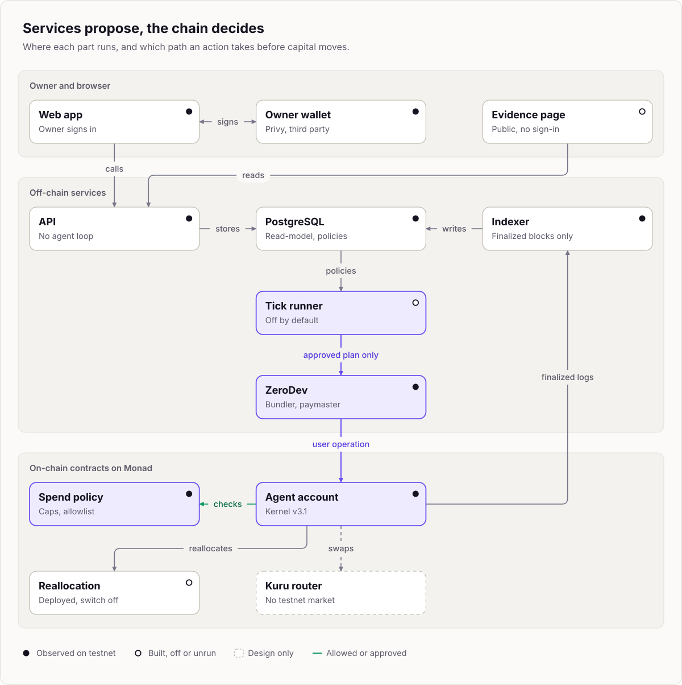
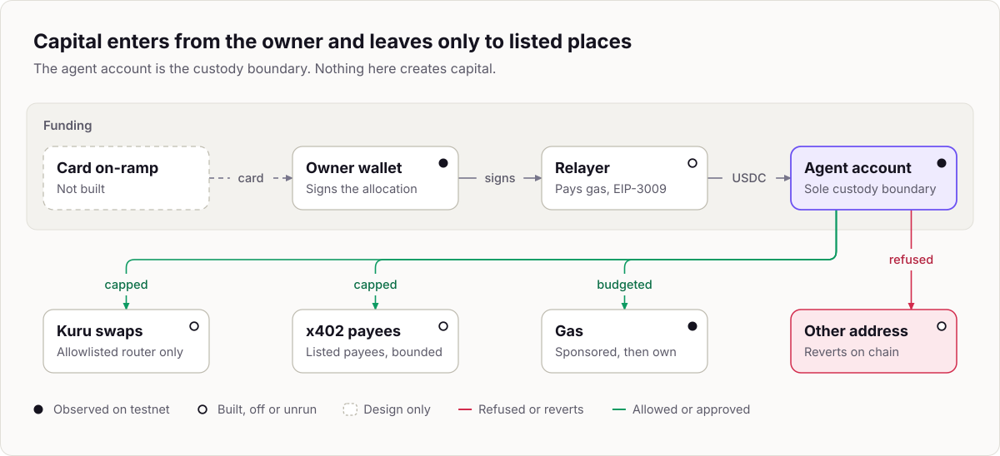
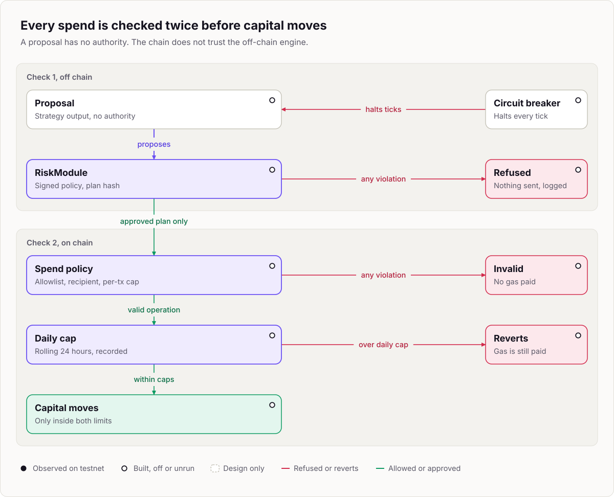
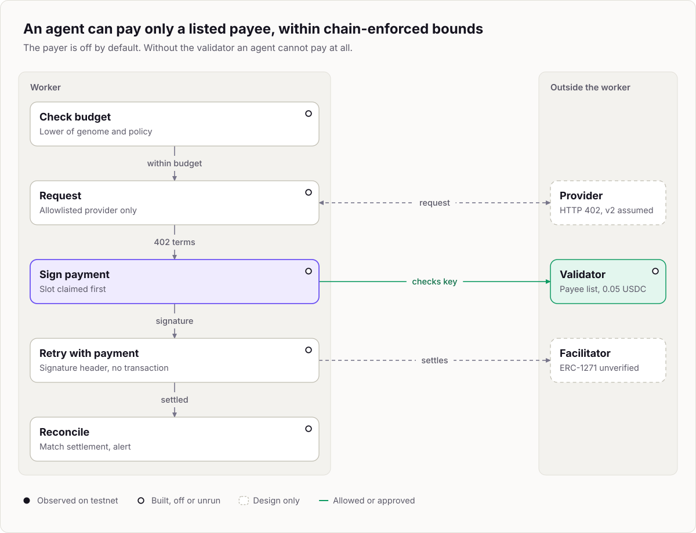
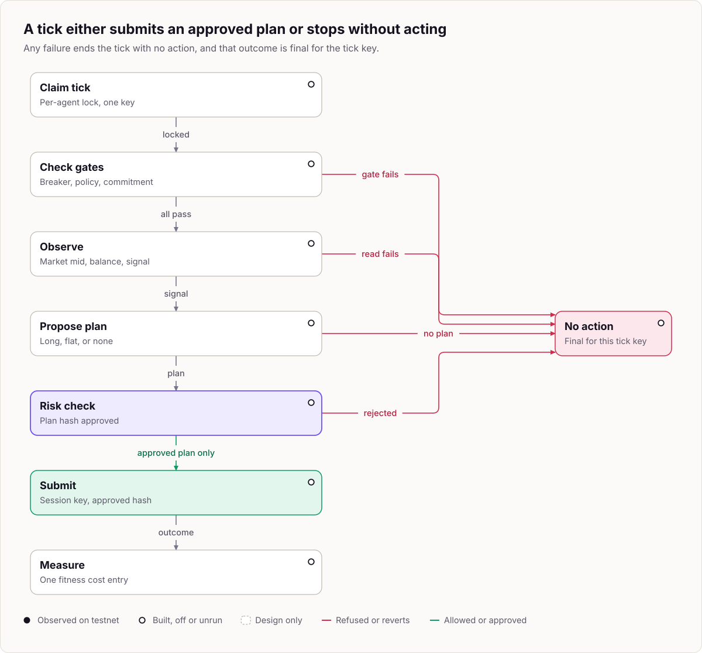
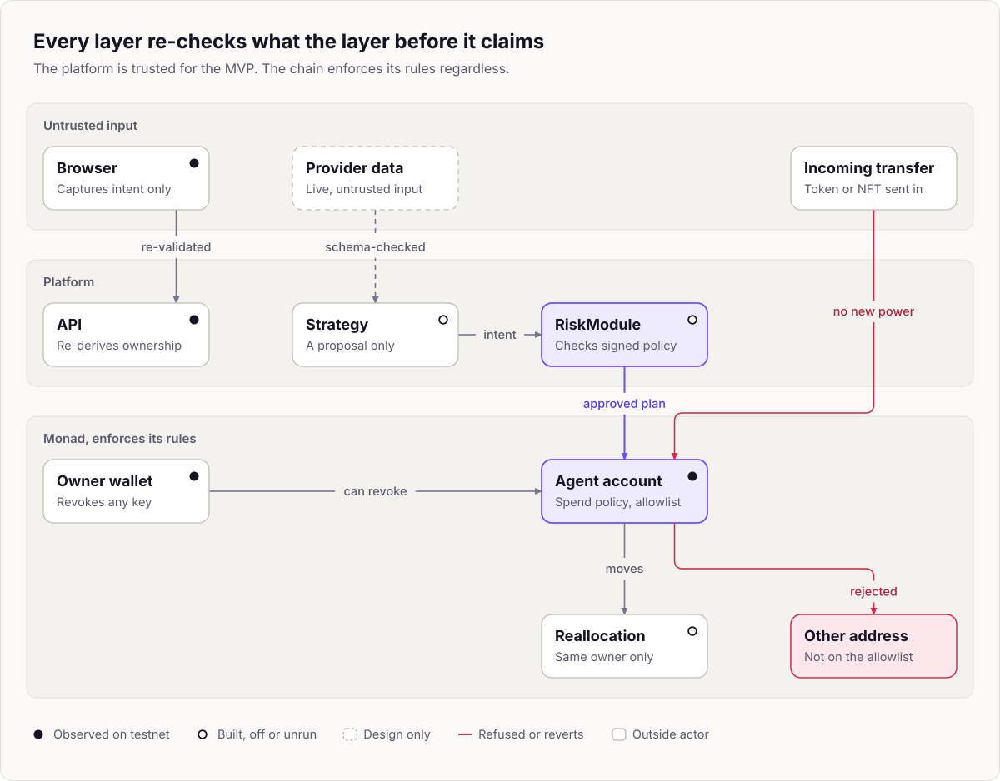
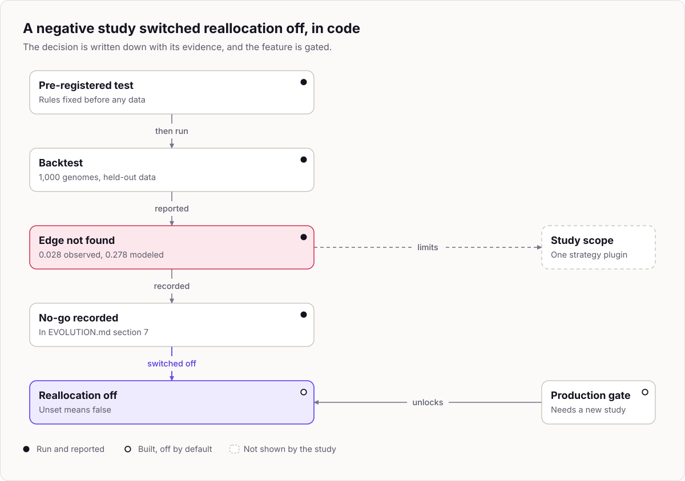

# Monadeum

Monadeum lets an owner create trading agents that each hold capital in their own smart account on Monad, inside spend limits that are enforced on chain and that the agent's own keys cannot change. Each proposed action is checked twice: by a deterministic policy engine off chain, then by the account's own spend policy contract (per-transaction cap, daily cap, and a call allowlist) on chain. Today an agent runs a deterministic hourly strategy. No language model is part of the decision loop. The design also covers buying information through x402 and ranking agents by a risk-adjusted fitness function, and neither has run live yet (see the status table below). Trading is the first environment. The underlying question is whether autonomous economic agents can improve when capital, information, and computation are scarce.

This repository holds the decisions and their rationale, the contracts, the services, the simulation, and the evidence. It is private today and is intended to go public as a separate, explicit decision. Everything described here runs on Monad testnet with testnet assets only. No contract is audited or on mainnet.

## Contents

1. [Live](#live)
2. [How it works](#how-it-works)
3. [Diagrams](#diagrams)
4. [Verify it on chain](#verify-it-on-chain)
5. [What works today and what does not](#what-works-today-and-what-does-not)
6. [Integrations](#integrations)
7. [Repository layout](#repository-layout)
8. [Run it locally](#run-it-locally)
9. [Security and contributing](#security-and-contributing)

## Live

| What | Where | State |
| --- | --- | --- |
| Web app | https://app.monadeum.xyz | Served from one VPS, Monad testnet (observed 2026-10-11) |
| API | https://api.monadeum.xyz | Same host (observed 2026-10-11) |
| Public evidence page | https://app.monadeum.xyz/evidence | Live (HTTP 200 observed 2026-10-13). Every record is re-checked against the chain in the browser |
| Documentation | https://docs.monadeum.xyz | Live (HTTP 200 observed 2026-10-13). Source is in [`docs-site/`](./docs-site) |
| `AgentSpendPolicy` | [`0xe54512401B8fCD0DCc3f4Aa4929b99F05AbA3f05`](https://testnet.monadscan.com/address/0xe54512401B8fCD0DCc3f4Aa4929b99F05AbA3f05) | Monad testnet, block 70167444 |
| `AgentReallocation` | [`0x4e7500415e81017670a9cFb8763f873EE6694A7f`](https://testnet.monadscan.com/address/0x4e7500415e81017670a9cFb8763f873EE6694A7f) | Monad testnet, block 70167453 |
| `X402PaymentValidator` | [`0xCA918F53FFc7507Bd41602c0bD1ef72558705991`](https://testnet.monadscan.com/address/0xCA918F53FFc7507Bd41602c0bD1ef72558705991) | Monad testnet, block 70167461 |

The explorer URL pattern (`https://testnet.monadscan.com/address/<address>`) is an assumption about Monadscan's routes. The authoritative record of the deployment is [`contracts/deployments/monad-testnet.json`](./contracts/deployments/monad-testnet.json).

## How it works

**The problem.** An agent that acts without a human approving each step is useful only if the worst thing it can do is bounded. Documented incidents show agents losing funds because a language model was the only judge of whether an action was allowed. Monadeum removes the model from that role.

**The agent.** Each agent is an independent economic identity:

- **Smart account.** Its own ERC-4337 account (ZeroDev Kernel v3.1) holds its capital. The owner's wallet, not the platform, owns the account.
- **Spend policy it cannot override.** `AgentSpendPolicy` enforces a call allowlist, a recipient rule, a per-transaction cap, and a rolling daily cap on-chain. The agent's session key cannot change its own limits.
- **Session key.** A scoped key lets the worker act without a human per trade. The owner can revoke it at any time.
- **x402 information purchases.** An agent can buy data from two named providers. Each payment is signed by a separate key that `X402PaymentValidator` bounds on-chain. The payer is off by default (see status below).
- **Trading on Kuru.** Trades go through Kuru's router. Mainnet is WETH/USDC by decision. Testnet is a WMON/USDC market the team creates and seeds.

**The decision flow.** At each tick: the strategy proposes at most one action, the RiskModule evaluates the exact transaction the TradingModule built from it, only an approved plan hash is submitted, and the agent's spend policy checks it again on-chain. A failure at any step ends the tick with no action.

**Selection, and the honest evidence.** The original design had agents reproduce. Simulation found no population-level benefit, so reproduction was superseded. The adopted mechanism is owner-scoped reallocation (an owner's capital shifts among that owner's own agents, under a policy the owner signs, within a cap, a floor, and a ceiling) plus retirement of agents that keep failing. It was confirmed in a pre-registered simulation run. A second pre-registered study (issue 102) then tested whether the production strategy's genomes carry the edge that mechanism needs, on real Kuru market data. They do not: the top fifth of genomes beat the bottom fifth by 0.028 market standard deviations per tick out of sample, against 0.278 modeled. Under the pre-registered rule this is a no-go. Reallocation is therefore off by default, and the supported product is well-calibrated static agents. The study covered MON-USDC, one signal, and cost snapshots. The extension to WETH/USDC is an assumption. Details: [`EVOLUTION.md`](./EVOLUTION.md) sections 3 and 7.

## Diagrams

Sources are in [`docs-site/images/diagrams/`](./docs-site/images/diagrams).

<picture>
  <source media="(prefers-color-scheme: dark)" srcset="./docs-site/images/diagrams/01-system-architecture-dark.svg">
  
</picture>

*System architecture. Source: `ARCHITECTURE.md` section 2.*

<picture>
  <source media="(prefers-color-scheme: dark)" srcset="./docs-site/images/diagrams/03-capital-flow-dark.svg">
  
</picture>

*Capital flow. Source: `ARCHITECTURE.md` section 3.*

<picture>
  <source media="(prefers-color-scheme: dark)" srcset="./docs-site/images/diagrams/04-spend-control-layers-dark.svg">
  
</picture>

*Spend control layers. Source: `SECURITY.md` section 9.*

<picture>
  <source media="(prefers-color-scheme: dark)" srcset="./docs-site/images/diagrams/07-x402-payment-flow-dark.svg">
  
</picture>

*x402 payment flow. Source: `ARCHITECTURE.md` section 16.3.*

<picture>
  <source media="(prefers-color-scheme: dark)" srcset="./docs-site/images/diagrams/08-worker-tick-dark.svg">
  
</picture>

*Worker tick. Source: `ARCHITECTURE.md` section 11.*

<picture>
  <source media="(prefers-color-scheme: dark)" srcset="./docs-site/images/diagrams/09-trust-boundaries-dark.svg">
  
</picture>

*Trust boundaries. Source: `THREAT-MODEL.md` section 3.*

<picture>
  <source media="(prefers-color-scheme: dark)" srcset="./docs-site/images/diagrams/12-evidence-chain-dark.svg">
  
</picture>

*Evidence chain. Source: `ECONOMICS.md` section 8 and `EVOLUTION.md` section 7.*

## Verify it on chain

You do not need to trust this README or the app. Everything below is read from the public RPC. Values come from [`contracts/deployments/monad-testnet.json`](./contracts/deployments/monad-testnet.json). The evidence page re-checks every record it lists against the chain in the browser once it is published.

| Item | Address or value |
| --- | --- |
| Chain | Monad testnet, id `10143`, RPC `https://testnet-rpc.monad.xyz` |
| Deployer | [`0x617940428CABaDF4528EFEDa9C27E1577ba0c1e3`](https://testnet.monadscan.com/address/0x617940428CABaDF4528EFEDa9C27E1577ba0c1e3) |
| Safe (reallocation operator and admin), 2-of-3, v1.4.1+L2 | [`0x9671dB7Ab4Afa09fe76402Ce127896b166029897`](https://testnet.monadscan.com/address/0x9671dB7Ab4Afa09fe76402Ce127896b166029897) |
| Settlement asset (testnet USDC, 6 decimals) | [`0x534b2f3A21130d7a60830c2Df862319e593943A3`](https://testnet.monadscan.com/address/0x534b2f3A21130d7a60830c2Df862319e593943A3) |
| Deployment transactions | [`AgentSpendPolicy`](https://testnet.monadscan.com/tx/0xe57f5b866b9eb5a438d137fdd126030c4bbec09d5a2d30b9ad14489a72af344e) (block 70167444), [`AgentReallocation`](https://testnet.monadscan.com/tx/0x654a555c3214551412c29a6a17ec391ea9dd2b032221880116fd0e58a213ee3e) (block 70167453), [`X402PaymentValidator`](https://testnet.monadscan.com/tx/0x914bb2d21130dd014ccc0688dbf5afca6df3bdd94f37880e560f1908e117bf0f) (block 70167461) |

```bash
export RPC=https://testnet-rpc.monad.xyz
export POLICY=0xe54512401B8fCD0DCc3f4Aa4929b99F05AbA3f05
export REALLOC=0x4e7500415e81017670a9cFb8763f873EE6694A7f
export X402=0xCA918F53FFc7507Bd41602c0bD1ef72558705991
export SAFE=0x9671dB7Ab4Afa09fe76402Ce127896b166029897

cast chain-id --rpc-url $RPC                                    # 10143
cast call $REALLOC "operator()(address)" --rpc-url $RPC         # the Safe
cast call $REALLOC "admin()(address)" --rpc-url $RPC            # the Safe
cast call $REALLOC "minEvaluationInterval()(uint256)" --rpc-url $RPC   # 36000
cast call $REALLOC "capitalFloor()(uint256)" --rpc-url $RPC     # 60000
cast call $POLICY "settlementAsset()(address)" --rpc-url $RPC   # the testnet USDC
cast call $SAFE "getThreshold()(uint256)" --rpc-url $RPC        # 2
```

The expected values are those recorded as verified on 2026-10-11. Re-read them, because chain state can change.

**An agent's account state.** Given an agent's smart account address `ACCOUNT` (the agent page in the app shows it), read its limits and window on the spend policy:

```bash
cast call $POLICY "limits(address)((uint128,uint128))" $ACCOUNT --rpc-url $RPC
cast call $POLICY "windowTotal(address)(uint256)" $ACCOUNT --rpc-url $RPC
cast call $REALLOC "agent(address)((address,uint8,uint256))" $ACCOUNT --rpc-url $RPC
```

The `agent` read returns zero values for an account that was never registered with the reallocation contract, which is the case while reallocation is off.

**Finding an account and its events.** The account's deployment appears in EntryPoint v0.7's `AccountDeployed` event, and the spend policy emits `LimitsSet`, `CallAllowed`, and `Spent` for it. Search the policy's logs by account:

```bash
cast logs --from-block 70167444 --to-block latest --address $POLICY --rpc-url $RPC
```

The public RPC limits `eth_getLogs` to a 100-block range (observed 2026-10-12), so scan in 100-block windows or use the explorer. To check that the deployed code equals this repository's source, run `python3 audit/check-deployed-bytecode.py deployments/monad-testnet.json https://testnet-rpc.monad.xyz` from `contracts/` after `forge build`. More commands, including `viem`, are in [Verify it yourself](./docs-site/deployments/verify-yourself.mdx).

## What works today and what does not

Testnet only. Dates are when the check was made. The fuller account is [Current status](./docs-site/introduction/current-status.mdx).

| Area | State | Verified |
| --- | --- | --- |
| Three contracts | Deployed on chain 10143, receipts succeeded, constructor values read back, roles held by a 2-of-3 Safe | 2026-10-11 |
| Web app and API | Served at `app.monadeum.xyz` and `api.monadeum.xyz` | 2026-10-11 |
| Sign-in, agent creation, account deployment | An owner signed in and created the first agent. Its Kernel account was deployed with sponsored gas | 2026-10-11 |
| Indexer | Recorded the account's deployment, limits, and allowlist events from finalized blocks | 2026-10-11 |
| Deployed bytecode | The runtime bytecode at all three addresses matched a build of commit `513e943` (`contracts/audit/README.md` section 14) | 2026-10-12 |
| Population circuit breaker | Built in the worker and tested offline. A trip halts every tick until a human clears it. Never run on testnet, because the tick runner is off | 2026-10-12 |
| Genome commitment on chain | `AgentCommitments` is written and tested. **Not deployed**, so no agent has an on-chain commitment yet | 2026-10-12 |
| Reallocation events in the indexer, event feed, net earnings | Built, tested against in-memory stores. The testnet read-model was synced without the reallocation handlers | 2026-10-12 |
| End-to-end threat tests | Offline suite over the worker loop, mapped in `docs/e2e-traceability.md`. Not run against the live deployment | 2026-10-12 |
| **Trades** | **No trade has been recorded.** The tick runner is built, tested offline, and off by default. No tick has run on the live deployment. The testnet WMON/USDC market was created and seeded on 2026-10-13 | 2026-10-13 |
| **x402 payments** | **No payment has been recorded.** Client, validator, and reconciliation are built. The payer is off by default, and whether the facilitator on Monad accepts ERC-1271 signatures is unverified | 2026-10-12 |
| Reallocation | Contract deployed, switch off by default, nothing submitted. Pre-registered study found no edge for the current strategy | 2026-10-11 |
| Relayed funding transfer | Built, tested against an in-memory token, not executed on Monad | 2026-10-11 |
| Session key activation | Built, not run through a Privy embedded wallet on testnet. Whether Privy's typed-data signature is accepted by Kernel is an assumption | 2026-10-11 |
| Spending operation through the spend policy | Fuzz, invariant, and fork tests exist. Not observed through a bundler | 2026-10-11 |
| Testnet market | Created and seeded by the team, so profit and loss on it is a transfer to or from that seed and is **not evidence of skill** | 2026-10-12 |
| External audit | Not done. An audit package exists and no auditor is engaged | 2026-10-12 |
| Design only | Mainnet deployment, a production key vault, the ERC-8004 identity registry (no contract exists), the card on-ramp session | 2026-10-12 |

Numeric constants in the documents are proposed defaults unless a document says they were measured or decided. Claims about Monad, vendors, and third-party protocols are time-sensitive and should be re-verified before they are relied on for anything involving capital.

## Integrations

Stated only as far as they exist on `main`. Other integrations are in progress on separate branches and are not claimed here.

| Technology | Role | State |
| --- | --- | --- |
| Privy | Social login and embedded wallets. The API verifies Privy tokens locally | Exercised on the testnet deployment (development mode), 2026-10-11 |
| Mera | Passkey sign-in: a passkey derives an ordinary account that signs the existing wallet challenge. Optional, alongside Privy | Built and tested offline against a fixed passkey output. Not yet run against a real authenticator on the deployed app. Mera is a preview library |
| ZeroDev | Kernel v3.1 smart accounts, bundler, and paymaster | An account was deployed with sponsored gas on testnet, 2026-10-11. Operations after deployment are not yet observed |
| Kuru | Order-book router and markets used by the TradingModule, through the official SDK pinned in `libs/trading` | Read-only testnet and mainnet reads and fork tests. No live fill yet |
| x402 | v2 HTTP transport client and an on-chain payment validator | Built and tested. Payer off by default |

## Repository layout

| Path | Contents |
| --- | --- |
| `ARCHITECTURE.md`, `EVOLUTION.md`, `ECONOMICS.md`, `THREAT-MODEL.md`, `SECURITY.md` | The five core decision documents |
| `BRIEF.md` | The founding product brief the other documents cite |
| `apps/web`, `apps/api`, `apps/worker`, `apps/indexer` | The four deployable processes |
| `libs/` | Shared packages: `risk`, `wallets`, `trading`, `x402`, `fitness`, `reallocation`, `recovery`, `commitment`, `read-model`, `agent-registry`, `auth`, `db`, `tick`, `strategy`, and others |
| `contracts/` | Solidity sources, Foundry tests, deployment scripts and records, and the audit package |
| `simulation/` | The standalone simulation harness and its results in `simulation/results/` |
| `deploy/` | The single-VPS testnet runtime and its runbook |
| `docs/` | Funding on-ramp and testnet trading option notes |
| `docs-site/` | The Mintlify documentation site and its diagrams |
| `spikes/` | Small experiments that informed decisions |

## Run it locally

Requires [bun](https://bun.sh) 1.3.14 (pinned in `package.json`) and Node.js.

```bash
bun install --frozen-lockfile
bun run test
```

`bun run test` runs the test suite of every workspace package, including the simulation and a production build of the web app. The web app runs in `sample` mode by default, with deterministic sample data labeled as such on screen:

```bash
bun run --filter @monadeum/web dev
```

Contracts use Foundry (CI pins forge 1.8.5) and a `forge-std` submodule:

```bash
git submodule update --init --recursive
cd contracts
forge test
```

Running the API, worker, and indexer against Monad testnet needs Postgres, Redis, a Privy app, a ZeroDev project, and encrypted key vaults. The runbook is [`deploy/README.md`](./deploy/README.md).

The documentation site, which needs Node.js 20.17 or newer:

```bash
cd docs-site
npx mint@latest dev
```

Publishing steps are in [`docs-site/README.md`](./docs-site/README.md).

## Security and contributing

- **Security.** Do not report a vulnerability in a public issue. [`SECURITY.md`](./SECURITY.md) section 14 explains how to report one, and sections 3 and 13 give the audit gates and known limitations. The threat model is [`THREAT-MODEL.md`](./THREAT-MODEL.md).
- **Contributing.** Read [`CLAUDE.md`](./CLAUDE.md) first. In short: no em dashes anywhere, professional and precise language, an unverified claim written as an assumption or a hypothesis, conventional one-line lowercase commits, and research before documentation before implementation. A change to a decision documented in a core document updates that document in the same pull request.
